# Base de Datos - Sistema de Alquiler de Vehículos (FlotaX)

## Arquitectura de Datos, Principio de Responsabilidad Única (SRP) y Multi-Tenancy

El sistema utiliza **Cloudflare D1 (SQLite en el Edge)** gestionado mediante **Drizzle ORM** y **Cloudflare R2 (`BUCKET_MULTIMEDIA`)** para el archivo probatorio longitudinal de imágenes, videos periciales y contratos PDF. La arquitectura implementa un modelo **Multi-Tenant jerárquico** con separación estricta de responsabilidades por entidad:

- **Sedes y Políticas Separadas**: La plataforma soporta múltiples locales o sedes de alquiler (`locales_alquiler`) y desacopla en una relación 1:1 sus reglas tarifarias, porcentajes de mora/fotomultas y datos fiscales del arrendador (`politicas_local`).
- **Autenticación y RBAC Extensible**: La autenticación es provista por **Better Auth** (**Email OTP** y **Google OAuth**). Los colaboradores pertenecen a un local (`miembros_local`) con roles canónicos (`DUENO`, `ADMIN`, `ASESOR`, `ENCARGADO_FLOTA`, `CONTADOR`, más alias compatibles `OPERATIVO` y `AUDITOR_FINANCIERO`) y cuentan con una tabla dedicada de overrides granulares por usuario (`permisos_miembro_local`) con efectos `CONCEDER` o `REVOCAR`.
- **Anti-Fuga de Clientes**: Los clientes (`USUARIO`) se vinculan a sus locales de origen y preferidos mediante `clientes_local`.
- **Separación de Reserva Comercial y Contrato Legal**:
  - `reservas`: Gestiona la solicitud comercial, bloqueo de fechas en el calendario de disponibilidad y abono inicial reportado (`30%` o `100%`).
  - `contratos_alquiler`: Instrumento jurídico 1:1 que formaliza el traslado de guarda material (Cláusula 4), autorización de fotomultas (Sentencias C-038/20 y C-321/22), telemetría real de entrega/retorno y liquidación financiera Waybill.
- **Historial Longitudinal Multimedia en Cloudflare R2**:
  - `multimedia_vehiculo`: Preserva cronológicamente todas las fotografías y videos (`IMAGEN` | `VIDEO`) de cada vehículo a través del tiempo y por cada reserva/alquiler (`CATALOGO_ESTUDIO`, `ENTREGA_SALIDA`, `DEVOLUCION_RETORNO`, `REPORTE_EN_RUTA`, `MANTENIMIENTO_TALLER`), clasificados por zona anatómica (exterior, interior, pantalla/odómetro, nivel de energía, video 360° y detalle de daños) con soporte de miniaturas instantáneas (`poster_r2_key`) para videos.
- **Peritaje R2 y Mantenimiento**:
  - `documentos_vehiculo`, `mantenimientos_vehiculo`, `plantillas_inspeccion`, `inspecciones_periciales`, `puntos_inspeccion_r2` y `evaluaciones_entrega_cliente` completan la trazabilidad técnica y probatoria de cada unidad.

---

## Dominios canónicos (enums)

Los dominios cerrados viven **en el schema Drizzle**, no en los módulos de consumo. Cada columna se declara con `text('columna', { enum: [...] })`, de modo que `$inferSelect` devuelve la unión literal y los tipos fluyen sin aserciones (`as`) hacia Zod, repositorios y UI.

| Archivo | Constante | Columna |
| :--- | :--- | :--- |
| `src/db/schema/miembros.ts` | `rolesMiembroLocal` | `miembros_local.rol` |
| `src/db/schema/invitaciones.ts` | `rolesInvitacionLocal`, `estadosInvitacionLocal` | `invitaciones_local.rol`, `invitaciones_local.estado` |
| `src/db/schema/permisos_miembro.ts` | `efectosPermisoIndividual` | `permisos_miembro_local.efecto` |
| `src/db/schema/vehiculos.ts` | `categoriasVehiculo` | `vehiculos.categoria`, `plantillas_inspeccion.categoria_vehiculo` |
| | `estadosVehiculo` | `vehiculos.estado` |
| | `transmisionesVehiculo` | `vehiculos.transmision` |
| | `combustiblesVehiculo` | `vehiculos.combustible` |
| | `unidadesMedidaUso` | `vehiculos.unidad_medida_uso`, `plantillas_inspeccion.unidad_medida_uso` |
| `src/db/schema/documentos_vehiculo.ts` | `tiposDocumentoVehiculo` | `documentos_vehiculo.tipo_documento` |
| `src/db/schema/multimedia_vehiculo.ts` | `tiposMedioMultimedia` | `multimedia_vehiculo.tipo_medio` |
| | `etapasMultimediaVehiculo` | `multimedia_vehiculo.etapa_operativa` |
| | `zonasEvidenciaVehiculo` | `multimedia_vehiculo.zona_evidencia` |
| | `angulosEstudioVehiculo` | `multimedia_vehiculo.angulo_estudio` |
| `src/db/schema/mantenimientos.ts` | `tiposMantenimientoVehiculo` | `mantenimientos_vehiculo.tipo` |
| | `estadosMantenimientoVehiculo` | `mantenimientos_vehiculo.estado` |
| `src/db/schema/reservas.ts` | `estadosReserva` | `reservas.estado` |
| | `modalidadesEntregaReserva` | `reservas.modalidad_entrega` |
| | `modalidadesPagoInicial` | `reservas.modalidad_pago_inicial` |
| | `metodosAbonoInicial` | `reservas.metodo_abono_inicial` |
| | `categoriasLicenciaConduccion` | `reservas.contacto_categoria_licencia`, `contratos_alquiler.arrendatario_licencia_categoria` |
| `src/db/schema/contratos.ts` | `estadosPagoContrato` | `contratos_alquiler.estado_pago` |
| | `estadosContratoAlquiler` | `contratos_alquiler.estado_contrato` |
| `src/db/schema/inspecciones.ts` | `tiposActoInspeccion` | `inspecciones_periciales.tipo_acto` |
| | `estadosGeneralesInspeccion` | `inspecciones_periciales.estado_general` |
| | `estadosPuntoInspeccionR2` | `puntos_inspeccion_r2.estado` |
| | `gravedadesNovedadInspeccion` | `puntos_inspeccion_r2.gravedad` |
| | `nivelesCalificacionServicio` | `evaluaciones_entrega_cliente.calificacion_general` |
| | `nivelesDesempenoVehiculo` | `evaluaciones_entrega_cliente.desempeno_vehiculo` |
| | `nivelesCombustibleEntregaCliente` | `evaluaciones_entrega_cliente.combustible_nivel` |
| `src/db/schema/caja.ts` | `tiposCuentaFinanciera` | `cuentas_financieras.tipo` |
| | `tiposMovimientoCaja` | `movimientos_caja.tipo` |
| | `categoriasIngreso` + `categoriasEgreso` + `TRANSFERENCIA_INTERNA` (`categoriasMovimiento`) | `movimientos_caja.categoria` |
| | `metodosPagoFinanciero` | `movimientos_caja.metodo_pago`, `depositos_garantia.metodo_pago` |
| | `estadosMovimientoCaja` | `movimientos_caja.estado` |
| | `estadosSesionCaja` | `sesiones_caja.estado` |
| | `estadosDepositoGarantia` | `depositos_garantia.estado` |
| | `entidadesAuditoria` / `accionesAuditoria` | `auditoria_financiera.entidad` / `.accion` |
| `src/db/schema/notificaciones.ts` | `tiposNotificacion` | `notificaciones.tipo` |
| | `alcancesNotificacion` / `prioridadesNotificacion` | `notificaciones.alcance` / `.prioridad` |
| `src/db/schema/verificaciones.ts` | `tiposDocumentoIdentidad` | `verificaciones_identidad.tipo_documento`, `reservas.contacto_tipo_documento`, `contratos_alquiler.arrendatario_tipo_documento` |
| | `estadosVerificacion` | `verificaciones_identidad.estado` |
| `src/db/schema/incidentes.ts` | `nivelesIncidente` | `incidentes_sistema.nivel` |
| | `estadosIncidente` | `incidentes_sistema.estado` |

---

## Esquema Módulos & Entidades

### 1. Módulo Autenticación (Better Auth)

#### `user`
Almacena la identidad de todos los usuarios (clientes, trabajadores, dueños y superadministradores).

| Campo | Tipo | Restricciones | Descripción |
|-------|------|---------------|-------------|
| `id` | TEXT | PRIMARY KEY | Identificador único del usuario. |
| `name` | TEXT | NOT NULL | Nombre completo. |
| `email` | TEXT | NOT NULL, UNIQUE | Correo electrónico de inicio de sesión. |
| `email_verified` | INTEGER (boolean) | NOT NULL, DEFAULT false | Estado de verificación del correo. |
| `image` | TEXT | NULLABLE | URL del avatar (provisto por Google OAuth). |
| `telefono` | TEXT | NULLABLE | Teléfono de contacto directo. |
| `tipo_documento` | TEXT | NULLABLE | Tipo de documento ('CC', 'CE', 'PASAPORTE', 'NIT'). |
| `numero_documento` | TEXT | NULLABLE | Número de identificación oficial. |
| `es_super_admin` | INTEGER (boolean) | NOT NULL, DEFAULT false | Privilegios globales de plataforma. |
| `local_origen_id` | TEXT | NULLABLE | ID del local donde fue captado el cliente. |
| `activo` | INTEGER (boolean) | NOT NULL, DEFAULT true | Estado de habilitación de la cuenta. |
| `created_at` | TIMESTAMP | NOT NULL | Fecha de creación. |
| `updated_at` | TIMESTAMP | NOT NULL | Fecha de última actualización. |

#### `session`
Manejo de sesiones activas en Better Auth.

| Campo | Tipo | Restricciones | Descripción |
|-------|------|---------------|-------------|
| `id` | TEXT | PRIMARY KEY | ID de sesión. |
| `user_id` | TEXT | NOT NULL, FK `user.id` | Usuario titular. |
| `token` | TEXT | NOT NULL, UNIQUE | Token de sesión firmado. |
| `expires_at` | TIMESTAMP | NOT NULL | Caducidad de la sesión. |
| `ip_address` | TEXT | NULLABLE | IP de conexión. |
| `user_agent` | TEXT | NULLABLE | Cliente/navegador. |
| `created_at` | TIMESTAMP | NOT NULL | Creación de sesión. |
| `updated_at` | TIMESTAMP | NOT NULL | Modificación. |

#### `account`
Cuentas externas asociadas (proveedor Google OAuth).

| Campo | Tipo | Restricciones | Descripción |
|-------|------|---------------|-------------|
| `id` | TEXT | PRIMARY KEY | ID de vinculación. |
| `user_id` | TEXT | NOT NULL, FK `user.id` | Usuario del sistema. |
| `account_id` | TEXT | NOT NULL | ID externo del proveedor. |
| `provider_id` | TEXT | NOT NULL | Identificador del proveedor ('google'). |
| `access_token` | TEXT | NULLABLE | Token de acceso OAuth. |
| `refresh_token` | TEXT | NULLABLE | Token de refresco OAuth. |
| `id_token` | TEXT | NULLABLE | Token OIDC de Google. |

#### `verification`
Códigos OTP de un solo uso (sin contraseña) y verificaciones temporales.

| Campo | Tipo | Restricciones | Descripción |
|-------|------|---------------|-------------|
| `id` | TEXT | PRIMARY KEY | ID de verificación. |
| `identifier` | TEXT | NOT NULL | Correo destino. |
| `value` | TEXT | NOT NULL | Código OTP o token seguro. |
| `expires_at` | TIMESTAMP | NOT NULL | Fecha de expiración. |

---

### 2. Módulo Multi-Tenant, Locales, Políticas & RBAC Granular

#### `locales_alquiler`
Representa cada agencia o sede física de alquiler de vehículos.

| Campo | Tipo | Restricciones | Descripción |
|-------|------|---------------|-------------|
| `id` | TEXT | PRIMARY KEY | Identificador del local. |
| `nombre` | TEXT | NOT NULL | Nombre comercial (ej. 'Patio Norte Medellín'). |
| `slug` | TEXT | NOT NULL, UNIQUE | Identificador de URL (ej. 'patio-norte'). |
| `ciudad` | TEXT | NULLABLE | Ciudad de operación. |
| `direccion` | TEXT | NULLABLE | Ubicación física. |
| `telefono` | TEXT | NULLABLE | Teléfono de atención de la sede. |
| `dueno_id` | TEXT | NOT NULL, FK `user.id` | Dueño/propietario actual del local. |
| `activo` | INTEGER (boolean) | NOT NULL, DEFAULT true | Estado del local. |
| `creado_en` | TIMESTAMP | NOT NULL | Creación. |
| `actualizado_en` | TIMESTAMP | NOT NULL | Última modificación. |

#### `politicas_local`
Políticas operativas, tarifarias, recargos de mora y datos jurídicos del arrendador (relación 1:1 con `locales_alquiler`).

| Campo | Tipo | Restricciones | Descripción |
|-------|------|---------------|-------------|
| `id` | TEXT | PRIMARY KEY | Identificador único de la política. |
| `local_id` | TEXT | NOT NULL, UNIQUE, FK `locales_alquiler.id` (CASCADE) | Local propietario. |
| `abono_minimo_pct` | INTEGER | NOT NULL, DEFAULT 30 | Porcentaje mínimo de anticipo para reservar (ej. 30%). |
| `cobertura_pericial_pct` | INTEGER | NOT NULL, DEFAULT 8 | Porcentaje de cobertura e inspección R2 (ej. 8%). |
| `recargo_mora_diaria_pct` | INTEGER | NOT NULL, DEFAULT 200 | Sanción por mora diaria según Cláusula 3 (ej. 200%). |
| `recargo_admin_fotomulta_pct` | INTEGER | NOT NULL, DEFAULT 30 | Recargo administrativo por gestión de comparendos (Cláusula 6). |
| `cargo_lavado_estandar` | INTEGER | NOT NULL, DEFAULT 45000 | Cargo base en COP por entrega con suciedad excesiva (Cláusula 8). |
| `limite_km_diario` | INTEGER | NULLABLE | Límite de km por día (`NULL` = kilometraje libre). |
| `cargo_km_adicional` | INTEGER | NOT NULL, DEFAULT 0 | Tarifa en COP por km excedido. |
| `nit_arrendador` | TEXT | NULLABLE | NIT y razón social del arrendador para contratos PDF. |
| `representante_legal` | TEXT | NULLABLE | Nombre del representante legal del local. |
| `municipio_contractual` | TEXT | NOT NULL, DEFAULT 'Medellín, Antioquia' | Jurisdicción contractual por defecto. |
| `creado_en` | TIMESTAMP | NOT NULL | Fecha de creación. |
| `actualizado_en` | TIMESTAMP | NOT NULL | Fecha de última modificación. |

#### `miembros_local`
Asignación de trabajadores y personal al local.

| Campo | Tipo | Restricciones | Descripción |
|-------|------|---------------|-------------|
| `id` | TEXT | PRIMARY KEY | Identificador de membresía. |
| `local_id` | TEXT | NOT NULL, FK `locales_alquiler.id` | Local asignado. |
| `usuario_id` | TEXT | NOT NULL, FK `user.id` | Trabajador o dueño. |
| `rol` | TEXT | NOT NULL | Rol en sede: 'DUENO', 'ADMIN', 'ASESOR', 'ENCARGADO_FLOTA', 'CONTADOR', 'OPERATIVO', 'AUDITOR_FINANCIERO'. |
| `activo` | INTEGER (boolean) | NOT NULL, DEFAULT true | Habilitación en la sede. |
| `onboarding_completado` | INTEGER (boolean) | NOT NULL, DEFAULT false | Flag de inducción operativa inicial completada. |
| `creado_en` | TIMESTAMP | NOT NULL | Fecha de alta. |

#### `permisos_miembro_local`
Overrides individuales de permisos por trabajador dentro de un local (`CONCEDER` o `REVOCAR` sobre la matriz base de su rol).

| Campo | Tipo | Restricciones | Descripción |
|-------|------|---------------|-------------|
| `id` | TEXT | PRIMARY KEY | Identificador del override de permiso. |
| `miembro_id` | TEXT | NOT NULL, FK `miembros_local.id` (CASCADE) | Membresía sobre la que aplica. |
| `local_id` | TEXT | NOT NULL, FK `locales_alquiler.id` (CASCADE) | Local donde aplica. |
| `usuario_id` | TEXT | NOT NULL, FK `user.id` (CASCADE) | Usuario afectado. |
| `permiso` | TEXT | NOT NULL | Código canónico del catálogo `PERMISOS` (`src/lib/auth/permisos.ts`). |
| `efecto` | TEXT | NOT NULL, DEFAULT 'CONCEDER' | 'CONCEDER' (habilita permiso extra) o 'REVOCAR' (restringe permiso del rol). |
| `motivo` | TEXT | NULLABLE | Justificación administrativa de la excepción. |
| `asignado_por_id` | TEXT | NOT NULL, FK `user.id` | Dueño o administrador que configuró el permiso. |
| `creado_en` | TIMESTAMP | NOT NULL | Fecha de asignación. |

Índices: único `permisos_miembro_unico_idx (miembro_id, permiso)` y `permisos_miembro_usuario_local_idx (local_id, usuario_id)`.

#### `clientes_local`
Vínculo entre clientes y locales para prevenir fuga comercial y rastrear comercios preferidos.

| Campo | Tipo | Restricciones | Descripción |
|-------|------|---------------|-------------|
| `id` | TEXT | PRIMARY KEY | Identificador de relación. |
| `usuario_id` | TEXT | NOT NULL, FK `user.id` | Cliente. |
| `local_id` | TEXT | NOT NULL, FK `locales_alquiler.id` | Local visitado o preferido. |
| `es_local_origen` | INTEGER (boolean) | NOT NULL, DEFAULT false | Indica si este local captó inicialmente al cliente. |
| `es_preferido` | INTEGER (boolean) | NOT NULL, DEFAULT false | Marcado como comercio favorito. |
| `ultima_visita_en` | TIMESTAMP | NULLABLE | Registro de última actividad. |
| `creado_en` | TIMESTAMP | NOT NULL | Fecha de registro. |

#### `invitaciones_local`
Invitaciones con token criptográfico emitidas por el dueño o administrador para incorporar colaboradores.

| Campo | Tipo | Restricciones | Descripción |
|-------|------|---------------|-------------|
| `id` | TEXT | PRIMARY KEY | Identificador de invitación. |
| `local_id` | TEXT | NOT NULL, FK `locales_alquiler.id` | Local al que se invita. |
| `email` | TEXT | NOT NULL | Correo del invitado. |
| `rol` | TEXT | NOT NULL | Rol propuesto ('ADMIN', 'ASESOR', 'ENCARGADO_FLOTA', 'CONTADOR', 'OPERATIVO', 'AUDITOR_FINANCIERO'). |
| `token` | TEXT | NOT NULL, UNIQUE | Token seguro de la URL de aceptación. |
| `invitado_por_id` | TEXT | NOT NULL, FK `user.id` | Usuario que invitó. |
| `estado` | TEXT | NOT NULL, DEFAULT 'PENDIENTE' | 'PENDIENTE', 'ACEPTADA', 'RECHAZADA', 'EXPIRADA'. |
| `expira_en` | TIMESTAMP | NOT NULL | Caducidad de la invitación. |
| `creado_en` | TIMESTAMP | NOT NULL | Emisión. |

#### `historial_transferencias_local`
Auditoría inmutable cuando el dueño transfiere la propiedad del local a otro usuario.

| Campo | Tipo | Restricciones | Descripción |
|-------|------|---------------|-------------|
| `id` | TEXT | PRIMARY KEY | ID del evento. |
| `local_id` | TEXT | NOT NULL, FK `locales_alquiler.id` | Local transferido. |
| `dueno_anterior_id` | TEXT | NOT NULL, FK `user.id` | Dueño emisor. |
| `nuevo_dueno_id` | TEXT | NOT NULL, FK `user.id` | Nuevo titular receptor. |
| `motivo` | TEXT | NULLABLE | Justificación o notas legales. |
| `creado_en` | TIMESTAMP | NOT NULL | Marca de tiempo de la transferencia. |

---

### 3. Módulo de Gobernanza, Logging e Incidentes del Sistema

#### `incidentes_sistema`
Persistencia y deduplicación global de errores entre isolates de Cloudflare Workers.

| Campo | Tipo | Restricciones | Descripción |
|-------|------|---------------|-------------|
| `id` | TEXT | PRIMARY KEY | Identificador único del incidente. |
| `fingerprint` | TEXT | NOT NULL, UNIQUE | Huella digital determinista calculada del error. |
| `nivel` | TEXT | NOT NULL | Severidad ('WARN', 'ERROR', 'FATAL'). |
| `mensaje` | TEXT | NOT NULL | Mensaje principal normalizado del error. |
| `modulo` | TEXT | NULLABLE | Módulo o subsistema de origen. |
| `ocurrencias` | INTEGER | NOT NULL, DEFAULT 1 | Total acumulado de veces que ha ocurrido. |
| `primera_vez` | TIMESTAMP | NOT NULL | Fecha/hora de la primera detección. |
| `ultima_vez` | TIMESTAMP | NOT NULL | Fecha/hora del evento más reciente. |
| `ultimo_correo_en` | TIMESTAMP | NULLABLE | Fecha/hora de la última alerta enviada por correo. |
| `estado` | TEXT | NOT NULL, DEFAULT 'ABIERTO' | Estado operativo ('ABIERTO', 'MITIGADO', 'RESUELTO'). |
| `metadata` | TEXT | NULLABLE | JSON sanitizado con contexto de petición y stack trace. |
| `creado_en` | TIMESTAMP | NOT NULL | Creación del registro. |
| `actualizado_en` | TIMESTAMP | NOT NULL | Última modificación. |

---

### 4. Módulo de Flota, Documentos Legales, Mantenimiento e Historial Multimedia R2

#### `vehiculos`
Catálogo de unidades físicas y operativas disponibles para alquiler y control perimetral de patio.

| Campo | Tipo | Restricciones | Descripción |
|-------|------|---------------|-------------|
| `id` | TEXT | PRIMARY KEY | Identificador único del vehículo (ej. 'veh-mercedes-eqb'). |
| `local_id` | TEXT | NULLABLE, FK `locales_alquiler.id` | Local o patio al que pertenece la unidad. |
| `marca` | TEXT | NOT NULL | Fabricante de la unidad (ej. 'Mercedes-Benz', 'BMW'). |
| `modelo` | TEXT | NOT NULL | Modelo comercial (ej. 'EQB 350 4MATIC Luxury'). |
| `anio` | INTEGER | NOT NULL | Año del modelo (ej. 2024). |
| `categoria` | TEXT | NOT NULL | Categoría canónica: 'SEDAN', 'SUV', 'MOTO', 'PATINETA', 'UTILITARIO'. |
| `categoria_etiqueta` | TEXT | NOT NULL | Etiqueta amigable (ej. 'SUV Eléctrica', 'Coupe Deportivo'). |
| `placa` | TEXT | NOT NULL, UNIQUE | Placa o matrícula oficial (ej. 'FLX-801'). |
| `color` | TEXT | NULLABLE | Color oficial registrado en tarjeta de propiedad (Cláusula 1). |
| `numero_motor` | TEXT | NULLABLE | Serial único de motor para contrato legal. |
| `numero_chasis` | TEXT | NULLABLE | VIN / número de chasis o serie para contrato legal. |
| `valor_comercial` | INTEGER | NULLABLE | Avalúo comercial en COP para respaldo y pagaré (Cláusula 4). |
| `unidad_medida_uso` | TEXT | NOT NULL, DEFAULT 'KM' | Medidor de uso: 'KM', 'HORAS_MOTOR', 'MINUTOS'. |
| `estado` | TEXT | NOT NULL, DEFAULT 'DISPONIBLE' | Estado operativo: 'DISPONIBLE', 'RESERVADO', 'MANTENIMIENTO', 'FUERA_SERVICIO'. |
| `precio_dia` | INTEGER | NOT NULL | Tarifa diaria en COP (ej. 280000). |
| `deposito_garantia` | INTEGER | NOT NULL | Depósito o fianza de garantía en COP (ej. 750000). |
| `transmision` | TEXT | NOT NULL | Tipo de transmisión ('Automática', 'Manual', 'Eléctrica'). |
| `combustible` | TEXT | NOT NULL | Tipo de propulsión ('Gasolina', 'Diésel', 'Eléctrico', 'Híbrido'). |
| `capacidad_pasajeros` | INTEGER | NOT NULL | Aforo máximo de personas (ej. 5 o 7). |
| `autonomia_km` | INTEGER | NULLABLE | Autonomía estimada en km para eléctricos o híbridos. |
| `kilometraje` | INTEGER | NOT NULL | Lectura actual del odómetro u horómetro. |
| `imagen_url` | TEXT | NOT NULL | URL de la imagen portada principal del vehículo. |
| `destacado` | INTEGER (boolean) | NOT NULL, DEFAULT false | Flag para visibilidad prioritaria en catálogo. |
| `descripcion` | TEXT | NOT NULL | Reseña técnica y descriptiva para el cliente. |
| `aceleracion` | TEXT | NULLABLE | Métrica de aceleración (ej. '3.8 s'). |
| `velocidad_maxima` | TEXT | NULLABLE | Velocidad punta (ej. '210 km/h'). |
| `rating` | REAL | NULLABLE | Calificación promedio del modelo (ej. 4.8). |
| `autonomia_odo` | TEXT | NULLABLE | Métrica visual de autonomía/odómetro (ej. '420 km'). |
| `specs_bento` | TEXT (JSON) | NULLABLE | Especificaciones editoriales Bento (`EspecificacionesBentoVehiculoSchema`). |
| `activo` | INTEGER (boolean) | NOT NULL, DEFAULT true | Estado de habilitación en el sistema. |
| `creado_en` | TIMESTAMP | NOT NULL | Fecha de alta en inventario. |
| `actualizado_en` | TIMESTAMP | NOT NULL | Fecha de última modificación. |

#### `documentos_vehiculo`
Control de vigencias normativas y pólizas por unidad (SOAT, Técnico-Mecánica, Tarjeta de Propiedad, Póliza Todo Riesgo, Kit de Carretera).

| Campo | Tipo | Restricciones | Descripción |
|-------|------|---------------|-------------|
| `id` | TEXT | PRIMARY KEY | Identificador único del documento. |
| `local_id` | TEXT | NOT NULL, FK `locales_alquiler.id` (CASCADE) | Local propietario. |
| `vehiculo_id` | TEXT | NOT NULL, FK `vehiculos.id` (CASCADE) | Vehículo asociado. |
| `tipo_documento` | TEXT | NOT NULL | 'SOAT', 'TECNICO_MECANICA', 'TARJETA_PROPIEDAD', 'POLIZA_TODO_RIESGO', 'LICENCIA_NAUTICA_DIMAR', 'KIT_CARRETERA'. |
| `numero_referencia` | TEXT | NULLABLE | Número de póliza o certificado oficial. |
| `entidad_emisora` | TEXT | NULLABLE | Aseguradora, CDA o autoridad de tránsito. |
| `fecha_expedicion` | TEXT | NULLABLE | Fecha de emisión (`YYYY-MM-DD`). |
| `fecha_vencimiento` | TEXT | NULLABLE | Fecha de expiración (`YYYY-MM-DD`). |
| `vigente` | INTEGER (boolean) | NOT NULL, DEFAULT true | Estado de vigencia verificado. |
| `archivo_r2_key` | TEXT | NULLABLE | Clave del PDF o imagen en Cloudflare R2 (`BUCKET_MULTIMEDIA`). |
| `observaciones` | TEXT | NULLABLE | Notas de auditoría documental. |
| `verificado_por_id` | TEXT | NULLABLE, FK `user.id` | Usuario que validó el documento. |
| `creado_en` | TIMESTAMP | NOT NULL | Creación. |
| `actualizado_en` | TIMESTAMP | NOT NULL | Última actualización. |

Índice: `documentos_vehiculo_vigencia_idx (vehiculo_id, tipo_documento, vigente, fecha_vencimiento)`.

#### `multimedia_vehiculo`
Historial longitudinal fotográfico y de video en Cloudflare R2 (`BUCKET_MULTIMEDIA`) por vehículo a través del tiempo y por cada reserva o alquiler.

| Campo | Tipo | Restricciones | Descripción |
|-------|------|---------------|-------------|
| `id` | TEXT | PRIMARY KEY | Identificador único del recurso multimedia. |
| `local_id` | TEXT | NOT NULL, FK `locales_alquiler.id` (CASCADE) | Local propietario. |
| `vehiculo_id` | TEXT | NOT NULL, FK `vehiculos.id` (CASCADE) | Vehículo al que pertenece la evidencia. |
| `reserva_id` | TEXT | NULLABLE, FK `reservas.id` (SET NULL) | Reserva asociada (en entregas, devoluciones o reportes en ruta). |
| `contrato_id` | TEXT | NULLABLE, FK `contratos_alquiler.id` (SET NULL) | Contrato asociado. |
| `inspeccion_id` | TEXT | NULLABLE | Acta en `inspecciones_periciales` donde se capturó. |
| `mantenimiento_id` | TEXT | NULLABLE, FK `mantenimientos_vehiculo.id` (SET NULL) | Orden de taller asociada. |
| `tipo_medio` | TEXT | NOT NULL, DEFAULT 'IMAGEN' | 'IMAGEN' o 'VIDEO'. |
| `etapa_operativa` | TEXT | NOT NULL | 'CATALOGO_ESTUDIO', 'ENTREGA_SALIDA', 'DEVOLUCION_RETORNO', 'REPORTE_EN_RUTA', 'MANTENIMIENTO_TALLER'. |
| `zona_evidencia` | TEXT | NOT NULL | Zona anatómica ('EXTERIOR_FRONTAL', 'PANTALLA_TABLERO_ODOMETRO', 'VIDEO_RECORRIDO_360', 'DETALLE_NOVEDAD_DANO', etc.). |
| `angulo_estudio` | TEXT | NULLABLE | 'ESTUDIO_3_4', 'PERFIL_DINAMICO', 'CABINA_CONFORT', 'TREN_MOTRIZ'. |
| `es_portada_catalogo` | INTEGER (boolean) | NOT NULL, DEFAULT false | Indica si es la foto principal del vehículo. |
| `orden_visual` | INTEGER | NOT NULL, DEFAULT 0 | Orden en la galería o línea de tiempo. |
| `r2_key` | TEXT | NOT NULL, UNIQUE | Clave jerárquica en Cloudflare R2. |
| `poster_r2_key` | TEXT | NULLABLE | Miniatura WebP/JPEG para carga móvil instantánea cuando `tipo_medio = 'VIDEO'`. |
| `mime_type` | TEXT | NOT NULL | MIME type (`image/webp`, `video/mp4`, `video/webm`). |
| `tamano_bytes` | INTEGER | NOT NULL, DEFAULT 0 | Peso del objeto en bytes. |
| `ancho_px` | INTEGER | NULLABLE | Resolución horizontal en píxeles. |
| `alto_px` | INTEGER | NULLABLE | Resolución vertical en píxeles. |
| `duracion_segundos` | REAL | NULLABLE | Duración en segundos para videos de inspección. |
| `sha256_hash` | TEXT | NULLABLE | Hash SHA-256 de integridad probatoria. |
| `medidor_uso_momento` | INTEGER | NULLABLE | Odómetro (km) u horómetro en el momento de la captura. |
| `observacion` | TEXT | NULLABLE | Nota pericial asociada a la captura. |
| `subido_por_id` | TEXT | NULLABLE, FK `user.id` | Inspector, operador o cliente que subió la evidencia. |
| `capturado_en` | TIMESTAMP | NOT NULL | Timestamp exacto de captura. |
| `creado_en` | TIMESTAMP | NOT NULL | Timestamp de registro en D1. |

Índices: `multimedia_vehiculo_historial_idx (vehiculo_id, capturado_en)`, `multimedia_vehiculo_reserva_etapa_idx (reserva_id, etapa_operativa, zona_evidencia)` y `multimedia_vehiculo_catalogo_idx (vehiculo_id, etapa_operativa, orden_visual)`.

#### `mantenimientos_vehiculo`
Órdenes de mantenimiento preventivo, correctivo, alistamiento y bloqueos técnicos en el calendario de disponibilidad.

| Campo | Tipo | Restricciones | Descripción |
|-------|------|---------------|-------------|
| `id` | TEXT | PRIMARY KEY | Identificador de la orden de mantenimiento. |
| `local_id` | TEXT | NOT NULL, FK `locales_alquiler.id` (CASCADE) | Local. |
| `vehiculo_id` | TEXT | NOT NULL, FK `vehiculos.id` (CASCADE) | Vehículo intervenido. |
| `reserva_origen_id` | TEXT | NULLABLE, FK `reservas.id` | Reserva que originó el mantenimiento al retorno. |
| `tipo` | TEXT | NOT NULL, DEFAULT 'PREVENTIVO' | 'PREVENTIVO', 'CORRECTIVO_NOVEDAD', 'ALISTAMIENTO', 'BLOQUEO_OPERATIVO'. |
| `estado` | TEXT | NOT NULL, DEFAULT 'PROGRAMADO' | 'PROGRAMADO', 'EN_TALLER', 'COMPLETADO', 'CANCELADO'. |
| `etiqueta` | TEXT | NOT NULL | Título corto para calendario (ej. 'Inspección y alistamiento técnico'). |
| `descripcion` | TEXT | NULLABLE | Detalle técnico de los trabajos. |
| `taller_proveedor` | TEXT | NULLABLE | Nombre del taller o proveedor. |
| `fecha_inicio` | TEXT | NOT NULL | Inicio del bloqueo (`YYYY-MM-DD`). |
| `fecha_fin` | TEXT | NOT NULL | Fin del bloqueo (`YYYY-MM-DD`). |
| `kilometraje_registro` | INTEGER | NULLABLE | Odómetro al ingresar a taller. |
| `costo_total` | INTEGER | NOT NULL, DEFAULT 0 | Costo en COP. |
| `movimiento_caja_id` | TEXT | NULLABLE, FK `movimientos_caja.id` | Egreso contable vinculado en caja. |
| `creado_por_id` | TEXT | NOT NULL, FK `user.id` | Responsable que programó la orden. |
| `creado_en` | TIMESTAMP | NOT NULL | Creación. |
| `actualizado_en` | TIMESTAMP | NOT NULL | Última modificación. |

Índices: `mantenimientos_vehiculo_fechas_idx (vehiculo_id, estado, fecha_inicio, fecha_fin)` y `mantenimientos_local_estado_idx (local_id, estado)`.

---

### 5. Módulo de Reservas Comerciales, Contratos de Alquiler y Peritaje R2

#### `reservas`
Solicitudes comerciales de alquiler, bloqueo de fechas en el calendario suizo y abono inicial reportado.

| Campo | Tipo | Restricciones | Descripción |
|-------|------|---------------|-------------|
| `id` | TEXT | PRIMARY KEY | Identificador interno de la reserva. |
| `codigo` | TEXT | NOT NULL, UNIQUE | Código público canónico (ej. 'FLX-849210'). |
| `local_id` | TEXT | NOT NULL, FK `locales_alquiler.id` (CASCADE) | Local de la reserva. |
| `vehiculo_id` | TEXT | NOT NULL, FK `vehiculos.id` | Vehículo solicitado. |
| `cliente_id` | TEXT | NULLABLE, FK `user.id` | Usuario cliente autenticado. |
| `fecha_inicio` | TEXT | NOT NULL | Fecha de inicio (`YYYY-MM-DD`). |
| `fecha_fin` | TEXT | NOT NULL | Fecha de fin (`YYYY-MM-DD`). |
| `dias_alquiler` | INTEGER | NOT NULL | Cantidad de días inclusivos. |
| `estado` | TEXT | NOT NULL, DEFAULT 'PENDIENTE' | 'PENDIENTE', 'CONFIRMADA', 'EN_CURSO', 'COMPLETADA', 'RECHAZADA', 'CANCELADA'. |
| `modalidad_entrega` | TEXT | NOT NULL, DEFAULT 'PATIO_PRINCIPAL' | 'PATIO_PRINCIPAL', 'DOMICILIO_MEDELLIN'. |
| `direccion_entrega` | TEXT | NULLABLE | Dirección cuando es entrega a domicilio. |
| `sede_nombre` | TEXT | NOT NULL | Nombre de la sede de entrega. |
| `precio_dia_cotizado` | INTEGER | NOT NULL | Tarifa diaria congelada al cotizar en COP. |
| `subtotal_tarifa_cotizado` | INTEGER | NOT NULL | Subtotal tarifa base (`dias * precio_dia`). |
| `cobertura_pericial_cotizada` | INTEGER | NOT NULL | Monto de cobertura e inspección R2 (8%). |
| `total_cotizado` | INTEGER | NOT NULL | Total cotizado en COP. |
| `modalidad_pago_inicial` | TEXT | NOT NULL, DEFAULT 'ABONO_30' | 'ABONO_30', 'TOTAL_100'. |
| `metodo_abono_inicial` | TEXT | NOT NULL, DEFAULT 'TRANSFERENCIA_PSE' | 'TRANSFERENCIA_PSE', 'NEQUI_BREB', 'CAJA_PATIO', 'EFECTIVO', 'TARJETA'. |
| `monto_abono_reportado` | INTEGER | NOT NULL, DEFAULT 0 | Importe en COP reportado al reservar. |
| `referencia_abono_inicial` | TEXT | NULLABLE | Comprobante o referencia de transferencia. |
| `contacto_nombre` | TEXT | NOT NULL | Nombre completo del conductor titular. |
| `contacto_tipo_documento` | TEXT | NOT NULL | 'CC', 'CE', 'PASAPORTE', 'NIT'. |
| `contacto_numero_documento` | TEXT | NOT NULL | Número de documento del conductor. |
| `contacto_categoria_licencia` | TEXT | NOT NULL | 'A1', 'A2', 'B1', 'B2', 'C1'. |
| `contacto_telefono` | TEXT | NOT NULL | Celular WhatsApp del conductor. |
| `contacto_correo` | TEXT | NOT NULL | Correo electrónico para envío de contrato y OTP. |
| `ley_1581_aceptada` | INTEGER (boolean) | NOT NULL, DEFAULT true | Aceptación de tratamiento de datos personales. |
| `motivo_rechazo` | TEXT | NULLABLE | Causal explicativa si la solicitud es rechazada. |
| `creado_por_id` | TEXT | NULLABLE, FK `user.id` | Usuario o asesor que creó la reserva. |
| `confirmado_por_id` | TEXT | NULLABLE, FK `user.id` | Operador que aprobó la solicitud. |
| `creado_en` | TIMESTAMP | NOT NULL | Fecha de creación. |
| `actualizado_en` | TIMESTAMP | NOT NULL | Fecha de última actualización. |

Índices: `reservas_vehiculo_fechas_idx (vehiculo_id, estado, fecha_inicio, fecha_fin)`, `reservas_local_estado_idx (local_id, estado, creado_en)` y `reservas_cliente_idx (cliente_id, creado_en)`.

#### `contratos_alquiler`
Instrumento jurídico 1:1 con `reservas` que formaliza el traslado de guarda material, fotomultas, telemetría de entrega/retorno y liquidación financiera Waybill.

| Campo | Tipo | Restricciones | Descripción |
|-------|------|---------------|-------------|
| `id` | TEXT | PRIMARY KEY | Identificador único del contrato. |
| `numero_contrato` | TEXT | NOT NULL, UNIQUE | Número oficial del contrato (ej. 'FLX-849210'). |
| `reserva_id` | TEXT | NOT NULL, UNIQUE, FK `reservas.id` (CASCADE) | Reserva origen (relación 1:1). |
| `local_id` | TEXT | NOT NULL, FK `locales_alquiler.id` (CASCADE) | Local arrendador. |
| `vehiculo_id` | TEXT | NOT NULL, FK `vehiculos.id` | Vehículo entregado en tenencia. |
| `cliente_id` | TEXT | NULLABLE, FK `user.id` | Cliente titular. |
| `arrendatario_nombre` | TEXT | NOT NULL | Nombre legal en el contrato. |
| `arrendatario_tipo_documento` | TEXT | NOT NULL | 'CC', 'CE', 'PASAPORTE', 'NIT'. |
| `arrendatario_numero_documento` | TEXT | NOT NULL | Identificación legal del arrendatario. |
| `arrendatario_ciudad_expedicion` | TEXT | NULLABLE | Lugar de expedición del documento. |
| `arrendatario_licencia_numero` | TEXT | NOT NULL | Número de licencia de conducción. |
| `arrendatario_licencia_categoria` | TEXT | NOT NULL | 'A1', 'A2', 'B1', 'B2', 'C1'. |
| `arrendatario_domicilio` | TEXT | NULLABLE | Dirección física para notificaciones judiciales. |
| `arrendatario_telefono` | TEXT | NOT NULL | Teléfono del arrendatario. |
| `arrendatario_correo` | TEXT | NOT NULL | Correo electrónico del arrendatario. |
| `ley_1581_aceptada` | INTEGER (boolean) | NOT NULL, DEFAULT true | Consentimiento Habeas Data (Ley 1581). |
| `traslado_fotomultas_aceptado` | INTEGER (boolean) | NOT NULL, DEFAULT true | Autorización de fotodetecciones (Sentencias C-038/20 y C-321/22). |
| `pagare_blanco_firmado` | INTEGER (boolean) | NOT NULL, DEFAULT false | Suscripción de pagaré y carta de instrucciones (Cláusula 10). |
| `fecha_hora_entrega_real` | TIMESTAMP | NULLABLE | Momento exacto del traslado de guarda material. |
| `fecha_hora_devolucion_pactada` | TIMESTAMP | NOT NULL | Límite contractual antes de configurar mora o retención indebida. |
| `fecha_hora_devolucion_real` | TIMESTAMP | NULLABLE | Momento exacto de restitución en patio. |
| `medidor_uso_entrega` | INTEGER | NOT NULL | Kilometraje u horas de motor a la salida. |
| `medidor_uso_retorno` | INTEGER | NULLABLE | Kilometraje u horas de motor al retorno. |
| `nivel_energia_entrega_pct` | INTEGER | NOT NULL, DEFAULT 100 | Porcentaje de batería o tanque en salida (0..100). |
| `nivel_energia_retorno_pct` | INTEGER | NULLABLE | Porcentaje de batería o tanque al retorno (0..100). |
| `canon_diario_pactado` | INTEGER | NOT NULL | Tarifa diaria contractual en COP. |
| `subtotal_canon` | INTEGER | NOT NULL | Subtotal del canon de arrendamiento. |
| `cobertura_pericial` | INTEGER | NOT NULL, DEFAULT 0 | Cobertura e inspección R2 en COP. |
| `cargos_mora` | INTEGER | NOT NULL, DEFAULT 0 | Sanción liquidada por retraso en devolución. |
| `cargos_novedades_danos` | INTEGER | NOT NULL, DEFAULT 0 | Cargos por daños verificados en inspección de retorno. |
| `cargos_combustible_lavado` | INTEGER | NOT NULL, DEFAULT 0 | Cargos por faltante de combustible/carga o limpieza. |
| `total_liquidado` | INTEGER | NOT NULL | Total final liquidado del Waybill en COP. |
| `total_pagado` | INTEGER | NOT NULL, DEFAULT 0 | Total recaudado en caja. |
| `saldo_pendiente` | INTEGER | NOT NULL | Saldo por cobrar al cliente. |
| `estado_pago` | TEXT | NOT NULL, DEFAULT 'PARCIAL' | 'PENDIENTE', 'PARCIAL', 'PAGADO', 'EN_MORA'. |
| `estado_contrato` | TEXT | NOT NULL, DEFAULT 'VIGENTE' | 'BORRADOR', 'VIGENTE', 'CERRADO_PAZ_Y_SALVO', 'CERRADO_CON_SALDO', 'INCUMPLIMIENTO_PENAL', 'ANULADO'. |
| `firma_arrendador_r2_key` | TEXT | NULLABLE | Firma digital del operador en R2. |
| `firma_arrendatario_r2_key` | TEXT | NULLABLE | Firma digital del cliente en R2. |
| `contrato_pdf_r2_key` | TEXT | NULLABLE | Documento PDF inmutable del contrato en R2. |
| `creado_en` | TIMESTAMP | NOT NULL | Creación. |
| `actualizado_en` | TIMESTAMP | NOT NULL | Última modificación. |

#### `plantillas_inspeccion`
Plantillas versionadas de checklist pericial por categoría de vehículo (`SUV`, `SEDAN`, `MOTO`, `PATINETA`, `UTILITARIO`).

| Campo | Tipo | Restricciones | Descripción |
|-------|------|---------------|-------------|
| `id` | TEXT | PRIMARY KEY | Identificador de la plantilla. |
| `local_id` | TEXT | NULLABLE, FK `locales_alquiler.id` (CASCADE) | `NULL` = plantilla base global; con valor = personalizada del local. |
| `categoria_vehiculo` | TEXT | NOT NULL | Categoría de vehículo a la que aplica. |
| `nombre` | TEXT | NOT NULL | Nombre del protocolo pericial. |
| `version` | INTEGER | NOT NULL, DEFAULT 1 | Versión inmutable del formulario. |
| `unidad_medida_uso` | TEXT | NOT NULL, DEFAULT 'KM' | 'KM', 'HORAS_MOTOR', 'MINUTOS'. |
| `items_definicion` | TEXT (JSON) | NOT NULL | Arreglo tipado `ItemDefinicionPlantillaInspeccion[]`. |
| `activo` | INTEGER (boolean) | NOT NULL, DEFAULT true | Habilitación de la plantilla. |
| `creado_en` | TIMESTAMP | NOT NULL | Creación. |

#### `inspecciones_periciales`
Actas formales de inspección de salida (`ENTREGA`) y devolución (`RECEPCION`).

| Campo | Tipo | Restricciones | Descripción |
|-------|------|---------------|-------------|
| `id` | TEXT | PRIMARY KEY | Identificador único del acta. |
| `local_id` | TEXT | NOT NULL, FK `locales_alquiler.id` (CASCADE) | Local. |
| `reserva_id` | TEXT | NOT NULL, FK `reservas.id` (CASCADE) | Reserva inspeccionada. |
| `contrato_id` | TEXT | NULLABLE, FK `contratos_alquiler.id` (SET NULL) | Contrato vinculado. |
| `vehiculo_id` | TEXT | NOT NULL, FK `vehiculos.id` | Unidad inspeccionada. |
| `plantilla_id` | TEXT | NULLABLE, FK `plantillas_inspeccion.id` | Plantilla utilizada. |
| `plantilla_version` | INTEGER | NOT NULL, DEFAULT 1 | Versión congelada de la plantilla. |
| `tipo_acto` | TEXT | NOT NULL | 'ENTREGA' o 'RECEPCION'. |
| `inspector_id` | TEXT | NOT NULL, FK `user.id` | Operador o encargado de flota que ejecutó el peritaje. |
| `medidor_uso` | INTEGER | NOT NULL | Lectura de odómetro u horómetro verificada. |
| `nivel_energia_pct` | INTEGER | NOT NULL | Nivel de carga/combustible (0..100). |
| `estado_general` | TEXT | NOT NULL, DEFAULT 'IMPECABLE' | 'IMPECABLE', 'OPTIMO', 'CON_NOVEDAD'. |
| `respuestas_checklist` | TEXT (JSON) | NOT NULL | Arreglo tipado `RespuestaItemChecklistInspeccion[]`. |
| `observaciones` | TEXT | NULLABLE | Dictamen general del inspector. |
| `firma_cliente_r2_key` | TEXT | NULLABLE | Firma de conformidad del cliente en R2. |
| `firma_responsable_r2_key` | TEXT | NULLABLE | Firma del inspector en R2. |
| `acta_pdf_r2_key` | TEXT | NULLABLE | Acta PDF generada en R2. |
| `iniciada_en` | TIMESTAMP | NOT NULL | Inicio de la inspección en patio. |
| `finalizada_en` | TIMESTAMP | NULLABLE | Cierre y firma del acta. |
| `creado_en` | TIMESTAMP | NOT NULL | Creación del registro. |

#### `puntos_inspeccion_r2`
Puntos interactivos 360° sobre la anatomía del vehículo con comparación directa entre la evidencia multimedia de entrega y la de retorno en Cloudflare R2.

| Campo | Tipo | Restricciones | Descripción |
|-------|------|---------------|-------------|
| `id` | TEXT | PRIMARY KEY | Identificador único del punto R2. |
| `local_id` | TEXT | NOT NULL, FK `locales_alquiler.id` (CASCADE) | Local. |
| `reserva_id` | TEXT | NOT NULL, FK `reservas.id` (CASCADE) | Reserva asociada. |
| `inspeccion_id` | TEXT | NULLABLE, FK `inspecciones_periciales.id` (SET NULL) | Acta de inspección asociada. |
| `vehiculo_id` | TEXT | NOT NULL, FK `vehiculos.id` (CASCADE) | Vehículo. |
| `zona` | TEXT | NOT NULL | Zona anatómica (ej. 'Carrocería y Pintura Superior'). |
| `etiqueta` | TEXT | NOT NULL | Título del dictamen (ej. 'Pintura Original Sin Rayones'). |
| `dictamen` | TEXT | NOT NULL | Descripción detallada del estado o hallazgo. |
| `estado` | TEXT | NOT NULL, DEFAULT 'VERIFICADO' | 'ORIGINAL', 'VERIFICADO', 'PROTEGIDO', 'NOVEDAD'. |
| `gravedad` | TEXT | NULLABLE | 'LEVE', 'MODERADA', 'GRAVE' (cuando `estado = 'NOVEDAD'`). |
| `coord_x` | TEXT | NOT NULL, DEFAULT '50%' | Posición horizontal porcentual en el visor interactivo. |
| `coord_y` | TEXT | NOT NULL, DEFAULT '50%' | Posición vertical porcentual en el visor interactivo. |
| `multimedia_entrega_id` | TEXT | NULLABLE, FK `multimedia_vehiculo.id` (SET NULL) | Evidencia foto/video R2 tomada a la salida. |
| `multimedia_retorno_id` | TEXT | NULLABLE, FK `multimedia_vehiculo.id` (SET NULL) | Evidencia foto/video R2 tomada al retorno. |
| `costo_estimado` | INTEGER | NOT NULL, DEFAULT 0 | Valor estimado de reparación en COP. |
| `genera_cargo_cliente` | INTEGER (boolean) | NOT NULL, DEFAULT false | Indica si se descuenta de la garantía del cliente. |
| `reparado` | INTEGER (boolean) | NOT NULL, DEFAULT false | Indica si la novedad ya fue corregida en taller. |
| `creado_en` | TIMESTAMP | NOT NULL | Creación. |
| `actualizado_en` | TIMESTAMP | NOT NULL | Última modificación. |

#### `evaluaciones_entrega_cliente`
Checklist de autoverificación y calificación de calidad del servicio completada por el cliente en el Wizard de entrega (`100dvh`).

| Campo | Tipo | Restricciones | Descripción |
|-------|------|---------------|-------------|
| `id` | TEXT | PRIMARY KEY | Identificador único de la evaluación. |
| `reserva_id` | TEXT | NOT NULL, UNIQUE, FK `reservas.id` (CASCADE) | Reserva evaluada (1:1). |
| `local_id` | TEXT | NOT NULL, FK `locales_alquiler.id` (CASCADE) | Local evaluado. |
| `vehiculo_id` | TEXT | NOT NULL, FK `vehiculos.id` | Vehículo evaluado. |
| `cliente_id` | TEXT | NULLABLE, FK `user.id` | Cliente que completó la entrega. |
| `calificacion_general` | TEXT | NOT NULL | 'SOBRESALIENTE', 'MUY_BUENO', 'REGULAR', 'ATENCION_REQUERIDA'. |
| `puntaje_numerico` | INTEGER | NOT NULL | Puntaje de 2 a 5. |
| `aspectos_destacados` | TEXT (JSON) | NOT NULL | Lista `string[]` de aspectos destacados. |
| `desempeno_vehiculo` | TEXT | NOT NULL | 'IMPECABLE', 'OPTIMO', 'DETALLE_MENOR'. |
| `comentario_opcional` | TEXT | NULLABLE | Reseña abierta del cliente. |
| `cabina_sin_objetos` | INTEGER (boolean) | NOT NULL, DEFAULT true | Confirmación de cabina revisada sin objetos personales. |
| `telemetria_verificada` | INTEGER (boolean) | NOT NULL, DEFAULT true | Confirmación de lectura de odómetro y carga. |
| `llaves_entregadas` | INTEGER (boolean) | NOT NULL, DEFAULT true | Confirmación de entrega de llaves/accesorios. |
| `combustible_nivel` | TEXT | NOT NULL, DEFAULT 'MISMO_NIVEL' | 'MISMO_NIVEL', 'CARGA_COMPLETA', 'RECARGA_PENDIENTE'. |
| `completada_en` | TIMESTAMP | NOT NULL | Fecha y hora de finalización del wizard. |

---

### 6. Módulo de Notificaciones

#### `notificaciones`
Bandeja in-app con *fan-out on write*: una fila por destinatario.

| Campo | Tipo | Restricciones | Descripción |
|-------|------|---------------|-------------|
| `id` | TEXT | PRIMARY KEY | Identificador único de la notificación. |
| `usuario_id` | TEXT | NOT NULL, FK `user.id` (CASCADE) | Destinatario. |
| `local_id` | TEXT | NULLABLE, FK `locales_alquiler.id` (CASCADE) | `NULL` = aviso personal (modo cliente); con valor = aviso del patio (modo operador). |
| `tipo` | TEXT | NOT NULL | Evento del catálogo (`SOLICITUD_NUEVA`, `RESERVA_CONFIRMADA`, ...). |
| `alcance` | TEXT | NOT NULL | 'USUARIO', 'LOCAL', 'LOCAL_ROLES', 'PLATAFORMA'. |
| `prioridad` | TEXT | NOT NULL, DEFAULT 'NORMAL' | 'NORMAL' o 'URGENTE'. |
| `titulo` | TEXT | NOT NULL | Título corto (verbo + objeto). |
| `detalle` | TEXT | NULLABLE | Dato clave (vehículo, fechas, monto). |
| `href` | TEXT | NULLABLE | Ruta interna a la que navega al tocar el aviso. |
| `dedupe_key` | TEXT | NULLABLE, UNIQUE con `usuario_id` | Evita avisos duplicados del mismo hecho. |
| `leida_en` | TIMESTAMP | NULLABLE | `NULL` = sin leer. |
| `creada_en` | TIMESTAMP | NOT NULL | Fecha de emisión. |

#### `suscripciones_push`
Suscripciones Web Push por dispositivo.

| Campo | Tipo | Restricciones | Descripción |
|-------|------|---------------|-------------|
| `id` | TEXT | PRIMARY KEY | Identificador de la suscripción. |
| `usuario_id` | TEXT | NOT NULL, FK `user.id` (CASCADE) | Propietario del dispositivo. |
| `endpoint` | TEXT | NOT NULL, UNIQUE | URL del servicio push del navegador. |
| `p256dh` | TEXT | NOT NULL | Llave pública ECDH del cliente (base64url). |
| `auth` | TEXT | NOT NULL | Secreto de autenticación del cliente (base64url). |
| `agente` | TEXT | NULLABLE | User-Agent para identificar el dispositivo. |
| `creada_en` | TIMESTAMP | NOT NULL | Fecha de alta. |

---

### 7. Módulo de Caja, Finanzas y Arqueo Diario

#### `cuentas_financieras`
Catálogo administrable de cajas físicas de efectivo, cuentas bancarias y billeteras digitales del local.

| Campo | Tipo | Restricciones | Descripción |
|-------|------|---------------|-------------|
| `id` | TEXT | PRIMARY KEY | Identificador único de la cuenta/caja. |
| `local_id` | TEXT | NOT NULL, FK `locales_alquiler.id` (CASCADE) | Local propietario. |
| `nombre` | TEXT | NOT NULL | Nombre comercial (ej. 'Caja Principal Efectivo', 'Bancolombia Operativo'). |
| `tipo` | TEXT | NOT NULL | 'CAJA_EFECTIVO', 'BANCO', 'BILLETERA_DIGITAL'. |
| `saldo_inicial` | INTEGER | NOT NULL, DEFAULT 0 | Saldo base inicial en COP. |
| `activo` | INTEGER (boolean) | NOT NULL, DEFAULT true | Estado de habilitación. |
| `creado_en` | TIMESTAMP | NOT NULL | Fecha de creación. |
| `actualizado_en` | TIMESTAMP | NOT NULL | Fecha de última modificación. |

#### `movimientos_caja`
Libro diario de ingresos, egresos y transferencias internas con trazabilidad estricta.

| Campo | Tipo | Restricciones | Descripción |
|-------|------|---------------|-------------|
| `id` | TEXT | PRIMARY KEY | Identificador único del movimiento. |
| `local_id` | TEXT | NOT NULL, FK `locales_alquiler.id` (CASCADE) | Local asignado. |
| `tipo` | TEXT | NOT NULL | 'INGRESO', 'EGRESO', 'TRANSFERENCIA'. |
| `categoria` | TEXT | NOT NULL | Categoría canónica operativa. |
| `concepto` | TEXT | NOT NULL | Concepto o justificación comercial. |
| `monto` | INTEGER | NOT NULL | Importe en COP. |
| `metodo_pago` | TEXT | NOT NULL | 'efectivo', 'transferencia', 'tarjeta', 'especie', 'otro'. |
| `cuenta_id` | TEXT | NOT NULL, FK `cuentas_financieras.id` | Cuenta origen/recaudo. |
| `cuenta_destino_id` | TEXT | NULLABLE, FK `cuentas_financieras.id` | Cuenta destino en transferencias internas. |
| `contrato_id` | TEXT | NULLABLE | Código de reserva/contrato asociado. |
| `cliente_id` | TEXT | NULLABLE, FK `user.id` | Cliente involucrado. |
| `cliente_nombre` | TEXT | NULLABLE | Nombre del cliente registrado. |
| `vehiculo_id` | TEXT | NULLABLE, FK `vehiculos.id` | Vehículo imputado al gasto/ingreso. |
| `proveedor` | TEXT | NULLABLE | Proveedor o taller en egresos. |
| `referencia` | TEXT | NULLABLE | Factura, voucher o comprobante. |
| `soporte_url` | TEXT | NULLABLE | URL del comprobante en Cloudflare R2. |
| `estado` | TEXT | NOT NULL, DEFAULT 'CONFIRMADO' | 'BORRADOR', 'PENDIENTE', 'CONFIRMADO', 'ANULADO'. |
| `motivo_anulacion` | TEXT | NULLABLE | Causal obligatoria de anulación. |
| `anulado_por_id` | TEXT | NULLABLE, FK `user.id` | Responsable de anulación. |
| `anulado_en` | TIMESTAMP | NULLABLE | Fecha de anulación. |
| `creado_por_id` | TEXT | NOT NULL, FK `user.id` | Operador que asentó el movimiento. |
| `observaciones` | TEXT | NULLABLE | Notas operativas complementarias. |
| `fecha_movimiento` | TIMESTAMP | NOT NULL | Fecha contable del hecho económico. |
| `creado_en` | TIMESTAMP | NOT NULL | Timestamp de inserción. |
| `actualizado_en` | TIMESTAMP | NOT NULL | Timestamp de actualización. |

#### `sesiones_caja`
Control de arqueo de caja física por turno u horario operativo.

| Campo | Tipo | Restricciones | Descripción |
|-------|------|---------------|-------------|
| `id` | TEXT | PRIMARY KEY | Identificador de la sesión/arqueo. |
| `local_id` | TEXT | NOT NULL, FK `locales_alquiler.id` (CASCADE) | Local. |
| `cuenta_id` | TEXT | NOT NULL, FK `cuentas_financieras.id` | Caja física asignada al turno. |
| `usuario_apertura_id` | TEXT | NOT NULL, FK `user.id` | Responsable de apertura. |
| `fecha_apertura` | TIMESTAMP | NOT NULL | Apertura de turno. |
| `saldo_inicial_contado` | INTEGER | NOT NULL | Dinero contado al abrir en COP. |
| `estado` | TEXT | NOT NULL, DEFAULT 'ABIERTA' | 'ABIERTA', 'CERRADA'. |
| `usuario_cierre_id` | TEXT | NULLABLE, FK `user.id` | Responsable de cierre. |
| `fecha_cierre` | TIMESTAMP | NULLABLE | Cierre de turno. |
| `saldo_esperado` | INTEGER | NULLABLE | Saldo matemático según movimientos. |
| `saldo_real_contado` | INTEGER | NULLABLE | Efectivo contado en cierre. |
| `diferencia` | INTEGER | NULLABLE | Faltante o sobrante (contado - esperado). |
| `motivo_diferencia` | TEXT | NULLABLE | Justificación obligatoria de diferencia. |
| `observaciones` | TEXT | NULLABLE | Observaciones de entrega de turno. |
| `creado_en` | TIMESTAMP | NOT NULL | Fecha de creación. |
| `actualizado_en` | TIMESTAMP | NOT NULL | Fecha de actualización. |

#### `depositos_garantia`
Control del pasivo transitorio de depósitos y fianzas por vehículo alquilado.

| Campo | Tipo | Restricciones | Descripción |
|-------|------|---------------|-------------|
| `id` | TEXT | PRIMARY KEY | Identificador del depósito. |
| `local_id` | TEXT | NOT NULL, FK `locales_alquiler.id` (CASCADE) | Local del contrato. |
| `contrato_id` | TEXT | NOT NULL | Código de reserva/contrato (ej. 'FLX-309418'). |
| `cliente_id` | TEXT | NULLABLE, FK `user.id` | Cliente titular. |
| `cliente_nombre` | TEXT | NOT NULL | Nombre registrado del cliente. |
| `vehiculo_id` | TEXT | NULLABLE, FK `vehiculos.id` | Unidad asegurada. |
| `monto_esperado` | INTEGER | NOT NULL | Fianza contractual estipulada en COP. |
| `monto_recibido` | INTEGER | NOT NULL, DEFAULT 0 | Importe efectivamente recibido. |
| `monto_retenido` | INTEGER | NOT NULL, DEFAULT 0 | Deducibles por daños o infracciones. |
| `monto_devuelto` | INTEGER | NOT NULL, DEFAULT 0 | Dinero devuelto al cliente. |
| `saldo_comprometido` | INTEGER | NOT NULL | Pasivo pendiente de liquidación. |
| `estado` | TEXT | NOT NULL | 'PENDIENTE_RECIBIR', 'RECIBIDO_CUSTODIA', 'EN_REVISION', 'PENDIENTE_DEVOLUCION', 'DEVUELTO_PARCIAL', 'DEVUELTO_TOTAL', 'APLICADO_CARGOS'. |
| `cuenta_id` | TEXT | NULLABLE, FK `cuentas_financieras.id` | Cuenta donde reposa el depósito. |
| `metodo_pago` | TEXT | NULLABLE | Medio de pago utilizado. |
| `referencia_recepcion` | TEXT | NULLABLE | Referencia del cobro de garantía. |
| `fecha_recepcion` | TIMESTAMP | NULLABLE | Fecha de recepción en caja. |
| `fecha_devolucion_prevista` | TIMESTAMP | NULLABLE | Fecha estimada de devolución. |
| `fecha_devolucion_real` | TIMESTAMP | NULLABLE | Fecha efectiva de restitución. |
| `referencia_devolucion` | TEXT | NULLABLE | Comprobante de egreso por devolución. |
| `motivo_retencion` | TEXT | NULLABLE | Soporte pericial del descuento. |
| `observaciones` | TEXT | NULLABLE | Notas del inspector. |
| `creado_en` | TIMESTAMP | NOT NULL | Fecha de creación. |
| `actualizado_en` | TIMESTAMP | NOT NULL | Fecha de actualización. |

#### `auditoria_financiera`
Registro inmutable para operaciones sensibles, anulaciones, reversiones y arqueos.

| Campo | Tipo | Restricciones | Descripción |
|-------|------|---------------|-------------|
| `id` | TEXT | PRIMARY KEY | Identificador de auditoría. |
| `local_id` | TEXT | NOT NULL, FK `locales_alquiler.id` (CASCADE) | Local. |
| `entidad` | TEXT | NOT NULL | 'MOVIMIENTO', 'SESION_CAJA', 'GARANTIA', 'CUENTA'. |
| `entidad_id` | TEXT | NOT NULL | ID de la entidad auditada. |
| `accion` | TEXT | NOT NULL | 'CREAR', 'MODIFICAR', 'ANULAR', 'REVERTIR', 'CERRAR_CAJA', 'DEVOLVER_GARANTIA', 'TRANSFERENCIA', 'RECIBIR'. |
| `monto_anterior` | INTEGER | NULLABLE | Valor previo a la mutación. |
| `monto_nuevo` | INTEGER | NULLABLE | Valor posterior a la mutación. |
| `motivo` | TEXT | NULLABLE | Causal justificada del cambio. |
| `usuario_id` | TEXT | NOT NULL, FK `user.id` | Autor de la acción. |
| `detalles_json` | TEXT | NULLABLE | Snapshot serializado del registro. |
| `creado_en` | TIMESTAMP | NOT NULL | Marca de tiempo inmutable. |

---

### 8. Módulo Verificación de Identidad (KYC & Peritaje FlotaX)

#### `verificaciones_identidad`
Almacena el estado pericial y las evidencias fotográficas de Cédula/DNI y Licencia de Conducir alojadas en Cloudflare R2 (`BUCKET_MULTIMEDIA`).

| Campo | Tipo | Restricciones | Descripción |
|-------|------|---------------|-------------|
| `id` | TEXT | PRIMARY KEY | Identificador único de la verificación. |
| `usuario_id` | TEXT | NOT NULL, FK `user.id` (CASCADE) | Usuario titular que se verifica. |
| `tipo_documento` | TEXT | NOT NULL | Tipo de documento ('CC', 'CE', 'PASAPORTE', 'NIT'). |
| `numero_documento` | TEXT | NOT NULL | Número de identificación del documento. |
| `documento_frente_key` | TEXT | NULLABLE | Clave del anverso del documento en Cloudflare R2. |
| `documento_dorso_key` | TEXT | NULLABLE | Clave del reverso del documento en Cloudflare R2. |
| `licencia_numero` | TEXT | NULLABLE | Número oficial de la licencia de conducción. |
| `licencia_categoria` | TEXT | NULLABLE | Categoría ('A1', 'A2', 'B1', 'B2', 'C1'). |
| `licencia_vencimiento` | TEXT | NULLABLE | Fecha de expiración de la licencia (YYYY-MM-DD). |
| `licencia_frente_key` | TEXT | NULLABLE | Clave del anverso de la licencia en Cloudflare R2. |
| `licencia_dorso_key` | TEXT | NULLABLE | Clave del reverso de la licencia en Cloudflare R2. |
| `estado` | TEXT | NOT NULL, DEFAULT 'PENDIENTE' | Estado ('PENDIENTE', 'EN_REVISION', 'APROBADO', 'RECHAZADO'). |
| `motivo_rechazo` | TEXT | NULLABLE | Causal en caso de no aprobación. |
| `verificado_en` | TIMESTAMP | NULLABLE | Fecha de aprobación por auditor. |
| `creado_en` | TIMESTAMP | NOT NULL | Fecha de creación del registro. |
| `actualizado_en` | TIMESTAMP | NOT NULL | Fecha de última modificación. |

---

## Diagrama Entidad-Relación

```mermaid
erDiagram
    user ||--o{ account : "proveedores OAuth"
    user ||--o{ session : "sesiones activas"
    user ||--o{ miembros_local : "trabaja en"
    user ||--o{ permisos_miembro_local : "overrides RBAC"
    user ||--o{ clientes_local : "accede / prefiere"
    user ||--o{ locales_alquiler : "es dueno de"
    user ||--o{ invitaciones_local : "invita trabajadores"
    user ||--o{ historial_transferencias_local : "participa en"
    user ||--o{ verificaciones_identidad : "solicita verificacion KYC"
    user ||--o{ reservas : "solicita alquiler"
    user ||--o{ contratos_alquiler : "firma contrato"
    user ||--o{ inspecciones_periciales : "ejecuta peritaje"
    user ||--o{ multimedia_vehiculo : "captura evidencia R2"

    locales_alquiler ||--|| politicas_local : "parametrizacion y tarifas"
    locales_alquiler ||--o{ miembros_local : "tiene trabajadores y dueno"
    miembros_local ||--o{ permisos_miembro_local : "excepciones de permisos"
    locales_alquiler ||--o{ clientes_local : "clientes captados"
    locales_alquiler ||--o{ invitaciones_local : "invitaciones activas"
    locales_alquiler ||--o{ historial_transferencias_local : "auditoria titularidad"
    locales_alquiler ||--o{ vehiculos : "posee unidades"
    locales_alquiler ||--o{ plantillas_inspeccion : "protocolos periciales"
    locales_alquiler ||--o{ reservas : "recibe solicitudes"
    locales_alquiler ||--o{ contratos_alquiler : "emite contratos"
    locales_alquiler ||--o{ mantenimientos_vehiculo : "programa taller"

    vehiculos ||--o{ documentos_vehiculo : "SOAT / RTM / polizas"
    vehiculos ||--o{ multimedia_vehiculo : "historial fotos y videos R2"
    vehiculos ||--o{ mantenimientos_vehiculo : "ordenes de taller"
    vehiculos ||--o{ reservas : "reservado en"
    vehiculos ||--o{ contratos_alquiler : "arrendado en"
    vehiculos ||--o{ inspecciones_periciales : "inspeccionado en"
    vehiculos ||--o{ puntos_inspeccion_r2 : "anatomia 360 R2"

    reservas ||--o| contratos_alquiler : "formaliza 1 a 1"
    reservas ||--o{ inspecciones_periciales : "actas entrega y retorno"
    reservas ||--o{ puntos_inspeccion_r2 : "hallazgos R2"
    reservas ||--o{ multimedia_vehiculo : "evidencia por reserva"
    reservas ||--o| evaluaciones_entrega_cliente : "wizard autoverificacion"

    inspecciones_periciales ||--o{ puntos_inspeccion_r2 : "registra puntos"
    multimedia_vehiculo ||--o{ puntos_inspeccion_r2 : "foto/video salida y retorno"

    user ||--o{ notificaciones : "recibe"
    locales_alquiler ||--o{ notificaciones : "avisos del patio"
    user ||--o{ suscripciones_push : "dispositivos push"

    locales_alquiler ||--o{ cuentas_financieras : "administra cuentas"
    locales_alquiler ||--o{ movimientos_caja : "asienta movimientos"
    locales_alquiler ||--o{ sesiones_caja : "arqueos de turno"
    locales_alquiler ||--o{ depositos_garantia : "custodia garantias"
    locales_alquiler ||--o{ auditoria_financiera : "trazabilidad financiera"

    cuentas_financieras ||--o{ movimientos_caja : "canaliza"
    cuentas_financieras ||--o{ sesiones_caja : "caja arqueada"
    cuentas_financieras ||--o{ depositos_garantia : "resguarda"
    user ||--o{ movimientos_caja : "asienta / anula"
    user ||--o{ sesiones_caja : "abre / cierra"
    user ||--o{ auditoria_financiera : "ejecuta cambio sensible"

    user {
        string id PK
        string name
        string email UK
        boolean email_verified
        string image
        string telefono
        string tipo_documento
        string numero_documento
        boolean es_super_admin
        string local_origen_id
        boolean activo
        timestamp created_at
        timestamp updated_at
    }

    session {
        string id PK
        timestamp expires_at
        string token UK
        timestamp created_at
        timestamp updated_at
        string ip_address
        string user_agent
        string user_id FK
    }

    account {
        string id PK
        string account_id
        string provider_id
        string user_id FK
        string access_token
        string refresh_token
        string id_token
        timestamp access_token_expires_at
        timestamp refresh_token_expires_at
        string scope
        string password
        timestamp created_at
        timestamp updated_at
    }

    verification {
        string id PK
        string identifier
        string value
        timestamp expires_at
        timestamp created_at
        timestamp updated_at
    }

    locales_alquiler {
        string id PK
        string nombre
        string slug UK
        string ciudad
        string direccion
        string telefono
        string dueno_id FK
        boolean activo
        timestamp creado_en
        timestamp actualizado_en
    }

    politicas_local {
        string id PK
        string local_id FK, UK
        integer abono_minimo_pct
        integer cobertura_pericial_pct
        integer recargo_mora_diaria_pct
        integer recargo_admin_fotomulta_pct
        integer cargo_lavado_estandar
        integer limite_km_diario
        integer cargo_km_adicional
        string nit_arrendador
        string representante_legal
        string municipio_contractual
        timestamp creado_en
        timestamp actualizado_en
    }

    miembros_local {
        string id PK
        string local_id FK
        string usuario_id FK
        string rol
        boolean activo
        boolean onboarding_completado
        timestamp creado_en
    }

    permisos_miembro_local {
        string id PK
        string miembro_id FK
        string local_id FK
        string usuario_id FK
        string permiso
        string efecto
        string motivo
        string asignado_por_id FK
        timestamp creado_en
    }

    clientes_local {
        string id PK
        string usuario_id FK
        string local_id FK
        boolean es_local_origen
        boolean es_preferido
        timestamp ultima_visita_en
        timestamp creado_en
    }

    invitaciones_local {
        string id PK
        string local_id FK
        string email
        string rol
        string token UK
        string invitado_por_id FK
        string estado
        timestamp expira_en
        timestamp creado_en
    }

    historial_transferencias_local {
        string id PK
        string local_id FK
        string dueno_anterior_id FK
        string nuevo_dueno_id FK
        string motivo
        timestamp creado_en
    }

    incidentes_sistema {
        string id PK
        string fingerprint UK
        string nivel
        string mensaje
        string modulo
        integer ocurrencias
        timestamp primera_vez
        timestamp ultima_vez
        timestamp ultimo_correo_en
        string estado
        string metadata
        timestamp creado_en
        timestamp actualizado_en
    }

    vehiculos {
        string id PK
        string local_id FK
        string marca
        string modelo
        integer anio
        string categoria
        string categoria_etiqueta
        string placa UK
        string color
        string numero_motor
        string numero_chasis
        integer valor_comercial
        string unidad_medida_uso
        string estado
        integer precio_dia
        integer deposito_garantia
        string transmision
        string combustible
        integer capacidad_pasajeros
        integer autonomia_km
        integer kilometraje
        string imagen_url
        boolean destacado
        string descripcion
        string aceleracion
        string velocidad_maxima
        real rating
        string autonomia_odo
        string specs_bento
        boolean activo
        timestamp creado_en
        timestamp actualizado_en
    }

    documentos_vehiculo {
        string id PK
        string local_id FK
        string vehiculo_id FK
        string tipo_documento
        string numero_referencia
        string entidad_emisora
        string fecha_expedicion
        string fecha_vencimiento
        boolean vigente
        string archivo_r2_key
        string verificado_por_id FK
        timestamp creado_en
        timestamp actualizado_en
    }

    multimedia_vehiculo {
        string id PK
        string local_id FK
        string vehiculo_id FK
        string reserva_id FK
        string contrato_id FK
        string inspeccion_id
        string mantenimiento_id FK
        string tipo_medio
        string etapa_operativa
        string zona_evidencia
        string angulo_estudio
        boolean es_portada_catalogo
        integer orden_visual
        string r2_key UK
        string poster_r2_key
        string mime_type
        integer tamano_bytes
        real duracion_segundos
        string sha256_hash
        integer medidor_uso_momento
        timestamp capturado_en
        timestamp creado_en
    }

    mantenimientos_vehiculo {
        string id PK
        string local_id FK
        string vehiculo_id FK
        string reserva_origen_id FK
        string tipo
        string estado
        string etiqueta
        string descripcion
        string taller_proveedor
        string fecha_inicio
        string fecha_fin
        integer kilometraje_registro
        integer costo_total
        string movimiento_caja_id FK
        string creado_por_id FK
        timestamp creado_en
        timestamp actualizado_en
    }

    reservas {
        string id PK
        string codigo UK
        string local_id FK
        string vehiculo_id FK
        string cliente_id FK
        string fecha_inicio
        string fecha_fin
        integer dias_alquiler
        string estado
        string modalidad_entrega
        integer precio_dia_cotizado
        integer subtotal_tarifa_cotizado
        integer cobertura_pericial_cotizada
        integer total_cotizado
        string modalidad_pago_inicial
        string metodo_abono_inicial
        integer monto_abono_reportado
        string contacto_nombre
        string contacto_tipo_documento
        string contacto_numero_documento
        string contacto_categoria_licencia
        timestamp creado_en
        timestamp actualizado_en
    }

    contratos_alquiler {
        string id PK
        string numero_contrato UK
        string reserva_id FK, UK
        string local_id FK
        string vehiculo_id FK
        string cliente_id FK
        string arrendatario_nombre
        string arrendatario_numero_documento
        boolean traslado_fotomultas_aceptado
        boolean pagare_blanco_firmado
        timestamp fecha_hora_entrega_real
        timestamp fecha_hora_devolucion_pactada
        timestamp fecha_hora_devolucion_real
        integer medidor_uso_entrega
        integer medidor_uso_retorno
        integer total_liquidado
        integer total_pagado
        integer saldo_pendiente
        string estado_pago
        string estado_contrato
        string contrato_pdf_r2_key
        timestamp creado_en
        timestamp actualizado_en
    }

    plantillas_inspeccion {
        string id PK
        string local_id FK
        string categoria_vehiculo
        string nombre
        integer version
        string unidad_medida_uso
        string items_definicion
        boolean activo
        timestamp creado_en
    }

    inspecciones_periciales {
        string id PK
        string local_id FK
        string reserva_id FK
        string contrato_id FK
        string vehiculo_id FK
        string plantilla_id FK
        string tipo_acto
        string inspector_id FK
        integer medidor_uso
        integer nivel_energia_pct
        string estado_general
        string respuestas_checklist
        string acta_pdf_r2_key
        timestamp iniciada_en
        timestamp finalizada_en
        timestamp creado_en
    }

    puntos_inspeccion_r2 {
        string id PK
        string local_id FK
        string reserva_id FK
        string inspeccion_id FK
        string vehiculo_id FK
        string zona
        string etiqueta
        string dictamen
        string estado
        string gravedad
        string coord_x
        string coord_y
        string multimedia_entrega_id FK
        string multimedia_retorno_id FK
        integer costo_estimado
        boolean genera_cargo_cliente
        boolean reparado
        timestamp creado_en
        timestamp actualizado_en
    }

    evaluaciones_entrega_cliente {
        string id PK
        string reserva_id FK, UK
        string local_id FK
        string vehiculo_id FK
        string cliente_id FK
        string calificacion_general
        integer puntaje_numerico
        string desempeno_vehiculo
        boolean cabina_sin_objetos
        boolean telemetria_verificada
        boolean llaves_entregadas
        string combustible_nivel
        timestamp completada_en
    }

    notificaciones {
        string id PK
        string usuario_id FK
        string local_id FK
        string tipo
        string alcance
        string prioridad
        string titulo
        string detalle
        string href
        string dedupe_key
        timestamp leida_en
        timestamp creada_en
    }

    suscripciones_push {
        string id PK
        string usuario_id FK
        string endpoint UK
        string p256dh
        string auth
        string agente
        timestamp creada_en
    }

    cuentas_financieras {
        string id PK
        string local_id FK
        string nombre
        string tipo
        integer saldo_inicial
        boolean activo
        timestamp creado_en
        timestamp actualizado_en
    }

    movimientos_caja {
        string id PK
        string local_id FK
        string tipo
        string categoria
        string concepto
        integer monto
        string metodo_pago
        string cuenta_id FK
        string cuenta_destino_id FK
        string contrato_id
        string cliente_id FK
        string cliente_nombre
        string vehiculo_id FK
        string proveedor
        string referencia
        string soporte_url
        string estado
        string motivo_anulacion
        string anulado_por_id FK
        timestamp anulado_en
        string creado_por_id FK
        string observaciones
        timestamp fecha_movimiento
        timestamp creado_en
        timestamp actualizado_en
    }

    sesiones_caja {
        string id PK
        string local_id FK
        string cuenta_id FK
        string usuario_apertura_id FK
        timestamp fecha_apertura
        integer saldo_inicial_contado
        string estado
        string usuario_cierre_id FK
        timestamp fecha_cierre
        integer saldo_esperado
        integer saldo_real_contado
        integer diferencia
        string motivo_diferencia
        string observaciones
        timestamp creado_en
        timestamp actualizado_en
    }

    depositos_garantia {
        string id PK
        string local_id FK
        string contrato_id
        string cliente_id FK
        string cliente_nombre
        string vehiculo_id FK
        integer monto_esperado
        integer monto_recibido
        integer monto_retenido
        integer monto_devuelto
        integer saldo_comprometido
        string estado
        string cuenta_id FK
        string metodo_pago
        string referencia_recepcion
        timestamp fecha_recepcion
        timestamp fecha_devolucion_prevista
        timestamp fecha_devolucion_real
        string referencia_devolucion
        string motivo_retencion
        string observaciones
        timestamp creado_en
        timestamp actualizado_en
    }

    auditoria_financiera {
        string id PK
        string local_id FK
        string entidad
        string entidad_id
        string accion
        integer monto_anterior
        integer monto_nuevo
        string motivo
        string usuario_id FK
        string detalles_json
        timestamp creado_en
    }

    verificaciones_identidad {
        string id PK
        string usuario_id FK
        string tipo_documento
        string numero_documento
        string documento_frente_key
        string documento_dorso_key
        string licencia_numero
        string licencia_categoria
        string licencia_vencimiento
        string licencia_frente_key
        string licencia_dorso_key
        string estado
        string motivo_rechazo
        timestamp verificado_en
        timestamp creado_en
        timestamp actualizado_en
    }
```



---

## 9. Entornos de Base de Datos y Operaciones (Runbook)

### Entornos Configurados

| Entorno | Nombre Base de Datos | Binding | Database ID | Propósito |
| :--- | :--- | :--- | :--- | :--- |
| **Producción** | `flotax-db` | `DB` | `27e3b8d1-c5f2-4a9c-a331-86dd3798b628` | Base de datos principal de clientes y operaciones de patio. |
| **Preview** | `flotax-db-preview` | `DB` | `c0feb9a7-f5f2-4bf0-a894-65b05415b267` | Base de datos aislada para pruebas de pre-producción y validación de features. |

### Gobernanza y Comandos de Migración

1. **Generar nueva migración (Schema-First):**
   ```bash
   pnpm db:generate
   ```
2. **Probar y validar en entorno Preview:**
   ```bash
   pnpm db:migrate:preview
   pnpm deploy:preview
   ```
3. **Aplicar a Producción de forma consciente:**
   ```bash
   pnpm db:migrate:prod
   pnpm deploy:prod
   ```
4. **Respaldos y Point-in-Time Recovery (PITR):**
   - **Historial de transacciones (Time Travel):** `pnpm db:timetravel:info`
   - **Restauración ante contingencias:** `pnpm wrangler d1 time-travel restore flotax-db --timestamp="YYYY-MM-DDTHH:MM:SSZ"`
   - **Backup lógico frío:** `pnpm db:backup:prod`
