# Base de Datos - Sistema de Alquiler de Vehículos

## Arquitectura de Datos y Multi-Tenancy

El sistema utiliza **Cloudflare D1 (SQLite en el Edge)** gestionado mediante **Drizzle ORM**. La arquitectura implementa un modelo **Multi-Tenant jerárquico**:
- La plataforma soporta múltiples locales o sedes de servicio de alquiler de vehículos (`locales_alquiler`).
- La autenticación es provista por **Better Auth** con soporte para inicio de sesión sin contraseña (**Email OTP**) y **Google OAuth**.
- Los empleados y dueños pertenecen a mínimo un local (`miembros_local`) con roles granulares de sede (`DUENO`, `ADMIN`, `OPERATIVO`, `AUDITOR_FINANCIERO`).
- Los clientes finales (`USUARIO`) pueden explorar catálogos de diferentes locales, y el sistema rastrea sus comercios preferidos, histórico de accesos y local de captación de origen (`clientes_local`) para **prevenir la fuga de clientes**.
- Los dueños de local pueden emitir invitaciones seguras con token (`invitaciones_local`) para vincular personal y transferir la titularidad del local a otro usuario (`historial_transferencias_local`).

---

## Esquema Módulos & Entidades

### 1. Módulo Autenticación (Better Auth)

#### `user`
Almacena la identidad de todos los usuarios (clientes, trabajadores, dueños y superadministradores).

| Campo | Tipo | Restricciones | Descripción |
|-------|------|---------------|-------------|
| `id` | TEXT | PRIMARY KEY | Identificador único del usuario. |
| `name` | TEXT | NOT NULL | Nombre completo. |
| `email` | TEXT | NOT NULL, UNIQUE | Correo electrónico de inicio de sesión. |
| `email_verified` | INTEGER (boolean) | NOT NULL, DEFAULT false | Estado de verificación del correo. |
| `image` | TEXT | NULLABLE | URL del avatar (provisto por Google OAuth). |
| `telefono` | TEXT | NULLABLE | Teléfono de contacto directo. |
| `tipo_documento` | TEXT | NULLABLE | Tipo de documento ('CC', 'CE', 'PASAPORTE', 'NIT'). |
| `numero_documento` | TEXT | NULLABLE | Número de identificación oficial. |
| `es_super_admin` | INTEGER (boolean) | NOT NULL, DEFAULT false | Privilegios globales de plataforma. |
| `local_origen_id` | TEXT | NULLABLE | ID del local donde fue captado el cliente. |
| `activo` | INTEGER (boolean) | NOT NULL, DEFAULT true | Estado de habilitación de la cuenta. |
| `created_at` | TIMESTAMP | NOT NULL | Fecha de creación. |
| `updated_at` | TIMESTAMP | NOT NULL | Fecha de última actualización. |

#### `session`
Manejo de sesiones activas en Better Auth.

| Campo | Tipo | Restricciones | Descripción |
|-------|------|---------------|-------------|
| `id` | TEXT | PRIMARY KEY | ID de sesión. |
| `user_id` | TEXT | NOT NULL, FK `user.id` | Usuario titular. |
| `token` | TEXT | NOT NULL, UNIQUE | Token de sesión firmado. |
| `expires_at` | TIMESTAMP | NOT NULL | Caducidad de la sesión. |
| `ip_address` | TEXT | NULLABLE | IP de conexión. |
| `user_agent` | TEXT | NULLABLE | Cliente/navegador. |
| `created_at` | TIMESTAMP | NOT NULL | Creación de sesión. |
| `updated_at` | TIMESTAMP | NOT NULL | Modificación. |

#### `account`
Cuentas externas asociadas (proveedor Google OAuth).

| Campo | Tipo | Restricciones | Descripción |
|-------|------|---------------|-------------|
| `id` | TEXT | PRIMARY KEY | ID de vinculación. |
| `user_id` | TEXT | NOT NULL, FK `user.id` | Usuario del sistema. |
| `account_id` | TEXT | NOT NULL | ID externo del proveedor. |
| `provider_id` | TEXT | NOT NULL | Identificador del proveedor ('google'). |
| `access_token` | TEXT | NULLABLE | Token de acceso OAuth. |
| `refresh_token` | TEXT | NULLABLE | Token de refresco OAuth. |
| `id_token` | TEXT | NULLABLE | Token OIDC de Google. |

#### `verification`
Códigos OTP de un solo uso (sin contraseña) y verificaciones temporales.

| Campo | Tipo | Restricciones | Descripción |
|-------|------|---------------|-------------|
| `id` | TEXT | PRIMARY KEY | ID de verificación. |
| `identifier` | TEXT | NOT NULL | Correo destino. |
| `value` | TEXT | NOT NULL | Código OTP o token seguro. |
| `expires_at` | TIMESTAMP | NOT NULL | Fecha de expiración. |

---

### 2. Módulo Multi-Tenant & Locales

#### `locales_alquiler`
Representa cada agencia o sede física de alquiler de vehículos.

| Campo | Tipo | Restricciones | Descripción |
|-------|------|---------------|-------------|
| `id` | TEXT | PRIMARY KEY | Identificador del local. |
| `nombre` | TEXT | NOT NULL | Nombre comercial (ej. 'Rentas Medellín Poblado'). |
| `slug` | TEXT | NOT NULL, UNIQUE | Identificador de URL (ej. 'medellin-poblado'). |
| `ciudad` | TEXT | NULLABLE | Ciudad de operación. |
| `direccion` | TEXT | NULLABLE | Ubicación física. |
| `telefono` | TEXT | NULLABLE | Teléfono de atención de la sede. |
| `dueno_id` | TEXT | NOT NULL, FK `user.id` | Dueño/propietario actual del local. |
| `activo` | INTEGER (boolean) | NOT NULL, DEFAULT true | Estado del local. |
| `creado_en` | TIMESTAMP | NOT NULL | Creación. |
| `actualizado_en` | TIMESTAMP | NOT NULL | Última modificación. |

#### `miembros_local`
Asignación de trabajadores y personal al local. Regla: todo empleado o dueño debe pertenecer a mínimo un local.

| Campo | Tipo | Restricciones | Descripción |
|-------|------|---------------|-------------|
| `id` | TEXT | PRIMARY KEY | Identificador de membresía. |
| `local_id` | TEXT | NOT NULL, FK `locales_alquiler.id` | Local asignado. |
| `usuario_id` | TEXT | NOT NULL, FK `user.id` | Trabajador o dueño. |
| `rol` | TEXT | NOT NULL | Rol en sede: 'DUENO', 'ADMIN', 'OPERATIVO', 'AUDITOR_FINANCIERO'. |
| `activo` | INTEGER (boolean) | NOT NULL, DEFAULT true | Habilitación en la sede. |
| `onboarding_completado` | INTEGER (boolean) | NOT NULL, DEFAULT false | Flag de inducción operativa inicial completada por el usuario. |
| `creado_en` | TIMESTAMP | NOT NULL | Fecha de alta. |

#### `clientes_local`
Vínculo entre clientes y locales para prevenir fuga comercial y rastrear comercios preferidos.

| Campo | Tipo | Restricciones | Descripción |
|-------|------|---------------|-------------|
| `id` | TEXT | PRIMARY KEY | Identificador de relación. |
| `usuario_id` | TEXT | NOT NULL, FK `user.id` | Cliente. |
| `local_id` | TEXT | NOT NULL, FK `locales_alquiler.id` | Local visitado o preferido. |
| `es_local_origen` | INTEGER (boolean) | NOT NULL, DEFAULT false | Indica si este local captó inicialmente al cliente. |
| `es_preferido` | INTEGER (boolean) | NOT NULL, DEFAULT false | Marcado como comercio favorito. |
| `ultima_visita_en` | TIMESTAMP | NULLABLE | Registro de última actividad. |
| `creado_en` | TIMESTAMP | NOT NULL | Fecha de registro. |

#### `invitaciones_local`
Invitaciones con token criptográfico emitidas por el dueño o creador para incorporar colaboradores.

| Campo | Tipo | Restricciones | Descripción |
|-------|------|---------------|-------------|
| `id` | TEXT | PRIMARY KEY | Identificador de invitación. |
| `local_id` | TEXT | NOT NULL, FK `locales_alquiler.id` | Local al que se invita. |
| `email` | TEXT | NOT NULL | Correo del invitado. |
| `rol` | TEXT | NOT NULL | Rol propuesto ('ADMIN', 'OPERATIVO', 'AUDITOR_FINANCIERO'). |
| `token` | TEXT | NOT NULL, UNIQUE | Token seguro de la URL de aceptación. |
| `invitado_por_id` | TEXT | NOT NULL, FK `user.id` | Usuario creador/dueño que invitó. |
| `estado` | TEXT | NOT NULL, DEFAULT 'PENDIENTE' | 'PENDIENTE', 'ACEPTADA', 'RECHAZADA', 'EXPIRADA'. |
| `expira_en` | TIMESTAMP | NOT NULL | Caducidad de la invitación. |
| `creado_en` | TIMESTAMP | NOT NULL | Emisión. |

#### `historial_transferencias_local`
Auditoría inmutable cuando el dueño transfiere la propiedad del local a otro usuario.

| Campo | Tipo | Restricciones | Descripción |
|-------|------|---------------|-------------|
| `id` | TEXT | PRIMARY KEY | ID del evento. |
| `local_id` | TEXT | NOT NULL, FK `locales_alquiler.id` | Local transferido. |
| `dueno_anterior_id` | TEXT | NOT NULL, FK `user.id` | Dueño emisor. |
| `nuevo_dueno_id` | TEXT | NOT NULL, FK `user.id` | Nuevo titular receptor. |
| `motivo` | TEXT | NULLABLE | Justificación o notas legales. |
| `creado_en` | TIMESTAMP | NOT NULL | Marca de tiempo de la transferencia. |

---

### 3. Módulo de Gobernanza, Logging e Incidentes del Sistema

#### `incidentes_sistema`
Persistencia y deduplicación global de errores entre isolates de Cloudflare Workers. Controla ventanas de enfriamiento, alertas tempranas y previene la saturación de correos a desarrolladores, habilitando monitoreo operativo futuro.

| Campo | Tipo | Restricciones | Descripción |
|-------|------|---------------|-------------|
| `id` | TEXT | PRIMARY KEY | Identificador único del incidente. |
| `fingerprint` | TEXT | NOT NULL, UNIQUE | Huella digital determinista calculada del error. |
| `nivel` | TEXT | NOT NULL | Severidad ('WARN', 'ERROR', 'FATAL'). |
| `mensaje` | TEXT | NOT NULL | Mensaje principal normalizado del error. |
| `modulo` | TEXT | NULLABLE | Módulo o subsistema de origen. |
| `ocurrencias` | INTEGER | NOT NULL, DEFAULT 1 | Total acumulado de veces que ha ocurrido. |
| `primera_vez` | TIMESTAMP | NOT NULL | Fecha/hora de la primera detección. |
| `ultima_vez` | TIMESTAMP | NOT NULL | Fecha/hora del evento más reciente. |
| `ultimo_correo_en` | TIMESTAMP | NULLABLE | Fecha/hora de la última alerta enviada por correo. |
| `estado` | TEXT | NOT NULL, DEFAULT 'ABIERTO' | Estado operativo ('ABIERTO', 'MITIGADO', 'RESUELTO'). |
| `metadata` | TEXT | NULLABLE | JSON sanitizado con contexto de petición y stack trace. |
| `creado_en` | TIMESTAMP | NOT NULL | Creación del registro. |
| ---

### 4. Módulo de Flota de Vehículos

#### `vehiculos`
Catálogo de unidades físicas y operativas disponibles para alquiler y control perimetral de patio.

| Campo | Tipo | Restricciones | Descripción |
|-------|------|---------------|-------------|
| `id` | TEXT | PRIMARY KEY | Identificador único del vehículo (ej. 'veh-mercedes-eqb'). |
| `local_id` | TEXT | NULLABLE, FK `locales_alquiler.id` | Local o patio al que pertenece la unidad. |
| `marca` | TEXT | NOT NULL | Fabricante de la unidad (ej. 'Mercedes-Benz', 'BMW'). |
| `modelo` | TEXT | NOT NULL | Modelo comercial (ej. 'EQB 350 4MATIC Luxury'). |
| `anio` | INTEGER | NOT NULL | Año del modelo (ej. 2024). |
| `categoria` | TEXT | NOT NULL | Categoría canónica: 'SEDAN', 'SUV', 'MOTO', 'PATINETA', 'UTILITARIO'. |
| `categoria_etiqueta` | TEXT | NOT NULL | Etiqueta amigable (ej. 'SUV Eléctrica', 'Coupe Deportivo'). |
| `placa` | TEXT | NOT NULL, UNIQUE | Placa o matrícula oficial (ej. 'FLX-801'). |
| `estado` | TEXT | NOT NULL, DEFAULT 'DISPONIBLE' | Estado operativo: 'DISPONIBLE', 'RESERVADO', 'MANTENIMIENTO', 'FUERA_SERVICIO'. |
| `precio_dia` | INTEGER | NOT NULL | Tarifa diaria en COP (ej. 280000). |
| `deposito_garantia` | INTEGER | NOT NULL | Depósito o fianza de garantía en COP (ej. 750000). |
| `transmision` | TEXT | NOT NULL | Tipo de transmisión ('Automática', 'Manual', 'Eléctrica'). |
| `combustible` | TEXT | NOT NULL | Tipo de propulsión ('Gasolina', 'Diésel', 'Eléctrico', 'Híbrido'). |
| `capacidad_pasajeros` | INTEGER | NOT NULL | Aforo máximo de personas (ej. 5 o 7). |
| `autonomia_km` | INTEGER | NULLABLE | Autonomía estimada en km para eléctricos o híbridos. |
| `kilometraje` | INTEGER | NOT NULL | Lectura actual del odómetro. |
| `imagen_url` | TEXT | NOT NULL | URL de la imagen principal del vehículo. |
| `destacado` | INTEGER (boolean) | NOT NULL, DEFAULT false | Flag para visibilidad prioritaria en catálogo. |
| `descripcion` | TEXT | NOT NULL | Reseña técnica y descriptiva para el cliente. |
| `aceleracion` | TEXT | NULLABLE | Métrica de aceleración (ej. '3.8 s'). |
| `velocidad_maxima` | TEXT | NULLABLE | Velocidad punta (ej. '210 km/h'). |
| `rating` | REAL | NULLABLE | Calificación promedio del modelo (ej. 4.8). |
| `autonomia_odo` | TEXT | NULLABLE | Métrica visual de autonomía/odómetro (ej. '420 km'). |
| `activo` | INTEGER (boolean) | NOT NULL, DEFAULT true | Estado de habilitación en el sistema. |
| `creado_en` | TIMESTAMP | NOT NULL | Fecha de alta en inventario. |
| `actualizado_en` | TIMESTAMP | NOT NULL | Fecha de última modificación. |

---

### 5. Módulo de Notificaciones

#### `notificaciones`
Bandeja in-app con *fan-out on write*: una fila por destinatario. El **alcance** (scope) con el que se emitió el aviso es `USUARIO` (uno o varios usuarios concretos), `LOCAL` (todos los miembros activos de un patio), `LOCAL_ROLES` (miembros de un patio con ciertos roles) o `PLATAFORMA` (todos los usuarios activos).

| Campo | Tipo | Restricciones | Descripción |
|-------|------|---------------|-------------|
| `id` | TEXT | PRIMARY KEY | Identificador único de la notificación. |
| `usuario_id` | TEXT | NOT NULL, FK `user.id` (CASCADE) | Destinatario. |
| `local_id` | TEXT | NULLABLE, FK `locales_alquiler.id` (CASCADE) | `NULL` = aviso personal (modo cliente); con valor = aviso del patio (modo operador). |
| `tipo` | TEXT | NOT NULL | Evento del catálogo (`SOLICITUD_NUEVA`, `RESERVA_CONFIRMADA`, ...). |
| `alcance` | TEXT | NOT NULL | 'USUARIO', 'LOCAL', 'LOCAL_ROLES', 'PLATAFORMA'. Solo auditoría. |
| `prioridad` | TEXT | NOT NULL, DEFAULT 'NORMAL' | 'NORMAL' o 'URGENTE'. |
| `titulo` | TEXT | NOT NULL | Título corto (verbo + objeto). |
| `detalle` | TEXT | NULLABLE | Dato clave (vehículo, fechas, monto). |
| `href` | TEXT | NULLABLE | Ruta interna a la que navega al tocar el aviso. |
| `dedupe_key` | TEXT | NULLABLE, UNIQUE con `usuario_id` | Evita avisos duplicados del mismo hecho. |
| `leida_en` | TIMESTAMP | NULLABLE | `NULL` = sin leer. |
| `creada_en` | TIMESTAMP | NOT NULL | Fecha de emisión. |

Índices: `notificaciones_bandeja_idx (usuario_id, leida_en, creada_en)` y único `notificaciones_dedupe_idx (usuario_id, dedupe_key)`.

#### `suscripciones_push`
Suscripciones Web Push por dispositivo.

| Campo | Tipo | Restricciones | Descripción |
|-------|------|---------------|-------------|
| `id` | TEXT | PRIMARY KEY | Identificador de la suscripción. |
| `usuario_id` | TEXT | NOT NULL, FK `user.id` (CASCADE) | Propietario del dispositivo. |
| `endpoint` | TEXT | NOT NULL, UNIQUE | URL del servicio push del navegador. |
| `p256dh` | TEXT | NOT NULL | Llave pública ECDH del cliente (base64url). |
| `auth` | TEXT | NOT NULL | Secreto de autenticación del cliente (base64url). |
| `agente` | TEXT | NULLABLE | User-Agent para identificar el dispositivo. |
| `creada_en` | TIMESTAMP | NOT NULL | Fecha de alta. |

---

### 6. Módulo de Caja, Finanzas y Arqueo Diario

#### `cuentas_financieras`
Catálogo administrable de cajas físicas de efectivo, cuentas bancarias y billeteras digitales del local.

| Campo | Tipo | Restricciones | Descripción |
|-------|------|---------------|-------------|
| `id` | TEXT | PRIMARY KEY | Identificador único de la cuenta/caja. |
| `local_id` | TEXT | NOT NULL, FK `locales_alquiler.id` (CASCADE) | Local propietario. |
| `nombre` | TEXT | NOT NULL | Nombre comercial (ej. 'Caja Principal Efectivo', 'Bancolombia Operativo'). |
| `tipo` | TEXT | NOT NULL | 'CAJA_EFECTIVO', 'BANCO', 'BILLETERA_DIGITAL'. |
| `saldo_inicial` | INTEGER | NOT NULL, DEFAULT 0 | Saldo base inicial en COP. |
| `activo` | INTEGER (boolean) | NOT NULL, DEFAULT true | Estado de habilitación. |
| `creado_en` | TIMESTAMP | NOT NULL | Fecha de creación. |
| `actualizado_en` | TIMESTAMP | NOT NULL | Fecha de última modificación. |

#### `movimientos_caja`
Libro diario de ingresos, egresos y transferencias internas con trazabilidad estricta.

| Campo | Tipo | Restricciones | Descripción |
|-------|------|---------------|-------------|
| `id` | TEXT | PRIMARY KEY | Identificador único del movimiento. |
| `local_id` | TEXT | NOT NULL, FK `locales_alquiler.id` (CASCADE) | Local asignado. |
| `tipo` | TEXT | NOT NULL | 'INGRESO', 'EGRESO', 'TRANSFERENCIA'. |
| `categoria` | TEXT | NOT NULL | Categoría canónica operativa. |
| `concepto` | TEXT | NOT NULL | Concepto o justificación comercial. |
| `monto` | INTEGER | NOT NULL | Importe en COP. |
| `metodo_pago` | TEXT | NOT NULL | 'efectivo', 'transferencia', 'tarjeta', 'especie', 'otro'. |
| `cuenta_id` | TEXT | NOT NULL, FK `cuentas_financieras.id` | Cuenta origen/recaudo. |
| `cuenta_destino_id` | TEXT | NULLABLE, FK `cuentas_financieras.id` | Cuenta destino en transferencias internas. |
| `contrato_id` | TEXT | NULLABLE | Código de reserva/contrato asociado. |
| `cliente_id` | TEXT | NULLABLE, FK `user.id` | Cliente involucrado. |
| `cliente_nombre` | TEXT | NULLABLE | Nombre del cliente registrado. |
| `vehiculo_id` | TEXT | NULLABLE, FK `vehiculos.id` | Vehículo imputado al gasto/ingreso. |
| `proveedor` | TEXT | NULLABLE | Proveedor o taller en egresos. |
| `referencia` | TEXT | NULLABLE | Factura, voucher o comprobante. |
| `soporte_url` | TEXT | NULLABLE | URL del comprobante en Cloudflare R2. |
| `estado` | TEXT | NOT NULL, DEFAULT 'CONFIRMADO' | 'BORRADOR', 'PENDIENTE', 'CONFIRMADO', 'ANULADO'. |
| `motivo_anulacion` | TEXT | NULLABLE | Causal obligatoria de anulación. |
| `anulado_por_id` | TEXT | NULLABLE, FK `user.id` | Responsable de anulación. |
| `anulado_en` | TIMESTAMP | NULLABLE | Fecha de anulación. |
| `creado_por_id` | TEXT | NOT NULL, FK `user.id` | Operador que asentó el movimiento. |
| `observaciones` | TEXT | NULLABLE | Notas operativas complementarias. |
| `fecha_movimiento` | TIMESTAMP | NOT NULL | Fecha contable del hecho económico. |
| `creado_en` | TIMESTAMP | NOT NULL | Timestamp de inserción. |
| `actualizado_en` | TIMESTAMP | NOT NULL | Timestamp de actualización. |

#### `sesiones_caja`
Control de arqueo de caja física por turno u horario operativo.

| Campo | Tipo | Restricciones | Descripción |
|-------|------|---------------|-------------|
| `id` | TEXT | PRIMARY KEY | Identificador de la sesión/arqueo. |
| `local_id` | TEXT | NOT NULL, FK `locales_alquiler.id` (CASCADE) | Local. |
| `cuenta_id` | TEXT | NOT NULL, FK `cuentas_financieras.id` | Caja física asignada al turno. |
| `usuario_apertura_id` | TEXT | NOT NULL, FK `user.id` | Responsable de apertura. |
| `fecha_apertura` | TIMESTAMP | NOT NULL | Apertura de turno. |
| `saldo_inicial_contado` | INTEGER | NOT NULL | Dinero contado al abrir en COP. |
| `estado` | TEXT | NOT NULL, DEFAULT 'ABIERTA' | 'ABIERTA', 'CERRADA'. |
| `usuario_cierre_id` | TEXT | NULLABLE, FK `user.id` | Responsable de cierre. |
| `fecha_cierre` | TIMESTAMP | NULLABLE | Cierre de turno. |
| `saldo_esperado` | INTEGER | NULLABLE | Saldo matemático según movimientos. |
| `saldo_real_contado` | INTEGER | NULLABLE | Efectivo contado en cierre. |
| `diferencia` | INTEGER | NULLABLE | Faltante o sobrante (contado - esperado). |
| `motivo_diferencia` | TEXT | NULLABLE | Justificación obligatoria de diferencia. |
| `observaciones` | TEXT | NULLABLE | Observaciones de entrega de turno. |
| `creado_en` | TIMESTAMP | NOT NULL | Fecha de creación. |
| `actualizado_en` | TIMESTAMP | NOT NULL | Fecha de actualización. |

#### `depositos_garantia`
Control del pasivo transitorio de depósitos y fianzas por vehículo alquilado.

| Campo | Tipo | Restricciones | Descripción |
|-------|------|---------------|-------------|
| `id` | TEXT | PRIMARY KEY | Identificador del depósito. |
| `local_id` | TEXT | NOT NULL, FK `locales_alquiler.id` (CASCADE) | Local del contrato. |
| `contrato_id` | TEXT | NOT NULL | Código de reserva/contrato (ej. 'FLX-309418'). |
| `cliente_id` | TEXT | NULLABLE, FK `user.id` | Cliente titular. |
| `cliente_nombre` | TEXT | NOT NULL | Nombre registrado del cliente. |
| `vehiculo_id` | TEXT | NULLABLE, FK `vehiculos.id` | Unidad asegurada. |
| `monto_esperado` | INTEGER | NOT NULL | Fianza contractual estipulada en COP. |
| `monto_recibido` | INTEGER | NOT NULL, DEFAULT 0 | Importe efectivamente recibido. |
| `monto_retenido` | INTEGER | NOT NULL, DEFAULT 0 | Deducibles por daños o infracciones. |
| `monto_devuelto` | INTEGER | NOT NULL, DEFAULT 0 | Dinero devuelto al cliente. |
| `saldo_comprometido` | INTEGER | NOT NULL | Pasivo pendiente de liquidación. |
| `estado` | TEXT | NOT NULL | 'PENDIENTE_RECIBIR', 'RECIBIDO_CUSTODIA', 'EN_REVISION', 'PENDIENTE_DEVOLUCION', 'DEVUELTO_PARCIAL', 'DEVUELTO_TOTAL', 'APLICADO_CARGOS'. |
| `cuenta_id` | TEXT | NULLABLE, FK `cuentas_financieras.id` | Cuenta donde reposa el depósito. |
| `metodo_pago` | TEXT | NULLABLE | Medio de pago utilizado. |
| `referencia_recepcion` | TEXT | NULLABLE | Referencia del cobro de garantía. |
| `fecha_recepcion` | TIMESTAMP | NULLABLE | Fecha de recepción en caja. |
| `fecha_devolucion_prevista` | TIMESTAMP | NULLABLE | Fecha estimada de devolución. |
| `fecha_devolucion_real` | TIMESTAMP | NULLABLE | Fecha efectiva de restitución. |
| `referencia_devolucion` | TEXT | NULLABLE | Comprobante de egreso por devolución. |
| `motivo_retencion` | TEXT | NULLABLE | Soporte pericial del descuento. |
| `observaciones` | TEXT | NULLABLE | Notas del inspector. |
| `creado_en` | TIMESTAMP | NOT NULL | Fecha de creación. |
| `actualizado_en` | TIMESTAMP | NOT NULL | Fecha de actualización. |

#### `auditoria_financiera`
Registro inmutable para operaciones sensibles, anulaciones, reversiones y arqueos.

| Campo | Tipo | Restricciones | Descripción |
|-------|------|---------------|-------------|
| `id` | TEXT | PRIMARY KEY | Identificador de auditoría. |
| `local_id` | TEXT | NOT NULL, FK `locales_alquiler.id` (CASCADE) | Local. |
| `entidad` | TEXT | NOT NULL | 'MOVIMIENTO', 'SESION_CAJA', 'GARANTIA', 'CUENTA'. |
| `entidad_id` | TEXT | NOT NULL | ID de la entidad auditada. |
| `accion` | TEXT | NOT NULL | 'CREAR', 'MODIFICAR', 'ANULAR', 'REVERTIR', 'CERRAR_CAJA', 'DEVOLVER_GARANTIA', 'TRANSFERENCIA'. |
| `monto_anterior` | INTEGER | NULLABLE | Valor previo a la mutación. |
| `monto_nuevo` | INTEGER | NULLABLE | Valor posterior a la mutación. |
| `motivo` | TEXT | NULLABLE | Causal justificada del cambio. |
| `usuario_id` | TEXT | NOT NULL, FK `user.id` | Autor de la acción. |
| `detalles_json` | TEXT | NULLABLE | Snapshot serializado del registro. |
| `creado_en` | TIMESTAMP | NOT NULL | Marca de tiempo inmutable. |

---

### 6. Módulo Verificación de Identidad (KYC & Peritaje FlotaX)

#### `verificaciones_identidad`
Almacena el estado pericial y las evidencias fotográficas de Cédula/DNI y Licencia de Conducir alojadas en Cloudflare R2 (`BUCKET_MULTIMEDIA`).

| Campo | Tipo | Restricciones | Descripción |
|-------|------|---------------|-------------|
| `id` | TEXT | PRIMARY KEY | Identificador único de la verificación. |
| `usuario_id` | TEXT | NOT NULL, FK `user.id` (CASCADE) | Usuario titular que se verifica. |
| `tipo_documento` | TEXT | NOT NULL | Tipo de documento ('CC', 'CE', 'PASAPORTE', 'NIT'). |
| `numero_documento` | TEXT | NOT NULL | Número de identificación del documento. |
| `documento_frente_key` | TEXT | NULLABLE | Clave del anverso del documento en Cloudflare R2. |
| `documento_dorso_key` | TEXT | NULLABLE | Clave del reverso del documento en Cloudflare R2. |
| `licencia_numero` | TEXT | NULLABLE | Número oficial de la licencia de conducción. |
| `licencia_categoria` | TEXT | NULLABLE | Categoría ('A1', 'A2', 'B1', 'B2', 'C1'). |
| `licencia_vencimiento` | TEXT | NULLABLE | Fecha de expiración de la licencia (YYYY-MM-DD). |
| `licencia_frente_key` | TEXT | NULLABLE | Clave del anverso de la licencia en Cloudflare R2. |
| `licencia_dorso_key` | TEXT | NULLABLE | Clave del reverso de la licencia en Cloudflare R2. |
| `estado` | TEXT | NOT NULL, DEFAULT 'PENDIENTE' | Estado ('PENDIENTE', 'EN_REVISION', 'APROBADO', 'RECHAZADO'). |
| `motivo_rechazo` | TEXT | NULLABLE | Causal en caso de no aprobación. |
| `verificado_en` | TIMESTAMP | NULLABLE | Fecha de aprobación por auditor. |
| `creado_en` | TIMESTAMP | NOT NULL | Fecha de creación del registro. |
| `actualizado_en` | TIMESTAMP | NOT NULL | Fecha de última modificación. |

---

## Diagrama Entidad-Relación

```mermaid
erDiagram
    user ||--o{ account : "proveedores OAuth"
    user ||--o{ session : "sesiones activas"
    user ||--o{ miembros_local : "trabaja en"
    user ||--o{ clientes_local : "accede / prefiere"
    user ||--o{ locales_alquiler : "es dueno de"
    user ||--o{ invitaciones_local : "invita trabajadores"
    user ||--o{ historial_transferencias_local : "participa en"
    user ||--o{ verificaciones_identidad : "solicita verificacion KYC"

    locales_alquiler ||--o{ miembros_local : "tiene trabajadores y dueno"
    locales_alquiler ||--o{ clientes_local : "clientes captados"
    locales_alquiler ||--o{ invitaciones_local : "invitaciones activas"
    locales_alquiler ||--o{ historial_transferencias_local : "auditoria titularidad"
    locales_alquiler ||--o{ vehiculos : "posee unidades"
    user ||--o{ notificaciones : "recibe"
    locales_alquiler ||--o{ notificaciones : "avisos del patio"
    user ||--o{ suscripciones_push : "dispositivos push"

    locales_alquiler ||--o{ cuentas_financieras : "administra cuentas"
    locales_alquiler ||--o{ movimientos_caja : "asienta movimientos"
    locales_alquiler ||--o{ sesiones_caja : "arqueos de turno"
    locales_alquiler ||--o{ depositos_garantia : "custodia garantias"
    locales_alquiler ||--o{ auditoria_financiera : "trazabilidad financiera"

    cuentas_financieras ||--o{ movimientos_caja : "canaliza"
    cuentas_financieras ||--o{ sesiones_caja : "caja arqueada"
    cuentas_financieras ||--o{ depositos_garantia : "resguarda"
    user ||--o{ movimientos_caja : "asienta / anula"
    user ||--o{ sesiones_caja : "abre / cierra"
    user ||--o{ auditoria_financiera : "ejecuta cambio sensible"

    user {
        string id PK
        string name
        string email UK
        boolean email_verified
        string image
        string telefono
        string tipo_documento
        string numero_documento
        boolean es_super_admin
        string local_origen_id
        boolean activo
        timestamp created_at
        timestamp updated_at
    }

    session {
        string id PK
        string user_id FK
        string token UK
        timestamp expires_at
        string ip_address
        string user_agent
        timestamp created_at
        timestamp updated_at
    }

    account {
        string id PK
        string user_id FK
        string account_id
        string provider_id
        string access_token
        string refresh_token
        string id_token
        timestamp created_at
        timestamp updated_at
    }

    verification {
        string id PK
        string identifier
        string value
        timestamp expires_at
        timestamp created_at
        timestamp updated_at
    }

    locales_alquiler {
        string id PK
        string nombre
        string slug UK
        string ciudad
        string direccion
        string telefono
        string dueno_id FK
        boolean activo
        timestamp creado_en
        timestamp actualizado_en
    }

    miembros_local {
        string id PK
        string local_id FK
        string usuario_id FK
        string rol
        boolean activo
        boolean onboarding_completado
        timestamp creado_en
    }

    clientes_local {
        string id PK
        string usuario_id FK
        string local_id FK
        boolean es_local_origen
        boolean es_preferido
        timestamp ultima_visita_en
        timestamp creado_en
    }

    invitaciones_local {
        string id PK
        string local_id FK
        string email
        string rol
        string token UK
        string invitado_por_id FK
        string estado
        timestamp expira_en
        timestamp creado_en
    }

    historial_transferencias_local {
        string id PK
        string local_id FK
        string dueno_anterior_id FK
        string nuevo_dueno_id FK
        string motivo
        timestamp creado_en
    }

    incidentes_sistema {
        string id PK
        string fingerprint UK
        string nivel
        string mensaje
        string modulo
        integer ocurrencias
        timestamp primera_vez
        timestamp ultima_vez
        timestamp ultimo_correo_en
        string estado
        string metadata
        timestamp creado_en
        timestamp actualizado_en
    }

    vehiculos {
        string id PK
        string local_id FK
        string marca
        string modelo
        integer anio
        string categoria
        string categoria_etiqueta
        string placa UK
        string estado
        integer precio_dia
        integer deposito_garantia
        string transmision
        string combustible
        integer capacidad_pasajeros
        integer autonomia_km
        integer kilometraje
        string imagen_url
        boolean destacado
        string descripcion
        string aceleracion
        string velocidad_maxima
        real rating
        string autonomia_odo
        boolean activo
        timestamp creado_en
        timestamp actualizado_en
    }

    notificaciones {
        string id PK
        string usuario_id FK
        string local_id FK
        string tipo
        string alcance
        string prioridad
        string titulo
        string detalle
        string href
        string dedupe_key
        timestamp leida_en
        timestamp creada_en
    }

    suscripciones_push {
        string id PK
        string usuario_id FK
        string endpoint UK
        string p256dh
        string auth
        string agente
        timestamp creada_en
    }

    cuentas_financieras {
        string id PK
        string local_id FK
        string nombre
        string tipo
        integer saldo_inicial
        boolean activo
        timestamp creado_en
        timestamp actualizado_en
    }

    movimientos_caja {
        string id PK
        string local_id FK
        string tipo
        string categoria
        string concepto
        integer monto
        string metodo_pago
        string cuenta_id FK
        string cuenta_destino_id FK
        string contrato_id
        string cliente_id FK
        string cliente_nombre
        string vehiculo_id FK
        string proveedor
        string referencia
        string soporte_url
        string estado
        string motivo_anulacion
        string anulado_por_id FK
        timestamp anulado_en
        string creado_por_id FK
        string observaciones
        timestamp fecha_movimiento
        timestamp creado_en
        timestamp actualizado_en
    }

    sesiones_caja {
        string id PK
        string local_id FK
        string cuenta_id FK
        string usuario_apertura_id FK
        timestamp fecha_apertura
        integer saldo_inicial_contado
        string estado
        string usuario_cierre_id FK
        timestamp fecha_cierre
        integer saldo_esperado
        integer saldo_real_contado
        integer diferencia
        string motivo_diferencia
        string observaciones
        timestamp creado_en
        timestamp actualizado_en
    }

    depositos_garantia {
        string id PK
        string local_id FK
        string contrato_id
        string cliente_id FK
        string cliente_nombre
        string vehiculo_id FK
        integer monto_esperado
        integer monto_recibido
        integer monto_retenido
        integer monto_devuelto
        integer saldo_comprometido
        string estado
        string cuenta_id FK
        string metodo_pago
        string referencia_recepcion
        timestamp fecha_recepcion
        timestamp fecha_devolucion_prevista
        timestamp fecha_devolucion_real
        string referencia_devolucion
        string motivo_retencion
        string observaciones
        timestamp creado_en
        timestamp actualizado_en
    }

    auditoria_financiera {
        string id PK
        string local_id FK
        string entidad
        string entidad_id
        string accion
        integer monto_anterior
        integer monto_nuevo
        string motivo
        string usuario_id FK
        string detalles_json
        timestamp creado_en
    }

    verificaciones_identidad {
        string id PK
        string usuario_id FK
        string tipo_documento
        string numero_documento
        string documento_frente_key
        string documento_dorso_key
        string licencia_numero
        string licencia_categoria
        string licencia_vencimiento
        string licencia_frente_key
        string licencia_dorso_key
        string estado
        string motivo_rechazo
        timestamp verificado_en
        timestamp creado_en
        timestamp actualizado_en
    }
```



---

## 7. Entornos de Base de Datos y Operaciones (Runbook)

### Entornos Configurados

| Entorno | Nombre Base de Datos | Binding | Database ID | Propósito |
| :--- | :--- | :--- | :--- | :--- |
| **Producción** | `flotax-db` | `DB` | `27e3b8d1-c5f2-4a9c-a331-86dd3798b628` | Base de datos principal de clientes y operaciones de patio. |
| **Preview** | `flotax-db-preview` | `DB` | `c0feb9a7-f5f2-4bf0-a894-65b05415b267` | Base de datos aislada para pruebas de pre-producción y validación de features. |

### Gobernanza y Comandos de Migración

1. **Generar nueva migración (Schema-First):**
   ```bash
   pnpm db:generate
   ```
2. **Probar y validar en entorno Preview:**
   ```bash
   pnpm db:migrate:preview
   pnpm deploy:preview
   ```
3. **Aplicar a Producción de forma consciente:**
   ```bash
   pnpm db:migrate:prod
   pnpm deploy:prod
   ```
4. **Respaldos y Point-in-Time Recovery (PITR):**
   - **Historial de transacciones (Time Travel):** `pnpm db:timetravel:info`
   - **Restauración ante contingencias:** `pnpm wrangler d1 time-travel restore flotax-db --timestamp="YYYY-MM-DDTHH:MM:SSZ"`
   - **Backup lógico frío:** `pnpm db:backup:prod`

