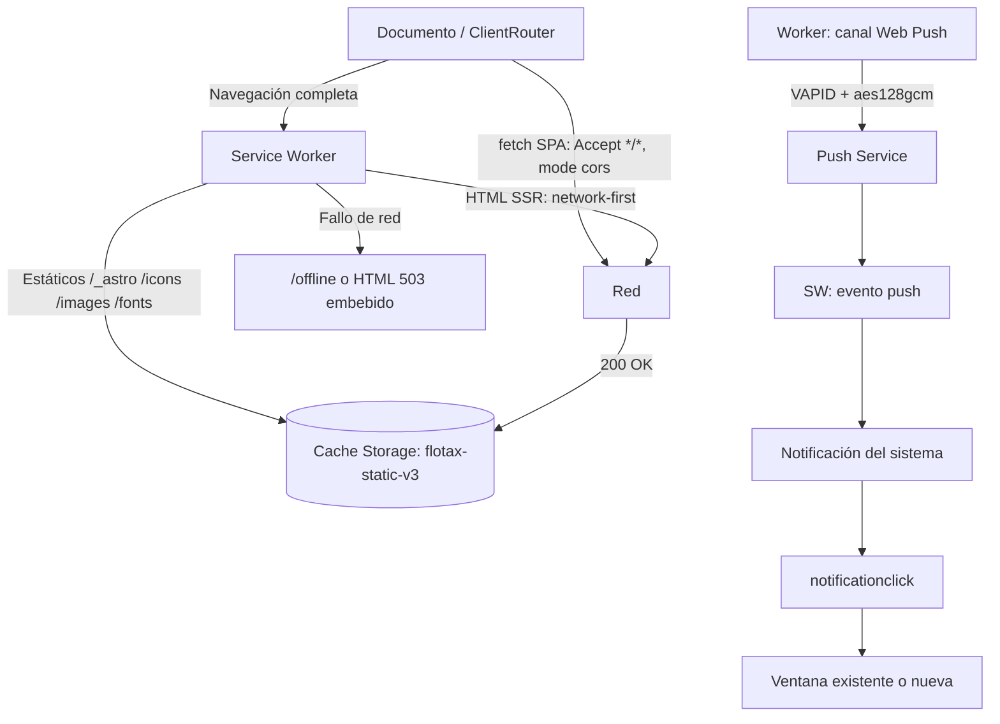

# Capacidades PWA en FlotaX — Estudio profundo (Astro 7 + Cloudflare Workers)

> **Estado:** documento de investigación y auditoría. No describe como implementado nada que no esté citado con su archivo.
> **Fecha de corte:** 27 de octubre de 2026.
> **Ámbito:** FlotaX (Movix), PWA instalable sobre Astro 7 SSR (`output: 'server'`) en Cloudflare Workers.
> **Normativa relacionada:** [ADR de arquitectura PWA/SPA](./ADR_arquitectura_pwa_spa_client_router.md) y [RUL-FLX-020](../.agents/rules/pwa-spa-governance.md).
> **Fuente principal:** curso [Learn PWA de web.dev](https://web.dev/learn/pwa?hl=es-419); en especial el capítulo [Funciones](https://web.dev/learn/pwa/capabilities?hl=es-419).

---

## 0. Resumen ejecutivo

FlotaX ya tiene una base PWA por encima de la media: manifiesto completo, Service Worker propio con estrategias diferenciadas, detección de modo standalone, instalación guiada para iOS, splash crítico antes del primer pintado, Web Push con VAPID implementado dentro del Worker y captura de cámara para verificación documental.

Lo que falta no es "más manifiesto", sino las capacidades que convierten una PWA en herramienta de campo: **datos offline reales**, **actualización segura**, **notificaciones accionables** y **señales del sistema operativo** (badge, wake lock). El orden importa: primero se corrige la seguridad de la caché y el ciclo de actualización; después se añaden capacidades operativas.

### Cinco hallazgos

1. **La app es instalable y se comporta como app**, pero el Service Worker guarda HTML autenticado en `Cache Storage` sin distinguir al usuario ([`public/sw.js`](../public/sw.js), L417–L419). En un dispositivo compartido de patio, un usuario sin conexión podría abrir páginas de otro.
2. **El ciclo de actualización no tiene control ni UX**: `skipWaiting()` y `clients.claim()` se ejecutan incondicionalmente ([`public/sw.js`](../public/sw.js), L329–L351), sin detectar la versión en espera ni avisar al usuario.
3. **No existe capa de datos offline**: no hay IndexedDB, cola de mutaciones ni Background Sync. La página [`/offline`](../src/pages/offline.astro) es informativa; el peritaje y el check-in siguen dependiendo de la red.
4. **Web Push está implementado, pero sin badge ni acciones**: el payload solo lleva título, detalle, enlace y urgencia ([`src/lib/notificaciones/canales.ts`](../src/lib/notificaciones/canales.ts), L68–L76); la campana no usa la Badging API ([`useNotificaciones.ts`](../src/components/notificaciones/useNotificaciones.ts), L19).
5. **Astro 7 no trae PWA nativa y `@vite-pwa/astro` no la soporta**: la versión publicada `1.2.0` declara peer `astro` `^1.6.0 || ^2 || ^3 || ^4 || ^5` (verificado en el registro npm). La vía nativa del ADR sigue siendo la correcta.

### Tres decisiones recomendadas

- **P0 antes que features**: política de caché para HTML privado, flujo de actualización con aviso y cabeceras `no-cache` para `sw.js` y el manifiesto.
- **P1 operativo**: persistencia de almacenamiento, Screen Wake Lock en la captura pericial, App Badging + acciones de notificación y una cola offline v1 con fallback para iOS.
- **P2 de integración**: `share_target`, `launch_handler`, `protocol_handlers`, `file_handlers`, imágenes de arranque iOS, geolocalización como evidencia y `BarcodeDetector` para placa/VIN.

---

## 1. Metodología y fuentes

Este informe combina tres tipos de evidencia:

1. **Normativa y capacidades**: capítulos del curso Learn PWA de web.dev (manifiesto, instalación, service workers, caché, serving, actualización, datos offline, integración con el SO, ventanas, mejoras, detección, experimental y funciones).
2. **Soporte real por plataforma**: datos de compatibilidad de MDN (`browser-compat-data`, consultados el 2026-10-27) y notas de caniuse. No se infiere soporte a partir de la documentación de una sola plataforma.
3. **Estado del repositorio**: auditoría estática de [`public/`](../public), [`src/`](../src), configuración de Astro/Wrangler, dependencias instaladas y reporte de Lighthouse.

**Límites explícitos:** no se hicieron pruebas en dispositivos físicos ni mediciones de campo para este documento; las afirmaciones de comportamiento del navegador se apoyan en la especificación y en el código de Astro 7.3.5 y `@astrojs/cloudflare` 14.3.3 instalados. La matriz de soporte es orientativa y debe revalidarse al implementar cada capacidad.

**Convención de decisiones** usada en las tablas:

| Valor | Significado |
| :--- | :--- |
| **Ya usada** | La capacidad existe en el código actual y se mantiene. |
| **Adoptar (P0/P1/P2)** | Se recomienda implementarla en la fase indicada. |
| **Evaluar** | Requiere una decisión de producto, privacidad o negocio antes de implementar. |
| **Diferir** | Tiene valor potencial, pero no es prioridad ni bloquea la operación. |
| **No aplica** | No encaja en el dominio, el hardware o la arquitectura de FlotaX. |
| **Parcial** | Hay una aproximación indirecta, pero no la API completa. |

---

## 2. Marco: qué significa "progresiva"

La "P" de PWA significa *progressive*: la app se construye en capas y **detecta capacidades antes de usarlas**. No se asume paridad entre Chrome Android, Safari iOS, Safari macOS y navegadores de escritorio. Web.dev agrupa las APIs en cuatro colores:

- **Verde**: disponibles en todos los navegadores y plataformas donde sea técnicamente posible. Ejemplo: Geolocation, Cache API, `fetch`.
- **Verde claro**: disponibles solo en algunos navegadores, pero maduras dentro de ese subconjunto. Ejemplo: WebUSB, Screen Wake Lock, Background Sync.
- **Amarillo**: experimentales, detrás de flags u origin trials. Ejemplo: File Handling, Window Controls Overlay.
- **Rojo**: no utilizables hoy en una PWA; los planes son de largo plazo. Ejemplo: geofencing.

Dos matices importantes para FlotaX:

- **La instalación cambia el conjunto de APIs disponibles.** En iOS, Web Push solo funciona con la app añadida a la pantalla de inicio; en Android, los accesos directos y el badge requieren una instalación WebAPK; `share_target` y `file_handlers` solo existen en Chromium y, en general, con la app instalada.
- **El permiso es parte de la capacidad.** Cámara, micrófono, geolocalización, notificaciones y almacenamiento persistente requieren gestos y decisiones del usuario. Una API "soportada" puede fallar por permiso denegado, contexto no seguro o política del sistema.

FlotaX debe seguir siendo **funcional sin las capacidades verdes claras**: la mejora es aditiva y la UI debe degradar con un mensaje comprensible, no con un error técnico.

---

## 3. Inventario actual

### 3.1 Manifiesto

Archivo: [`public/manifest.webmanifest`](../public/manifest.webmanifest) (82 líneas).

| Campo | Valor actual | Observación |
| :--- | :--- | :--- |
| `id` | `/` | Identidad estable; no debe cambiarse sin tratar la app como nueva. |
| `name` / `short_name` | FlotaX — Gestión y Alquiler de Flota / FlotaX | Correcto. |
| `start_url` | `/home` | Enruta a `/admin` o `/catalogo` según sesión y cookie de portal. |
| `scope` | `/` | Toda la app queda dentro de la ventana instalada. |
| `display` | `standalone` | Modo principal. |
| `display_override` | `["standalone", "minimal-ui"]` | Fallback correcto; no incluye `window-controls-overlay`. |
| `orientation` | `portrait-primary` | Android la respeta; iOS la ignora. Puede molestar en tablets y documentos apaisados. |
| `background_color` / `theme_color` | `#EDEDED` | Coherente con la superficie clara; el fallback offline usa `#111827`. |
| `lang` / `dir` | `es-CO` / `ltr` | Correcto. |
| `categories` | business, productivity, transportation | Correcto. |
| `icons` | SVG `any`, PNG 192, PNG 512, PNG maskable 512 | Cumple instalabilidad; no hay 1024 (opcional). |
| `screenshots` | 540×960 (narrow) y 1280×720 (wide) | Habilita el diálogo de instalación enriquecido en Android. |
| `shortcuts` | Catálogo, Reservas, Panel de patio | Chrome Android muestra como máximo tres: el orden actual es el correcto por prioridad. |
| `prefer_related_applications` | `false` | Correcto: no hay app nativa asociada. |

**Campos de capacidades ausentes:** `share_target`, `launch_handler`, `protocol_handlers`, `file_handlers`, `handle_links`, `url_handlers`, `related_applications` y `scope_extensions`. Son mejoras progresivas, no requisitos de instalación.

### 3.2 Service Worker

Archivo: [`public/sw.js`](../public/sw.js) (486 líneas).

| Elemento | Comportamiento | Líneas |
| :--- | :--- | :--- |
| Versión de caché | `CACHE_VERSION = 'flotax-static-v3'`, manual | L10 |
| Precarga | 9 URLs: manifiesto, favicon, apple-touch-icon, 3 iconos, 2 fuentes y `/offline` | L12–L22 |
| `install` | `cache.addAll(...)` y luego `skipWaiting()` | L329–L336 |
| `activate` | Borra cachés con otro nombre y ejecuta `clients.claim()` | L338–L351 |
| Bypass | No-GET, otro origen, `/api/` y `/_actions/` | L369–L386 |
| Estáticos | Cache-First para `/_astro/`, `/icons/`, `/images/`, `/fonts/`, favicon, apple-touch-icon y manifiesto | L353–L363, L389–L407 |
| HTML | Network-First con `cache.put` de respuestas 200 | L409–L422 |
| Offline | Intenta la página cacheada, luego `/offline` y, por último, un HTML 503 embebido | L423–L436 |
| Push | `showNotification` + aviso a ventanas abiertas (`flotax:notificacion-nueva`) | L445–L471 |
| Click | Enfoca una ventana del origen y navega al `href`, o abre una nueva | L473–L486 |

**Observación técnica verificada:** el comentario del SW dice que la estrategia HTML cubre "transiciones de ClientRouter", pero el router de Astro 7 hace `fetch` con `Accept` por defecto (`*/*`) y sin cabeceras internas del adaptador (`internalFetchHeaders` está vacío en `@astrojs/cloudflare`), por lo que `request.mode` no es `navigate` y `Accept` no contiene `text/html`. Esas transiciones **no** entran en la rama HTML; cuando fallan, el router cae a una navegación completa (`location.href`) y ahí sí la intercepta el SW. Ver §6.1.

### 3.3 Utilidades y runtime

| Archivo | Rol | Referencias |
| :--- | :--- | :--- |
| [`src/lib/pwa/standalone.ts`](../src/lib/pwa/standalone.ts) | `isStandalonePwa`, `isSpaInterceptableUrl`, `registerPwaServiceWorker` | L32–L52, L58–L93, L98–L110 |
| [`src/lib/pwa/install.ts`](../src/lib/pwa/install.ts) | Detección de plataforma, descarte temporal, marca de instalación | L32–L56, L61–L95, L100–L125 |
| [`src/lib/pwa/push.ts`](../src/lib/pwa/push.ts) | `soportaPush`, estado de permiso, suscripción VAPID | L14–L28, L47–L70 |
| [`src/lib/pwa/index.ts`](../src/lib/pwa/index.ts) | Barrel de exportaciones | L1–L26 |
| [`PwaRuntimeIsland.tsx`](../src/components/navigation/PwaRuntimeIsland.tsx) | Registra SW, sincroniza standalone, captura `beforeinstallprompt`, píldora offline, guía iOS | L58, L64–L72, L89, L210–L211 |
| [`PwaBootSplash.astro`](../src/components/navigation/PwaBootSplash.astro) | Splash crítico inline antes del primer pintado | L31–L63 |
| [`LayoutApp.astro`](../src/layouts/LayoutApp.astro) | Metas, manifiesto, `ClientRouter`, isla persistida | L63–L73, L89–L93 |
| [`src/middleware.ts`](../src/middleware.ts) | Bypass de artefactos PWA y estáticos | L57–L72 |

La isla de runtime se hidrata con `client:load` y persiste con `transition:persist="flotax-pwa-runtime"`. El registro del SW ocurre en el `useEffect` de montaje (L58), es decir, después de la hidratación.

### 3.4 Push y notificaciones

- Servidor: [`src/lib/notificaciones/webpush.ts`](../src/lib/notificaciones/webpush.ts) implementa VAPID (RFC 8292) y cifrado `aes128gcm` (RFC 8291/8188) con WebCrypto, sin dependencias de Node. Envía `TTL: 86400` y `Urgency: normal` (L147–L151).
- Persistencia: tabla `suscripciones_push` en [`src/db/schema/notificaciones.ts`](../src/db/schema/notificaciones.ts) (L57–L76), con limpieza de suscripciones caducadas (404/410) en [`canales.ts`](../src/lib/notificaciones/canales.ts) (L79–L91).
- Cliente: [`ActivarPush.tsx`](../src/components/notificaciones/ActivarPush.tsx) pide permiso tras un gesto (L48–L51) y sincroniza la suscripción.
- Bandeja: [`useNotificaciones.ts`](../src/components/notificaciones/useNotificaciones.ts) sondea cada 60 s, al volver a la pestaña y al recibir el mensaje del SW (L19–L54).
- iOS: el propio componente explica que hay que instalar la app en la pantalla de inicio; es correcto y coincide con la limitación de WebKit.

**Ausencias:** acciones en la notificación (`actions`), `timestamp`, badge monocromo, `silent`, `topic`, `Urgency` por prioridad, `pushsubscriptionchange` y App Badging.

### 3.5 Cámara, share y splash

- Cámara: [`VerificacionCameraModal.tsx`](../src/components/verificacion/VerificacionCameraModal.tsx) usa `getUserMedia` con `facingMode` y 1920×1080 (L48–L70); comprime antes de aceptar la foto (L110). No solicita Wake Lock.
- Compartir: [`LocalCatalogShareCard.tsx`](../src/components/flota/LocalCatalogShareCard.tsx) usa `navigator.share` cuando existe y Clipboard como alternativa (L109, L128–L143).
- Splash: [`PwaBootSplash.astro`](../src/components/navigation/PwaBootSplash.astro) detecta standalone en un script inline (L51–L63) y marca `html.pwa-boot-active` antes de pintar. Es una excelente solución para Android y desktop; en iOS no sustituye a `apple-touch-startup-image`, que se renderiza antes de que exista el HTML.

### 3.6 Flujo actual



---

## 4. Matriz de capacidades

### 4.1 Cómo leerla

Cada fila responde a: **¿qué puede hacer la Web?**, **¿lo usa FlotaX?**, **¿qué soporte real tiene?** y **¿qué valor aporta al dominio?** La columna "Decisión" usa la convención de §1. Las capacidades se agrupan como en web.dev para facilitar la comparación con la fuente.

### 4.2 Verde — conceptos básicos

| Capacidad | API / origen | Estado en FlotaX | Soporte | Valor en FlotaX | Decisión |
| :--- | :--- | :--- | :--- | :--- | :--- |
| Cache Storage | `caches` | Ya usada en SW y página offline | Todos | Assets y fallback sin red | Mantener y endurecer (P0) |
| Estrategias de red | `FetchEvent` | Ya usadas: cache-first y network-first | Todos | Rendimiento y resiliencia | Mantener (P0) |
| IndexedDB | `indexedDB` | No usada | Todos | Cola offline, borradores de peritaje | Adoptar (P1) |
| StorageManager | `navigator.storage` | No usada | Chrome 55+, Safari 15.2+ | Evitar desalojo y diagnosticar cuota | Adoptar (P1) |
| Page Visibility | `visibilitychange` | Ya usada en notificaciones | Todos | Pausar sondeo y refrescar | Mantener |
| Web Performance | `PerformanceObserver`, `performance` | No usada de forma explícita | Todos | Medir LCP, CLS e interacción en patio | Evaluar (P2) |
| Fetch | `fetch` | Ya usada | Todos | Toda la capa de datos | Mantener |
| Web Workers | `Worker` | No hay worker dedicado | Todos | Compresión de fotos fuera del hilo | Evaluar (P2) |
| Canvas 2D / WebGL / WASM | `canvas`, `WebGL`, `WebAssembly` | Uso indirecto (compresión de imagen) | Todos | Procesamiento de imagen | Diferir |
| Web Audio | `AudioContext` | No usada | Todos | Feedback sonoro | No aplica |
| WebRTC | `RTCPeerConnection` | No usada | Todos | Videollamada de peritaje | Diferir |
| WebSocket | `WebSocket` | No usada | Todos | Disponibilidad en vivo | No aplica: el sondeo y las Actions bastan |

### 4.3 Verde — hardware y sensores

| Capacidad | API / origen | Estado en FlotaX | Soporte | Valor en FlotaX | Decisión |
| :--- | :--- | :--- | :--- | :--- | :--- |
| Cámara y micrófono | `getUserMedia` | Cámara ya usada; micrófono no | Todos (HTTPS + gesto) | Peritaje documental | Mantener y añadir Wake Lock (P1) |
| Geolocalización | `geolocation` | No usada | Todos | Evidencia de ubicación en entrega/devolución | Evaluar (P2) |
| Sensores de movimiento | `DeviceMotionEvent`, `Sensor` | No usados | Todos (iOS pide permiso) | Nada | No aplica |
| Puntero y táctil | Pointer Events, Touch Events | Uso implícito en toda la UI | Todos | Ergonomía de 44 px | Mantener |
| Gamepad | `getGamepads` | No usado | Todos | Nada | No aplica |
| WebAuthn / passkeys | `PublicKeyCredential` | No usado | Amplio (Chrome, Safari 13+, Firefox) | Alternativa a OTP con Better Auth | Evaluar (P2) |

### 4.4 Verde — integración con el sistema operativo

| Capacidad | API / origen | Estado en FlotaX | Soporte | Valor en FlotaX | Decisión |
| :--- | :--- | :--- | :--- | :--- | :--- |
| Web Share | `navigator.share` | Ya usada | Safari 12.1+, Chrome Android y desktop reciente | Compartir catálogo | Mantener |
| Clipboard | `navigator.clipboard` | Ya usada con fallback | Chrome 66+, Safari 13.1+ | Copiar enlace de catálogo | Mantener |
| Credential Management | `navigator.credentials` | No usada | Amplio | Login con credenciales guardadas | No aplica por ahora: el flujo es OTP |
| Web Speech | `SpeechSynthesis`, `SpeechRecognition` | No usada | Parcial y variable | Manos libres en patio | Diferir |
| Picture-in-Picture | `requestPictureInPicture` | No usada | Amplio | Nada | No aplica |
| Fullscreen | `requestFullscreen` | No usada | Amplio | Visor de fotos periciales | Diferir |

### 4.5 Verde claro — conceptos básicos y hardware

| Capacidad | API / origen | Estado en FlotaX | Soporte | Valor en FlotaX | Decisión |
| :--- | :--- | :--- | :--- | :--- | :--- |
| WebGL 2.0 | `WebGL2RenderingContext` | No usada | Amplio | Nada | No aplica |
| WebCodecs | `VideoEncoder`, `VideoDecoder` | No usada | Chromium; Safari reciente con soporte parcial | Comprimir video pericial | Diferir (P2) |
| Cámara PTZ | `MediaStreamTrack` PTZ | No usada | Chromium | Nada | No aplica |
| Vibration | `navigator.vibrate` | Ya usada como feedback | Chrome Android; iOS no | Confirmación táctil | Mantener (mejora progresiva) |
| MediaRecorder | `MediaRecorder` | No usada | Amplio en móvil moderno | Video de walkaround en entrega | Diferir (P2) |
| Screen Wake Lock | `navigator.wakeLock` | No usada | Chrome 84+, Safari 16.4+, iOS 18.4+ | Evitar que la pantalla se apague durante el peritaje | Adoptar (P1) |
| Bloqueo de orientación | `screen.orientation`, manifiesto | Parcial: `orientation` en manifiesto | Android; iOS ignora | Horizontal en tablets y documentos apaisados | Revisar (P2) |
| Web Bluetooth | `Bluetooth` | No usada | Chromium | Nada | No aplica |
| WebNFC | `NDEFReader` | No usada | Chromium Android | Nada | No aplica |
| Web Serial / USB / HID | `Serial`, `USB`, `HID` | No usadas | Chromium | Nada | No aplica |
| Ambient Light | `AmbientLightSensor` | No usada | Chromium | Nada | No aplica |
| WebXR / AR | `WebXR` | No usada | Limitado | Nada | No aplica |
| Idle Detection | `IdleDetector` | No usada | Chromium | Nada | No aplica |
| Presentation | `PresentationRequest` | No usada | Chromium | Nada | No aplica |
| Pointer Lock | `requestPointerLock` | No usada | Amplio | Nada | No aplica |

### 4.6 Verde claro — integración con el sistema operativo

| Capacidad | API / origen | Estado en FlotaX | Soporte | Valor en FlotaX | Decisión |
| :--- | :--- | :--- | :--- | :--- | :--- |
| File System Access | `showOpenFilePicker`, `showSaveFilePicker` | No usada; las fotos van a R2 por red | Chromium; Safari 15.2+ parcial | Exportar contratos o reportes | Diferir |
| Web Share Target | `share_target` en manifiesto | No declarado | Chromium Android/ChromeOS con app instalada | Recibir enlaces o archivos compartidos | Evaluar (P2) |
| Contact Picker | `navigator.contacts` | No usada | Chromium Android | Nada | No aplica |
| Background Sync | `SyncManager` | No usada | **Chromium 49+; sin Safari ni Firefox** | Reintentar peritajes y check-in | Adoptar con fallback (P1) |
| Periodic Background Sync | `PeriodicSyncManager` | No usada | Chromium con app instalada y engagement | Refrescar disponibilidad en segundo plano | Diferir (P2) |
| Web Push | Push API + VAPID | Ya usada, con servidor propio | iOS 16.4+ solo instalada; macOS 13+ | Avisos operativos | Endurecer (P1) |
| Notifications | `Notification`, `showNotification` | Ya usada | Igual que Push | Avisos | Endurecer (P1) |
| Background Fetch | `BackgroundFetchManager` | No usada | Chromium | Subir fotos en segundo plano | Evaluar (P2) |
| Media Session | `navigator.mediaSession` | No usada | Amplio | Nada | No aplica |
| Payment Request | `PaymentRequest` | No usada | Amplio; Apple Pay JS aparte | Cobro de depósitos o reservas | Diferir: decisión de negocio |
| Network Information | `navigator.connection` | No usada | Chromium | Ajustar subida de fotos con data-saver | Adoptar ligero (P1/P2) |
| Screen Capture | `getDisplayMedia` | No usada | Amplio | Nada | No aplica |
| Shape Detection | `BarcodeDetector` | No usada | Chromium | Lectura de placa o VIN | Evaluar (P2) |
| Device Memory | `navigator.deviceMemory` | No usada | Chromium | Nada | No aplica |
| WebOTP | `OTPCredential` | No usada | Chromium Android | Nada: el OTP de FlotaX es por email | No aplica |
| Virtual Keyboard | `navigator.virtualKeyboard`, viewport | Parcial: `interactive-widget=resizes-content` | Chromium | Ergonomía de formularios | Mantener; evaluar API en P2 |

### 4.7 Amarillo — experimental

Estas capacidades no deben entrar en producción sin un caso de negocio claro y una ruta de degradación. Se documentan para que no se confundan con "verde claro".

| Capacidad | Estado | Motivo para no adoptar hoy |
| :--- | :--- | :--- |
| File Handling (`file_handlers`) | Experimental en Chromium | Útil para abrir PDF de contratos, pero solo Chromium y sin iOS. Se difiere a P2 condicionado a soporte. |
| Window Controls Overlay | Experimental en Chromium | Solo escritorio; FlotaX es mobile-first. |
| Tabbed app mode | Experimental | No aporta al flujo de patio. |
| Window Management (`getScreenDetails`) | Experimental | Solo escritorio multi-pantalla. |
| Web Share Target con archivos | Dependiente de Chromium | No hay caso de negocio validado para recibir archivos. |
| Background Fetch | Chromium | La cola propia con IndexedDB cubre el caso sin depender de una API no estándar en iOS. |
| Contact Picker | Chromium Android | Riesgo de privacidad y poco valor frente a escribir un teléfono. |
| Origin trials / Fugu | Según el momento | Requieren registro y caducidad; no se usan sin una necesidad concreta. |

### 4.8 Rojo — no disponible

Web.dev incluye aquí APIs que hoy no se pueden usar en una PWA (por ejemplo, geofencing). No se listan como oportunidad. Si aparece una necesidad que no cabe en el conjunto actual, el camino es el [proyecto de capacidades web de Chromium](https://www.chromium.org/teams/web-capabilities-fugu/) y el capítulo [Experimental](https://web.dev/learn/pwa/experimental?hl=es-419), no una solución casera.

---

## 5. Análisis por capa

### 5.1 Instalación, manifiesto e iOS

**Lo que está bien.** El manifiesto cumple los requisitos de instalación de Chromium: `name`, `short_name`, `icons` de 192 y 512, `start_url`, `display: standalone` y `id`. Un Service Worker controla la página y maneja `fetch`. Los `screenshots` habilitan el diálogo enriquecido de Android. Los `shortcuts` están ordenados por prioridad y apuntan a rutas dentro del `scope`.

**iOS es otro modelo.** No hay diálogo de instalación: el usuario debe usar *Compartir → Agregar a la pantalla de inicio*. FlotaX ya lo explica con [`IosInstallGuideModal.tsx`](../src/components/navigation/IosInstallGuideModal.tsx). Tres consecuencias:

1. **Cada instalación tiene almacenamiento aislado.** En iOS, la app instalada no comparte almacenamiento con Safari ni con otras instancias del mismo ícono. Para una app con caché offline esto es una ventaja de privacidad y una advertencia de diseño: no se puede asumir que el usuario verá la misma caché que en la pestaña.
2. **Falta la imagen de arranque.** iOS no usa `background_color` ni el manifiesto para la pantalla de lanzamiento: usa `<link rel="apple-touch-startup-image">`, que debe tener el tamaño exacto del dispositivo y orientación. Sin ella, se ve un destello blanco antes de que se pinte [`PwaBootSplash.astro`](../src/components/navigation/PwaBootSplash.astro). Es una mejora visual, no un bloqueo funcional.
3. **Metadatos legacy.** [`LayoutApp.astro`](../src/layouts/LayoutApp.astro) conserva `apple-mobile-web-app-capable`, `status-bar-style` y `title` (L68–L71). Web.dev recomienda no usar esos `<meta>` porque hoy el manifiesto es la fuente de verdad y, si el navegador no lo carga, los metas producen una experiencia inesperada. Su retirada debe probarse en iOS antiguo antes de ejecutarse; no es un cambio urgente.

**Riesgos de configuración.** `orientation: portrait-primary` puede impedir el horizontal en tablets Android, justo donde un documento apaisado se captura mejor. Antes de cambiarlo, hay que decidir si el peritaje exige horizontal o si basta con el visor de fotos. `theme_color` y `background_color` son claros (`#EDEDED`) mientras el fallback offline es oscuro (`#111827`); conviene unificar la transición visual.

### 5.2 Ciclo de vida y actualización del Service Worker

El ciclo actual es "instalar y tomar el control de inmediato":

- `install` precarga y ejecuta `skipWaiting()` ([`public/sw.js`](../public/sw.js), L329–L336).
- `activate` borra cachés con otro nombre y ejecuta `clients.claim()` (L338–L351).

Web.dev advierte que `skipWaiting()` puede dejar páginas cargadas con una versión anterior bajo el control de un SW nuevo. En FlotaX el riesgo se mitiga parcialmente porque los assets de `/_astro/` están hasheados, pero no desaparece: una pestaña abierta puede pedir un chunk que ya no existe tras el despliegue, o el usuario puede quedar con un HTML viejo y un JS nuevo.

**Lo que falta:**

- Detectar la versión en espera con `registration.updatefound` y `statechange === 'installed'`.
- Mostrar un aviso humano ("Hay una versión nueva; actualiza cuando puedas") y no recargar a la fuerza.
- Enviar `SKIP_WAITING` por `postMessage` cuando el usuario acepte.
- Escuchar `controllerchange` y recargar **una sola vez** (con una bandera para evitar bucles).
- Llamar a `registration.update()` al volver a la pestaña y con una periodicidad razonable, sin bloquear la carga.
- Decidir qué hacer con los metadatos del manifiesto: en Android WebAPK se actualizan de forma asíncrona; en iOS solo reinstalando.

**La versión de caché es manual.** `CACHE_VERSION = 'flotax-static-v3'` (L10) exige que una persona recuerde cambiarla. Si no se cambia, los estáticos nuevos se añaden a la misma caché y los viejos nunca se purgan. En `activate` solo se borran **otras** cachés (L342–L348), no las entradas obsoletas de la caché vigente. Con cada despliegue, `/_astro/` acumula archivos hasheados que ya nadie solicita.

### 5.3 Caché y serving

**Estrategia actual:**

- **Cache-First** para assets inmutables: es correcto para `/_astro/` (contenido hasheado) y fuentes.
- **Network-First** para HTML: correcto para datos en tiempo real, pero incompleto para privacidad.
- **Bypass** de `/api/` y `/_actions/`: imprescindible; evita cachear sesión, OTP y mutaciones.

**Problemas detectados:**

1. **HTML autenticado en caché.** Cualquier respuesta HTML 200 se guarda (L415–L419), sin mirar `Cache-Control`, `Set-Cookie` ni si la ruta es privada. El middleware no emite `Cache-Control` para HTML (no hay ocurrencias en [`src/middleware.ts`](../src/middleware.ts)). En un dispositivo compartido, la persona B puede abrir sin red una página que la persona A había visitado. Es el hallazgo de mayor severidad del informe.
2. **El manifiesto es Cache-First.** `isStaticAssetPathname` incluye `/manifest.webmanifest` (L353–L362). Los cambios de `shortcuts`, `name` o iconos no se propagan hasta que se cambia la versión de caché. El manifiesto debería ser network-first o stale-while-revalidate.
3. **Crecimiento no acotado.** `caches.match(request)` no usa `ignoreSearch` (L391, L424), así que cada variante con query string (`?pagina=2`, `?sede=norte`) crea una entrada distinta. El fallback siempre va a `/offline` (L428), no a la última vista cacheada de la misma ruta.
4. **Fallback embebido y CSP.** El HTML 503 incluye `onclick` y un `<script>` inline (L308–L324). Si en el futuro se añade una Content-Security-Policy estricta, ese fallback dejará de funcionar. Además duplica mantenimiento con la página real `/offline`.
5. **Cabeceras de caché del borde.** El adaptador de Cloudflare genera `dist/client/_headers` con una sola regla (`/_astro/*` immutable). No hay regla para `/sw.js` ni `/manifest.webmanifest`, por lo que el navegador puede tardar hasta 24 horas (límite de la especificación) en detectar un SW nuevo. Añadir `public/_headers` es seguro: el adaptador fusiona e inyecta la regla de `/_astro/*` cuando no hay una que la contradiga (verificado en `@astrojs/cloudflare` 14.3.3, `astro:build:done`).

**Recomendación P0:** allowlist explícita de HTML cacheable (por ejemplo `/catalogo`, `/vehiculos/*`, `/offline`; excluir `/home`, `/admin`, `/reservas`, `/perfil`, `/notificaciones`, `/login` y `/registro`), nunca cachear respuestas con `Cache-Control: no-store` o `private`, y emitir `no-store` en el SSR privado. Si una ruta privada no tiene caché, el fallback es `/offline`, no una página de otro usuario.

**Navegación instantánea (implementación vigente, 2026-10-27).** La recomendación anterior aplica a **Cache Storage del Service Worker**, que es compartido entre usuarios. La caché **HTTP privada del navegador** sí se usa: el middleware emite `Cache-Control: private, max-age=<ttl>, stale-while-revalidate=<swr>` y `Vary: Cookie` para HTML, y cada acción mutante renueva la cookie `flotax_rev` para invalidar. El `fetch` de `<ClientRouter />` se sirve desde esa caché durante 5–30 s según la ruta, y un calentamiento autenticado precarga las pestañas troncales. El SW solo cachea HTML público de catálogo. Detalle completo, matriz de TTL y verificación en [`ADR_navegacion_instantanea.md`](./ADR_navegacion_instantanea.md).

### 5.4 Datos offline

Hoy no existe una capa de datos offline. `Cache Storage` guarda respuestas, no intenciones: no hay forma de registrar "el operario verificó esta entrega" y reintentarlo después. Tampoco se solicita almacenamiento persistente, así que el navegador puede desalojar la caché bajo presión de cuota.

**Qué aporta cada pieza:**

| Pieza | Para qué sirve | Límite |
| :--- | :--- | :--- |
| `Cache Storage` | Respuestas HTTP y assets | No es una base de datos; no sirve para estado de negocio |
| `IndexedDB` | Cola de mutaciones, borradores, fotos pendientes | Sujeta a cuota y desalojo |
| `navigator.storage.persist()` | Evitar el desalojo automático | El usuario siempre puede borrar; en Chromium se concede por heurística (instalación, interacción) |
| `navigator.storage.estimate()` | Diagnóstico de uso y cuota | No disponible en todos los navegadores |
| Background Sync | Reintento cuando vuelve la red | **Solo Chromium**; iOS no lo soporta |
| Periodic Background Sync | Refresco periódico | Chromium, app instalada y engagement |

**Diseño recomendado para FlotaX (P1):**

- Cola en IndexedDB con `id` generado en el cliente, `tipo`, `payload`, `creadoEn`, `intentos`, `estado` y `ultimoError`.
- Fotos comprimidas como `Blob` en IndexedDB, no como base64 en memoria; subida a R2 con URL firmada o endpoint propio, reintentable e idempotente.
- Reintento en `online`, `visibilitychange` y arranque de la app. Background Sync solo como **mejora** en Chromium; iOS necesita el fallback en primer plano.
- Indicador visible de "pendiente de sincronizar" y una pantalla de diagnóstico que use `storage.estimate()`.
- Respetar la arquitectura: lógica en `src/lib/pwa/` (sin `utils.ts`), isla React para la UI y páginas por debajo de 150 LOC.
- Conflictos: una mutación offline puede llegar después de otra que la invalida. El servidor debe validar estado y devolver un resultado explícito; la UI debe mostrar "requiere revisión" en lugar de fingir éxito.

Safari aplica políticas de desalojo a almacenamiento escrito por script en sitios no instalados; la instalación en pantalla de inicio y `persist()` reducen el riesgo, pero no lo eliminan. Por eso la cola debe sobrevivir a la pérdida de la caché y no asumir que los datos estarán ahí para siempre.

### 5.5 Push y notificaciones

**Fortalezas.** El servidor no depende de `web-push` ni de Node: firma VAPID y cifra con WebCrypto dentro del Worker. Limpia suscripciones caducadas y avisa a las ventanas abiertas por `postMessage`. La suscripción se guarda por usuario y endpoint. El permiso se pide con un gesto desde [`ActivarPush.tsx`](../src/components/notificaciones/ActivarPush.tsx).

**Brechas:**

- **Sin acciones.** `notificationclick` ignora `event.action` y no hay `actions` en las opciones ([`public/sw.js`](../public/sw.js), L453–L461). Un aviso de "entrega programada" podría ofrecer "Ver entrega" y "Marcar leída".
- **Sin badge.** La campana muestra el contador en la UI, pero el icono instalado no se marca. `setAppBadge` está disponible en Chrome 81+, Safari 17+ e iOS 16.4+; es una mejora de bajo costo.
- **Badge visual incorrecto.** `badge: '/icons/icon-192.png'` apunta a un PNG a color; Android espera un icono monocromo para la barra de estado.
- **Sin `timestamp` ni `silent`.** Ayudan a ordenar y a no interrumpir en horarios sensibles.
- **Sin `pushsubscriptionchange`.** Si el navegador rota la suscripción, el servidor conserva un endpoint muerto hasta el próximo 404/410.
- **Payload sin contador.** Para pintar el badge desde el SW haría falta incluir el número de no leídas en el payload o hacer que el cliente lo consulte al abrir.
- **Prioridad no traducida.** `urgente` se usa para `renotify`, pero `Urgency` siempre es `normal` en el envío (L151). Una alerta urgente podría usar `high`.
- **iOS.** Solo funciona con la app en la pantalla de inicio; el texto actual ya lo explica. En macOS Safari 13+ requiere la app web añadida.

### 5.6 Integración con el sistema operativo

FlotaX ya usa las dos capacidades verdes más útiles: Web Share y Clipboard. Las capacidades de integración profunda son **mejoras progresivas** y deben evaluarse por plataforma:

| Capacidad | Uso potencial | Cuándo tiene sentido |
| :--- | :--- | :--- |
| `share_target` | Recibir un enlace de vehículo o una foto compartida desde otra app | Si el equipo comercial comparte fichas por WhatsApp y quiere abrirlas en FlotaX |
| `launch_handler` | Reutilizar la ventana instalada en lugar de abrir otra | Desktop y Android; mejora la sensación de app única |
| `protocol_handlers` | Enlaces `web+flotax://` desde correos o mensajes | Solo escritorio; iOS no lo permite sin tienda |
| `file_handlers` | Abrir PDF de contrato con FlotaX | Experimental, Chromium; P2 condicionado |
| `handle_links` / `url_handlers` | Capturar enlaces del dominio en la app instalada | Experimental; Android WebAPK ya lo hace de forma automática |
| App Badging | Marcar no leídas en el icono | P1, alto valor y bajo costo |
| Contact Picker | Elegir teléfono de un cliente | No aplica: riesgo de privacidad y poco valor |

**Regla de oro:** ninguna de estas capacidades debe ser la única vía para completar una tarea. Si el navegador no la soporta, el flujo debe seguir funcionando con un enlace normal o una instrucción clara.

### 5.7 Ventanas y escritorio

El manifiesto ya usa `display_override` con `standalone` y `minimal-ui`. No hay `window-controls-overlay`, y no hace falta: la app es mobile-first y el escritorio es secundario. `window.getScreenDetails()` y `Presentation` son experimentales y no aportan al patio.

La instalación en escritorio (Chrome/Edge) sí aporta: icono en el menú de aplicaciones, ventana propia, accesos directos y badge. El soporte de `shortcuts` en desktop es de "mejor esfuerzo": Chrome y Edge renderizan hasta 10; Android Chrome solo 3. El orden actual del manifiesto es correcto.

**Virtual Keyboard.** [`LayoutApp.astro`](../src/layouts/LayoutApp.astro) usa `interactive-widget=resizes-content` en el viewport (L63–L64), que es la aproximación correcta para que el teclado no tape el campo. La API `navigator.virtualKeyboard` es una mejora adicional solo en Chromium; no es necesaria para cumplir la ergonomía.

### 5.8 Hardware relevante para el patio

- **Cámara.** Ya integrada. Falta Wake Lock y, si se quiere video, `MediaRecorder`. La compresión actual ocurre en el hilo principal; un Web Worker evitaría congelar la UI en fotos grandes.
- **Wake Lock.** Es la mejora de hardware con mejor relación costo/beneficio: una captura pericial no debería interrumpirse porque la pantalla se apagó. Debe re-solicitarse al volver a la pestaña (`visibilitychange`) y liberarse al cerrar el modal. iOS solo desde 18.4; en versiones anteriores se degrada sin error.
- **Geolocalización.** Aporta valor probatorio, pero es un dato personal. Requiere consentimiento explícito, explicación en la UI y una decisión de privacidad sobre retención. No debe capturarse en segundo plano.
- **`BarcodeDetector`.** Leer placa o VIN con la cámara ahorraría errores de tecleo, pero solo existe en Chromium. En iOS habría que mantener la entrada manual; es una mejora, no un reemplazo.
- **Network Information.** `navigator.connection.saveData` permitiría subir fotos más comprimidas o posponer video en redes lentas. Solo Chromium; el resto sigue con la lógica actual.

---

## 6. Astro 7 y Cloudflare: lo que hay que saber

### 6.1 `<ClientRouter />` y el `fetch` del Service Worker

Verificado en el código instalado de Astro 7.3.5: `fetchHTML` crea un `Headers` vacío, aplica `internalFetchHeaders` (vacío en el adaptador de Cloudflare) y llama a `fetch(href, { signal })` (`astro/dist/transitions/router.js`, L43–L49). El navegador envía `Accept: */*` y `mode: cors`, no `navigate`.

Consecuencias:

- La estrategia HTML del SW **no** cachea ni sirve las transiciones SPA. Solo intercepta cargas de documento completas: primera carga, recarga, navegación desde fuera y el fallback del router cuando el `fetch` falla.
- Cuando no hay red, el router de Astro hace `preventDefault` y cae a `location.href = to.href` (L250–L254), que sí es una navegación completa y sí llega al SW. La experiencia offline funciona, pero con un salto de página completo en lugar de una transición.
- El comentario de [`public/sw.js`](../public/sw.js) (L409) que atribuye la estrategia a las transiciones de ClientRouter es impreciso y debe corregirse al tocar el archivo.

No se recomienda parchear Astro para inyectar `Accept: text/html` en el router. La alternativa correcta es aceptar el comportamiento y diseñar el fallback offline para navegaciones completas, que es lo que ya ocurre.

### 6.2 Astro Actions y Server Islands

- **Actions.** El SW hace bypass de `/_actions/` (L380–L386), que es la ruta RPC de Astro (`astro/dist/actions/consts.js`, L13). Es correcto: las Actions llevan sesión y mutaciones y nunca deben servirse desde caché.
- **Server Islands.** FlotaX no las usa hoy (no hay `server:defer` en `src/`). Si se adoptan, sus peticiones van a `/_server-islands/` y no están en el bypass; habría que añadirlas. Es un riesgo condicional, no actual.
- **Acciones GET.** Las Actions invocadas por formularios pueden usar GET; el bypass por prefijo las cubre igual.

### 6.3 Assets, `_headers` y Cloudflare Workers

- `/_astro/*` contiene nombres hasheados: cache-first es seguro y el adaptador inyecta `Cache-Control: public, max-age=31536000, immutable` en `_headers` durante `astro:build:done`.
- El adaptador **fusiona** un `_headers` propio si existe: recorre el archivo, comprueba si ya hay una regla de `Cache-Control` que aplique al patrón de assets y, si no, inyecta la suya. Por eso añadir `public/_headers` con reglas para `sw.js` y el manifiesto no rompe el cache immutable.
- El worker se despliega con `assets.binding = ASSETS` y `directory = ../client` (verificado en `dist/server/wrangler.json`). Los archivos de `public/` se copian tal cual: `sw.js` no pasa por Vite, no se tipa y no se hashea. Es una decisión consciente del ADR; si se quiere TypeScript en el SW, habría que añadir un paso de build, lo que hoy no se justifica.
- `public/_headers` es un archivo de Cloudflare Workers Static Assets, no de Astro. Debe contener solo reglas; el adaptador añade la de `/_astro/*`.

### 6.4 Desarrollo vs producción

`registerPwaServiceWorker()` se ejecuta sin comprobar el entorno ([`standalone.ts`](../src/lib/pwa/standalone.ts), L98–L110; llamado desde [`PwaRuntimeIsland.tsx`](../src/components/navigation/PwaRuntimeIsland.tsx), L58). En `astro dev` el SW también se registra y puede cachear respuestas de desarrollo, además de intentar precargar `/offline`. No es un fallo grave porque las rutas de Vite no coinciden con los patrones cacheados, pero conviene registrar solo en producción (`import.meta.env.PROD`) y limpiar registros antiguos en desarrollo.

### 6.5 `@vite-pwa/astro`

El registro npm devuelve `1.2.0` con peer `astro` `^1.6.0 || ^2.0.0 || ^3.0.0 || ^4.0.0 || ^5.0.0` y dependencia `vite-plugin-pwa` `^1.2.0`. No declara soporte para Astro 7. Instalarlo obligaría a ignorar peers y a confiar en Workbox sobre SSR autenticado, justo lo que el ADR descartó. **La arquitectura nativa sigue siendo la decisión correcta.** Si en el futuro se quiere Workbox, habría que hacer una prueba aislada con Astro 7 y Vite 8 antes de adoptarlo.

---

## 7. Brechas y deuda técnica

Severidad: **P0** = seguridad o corrección; **P1** = valor operativo alto; **P2** = mejora diferible.

| ID | Hallazgo | Evidencia | Impacto | Recomendación | Fase |
| :--- | :--- | :--- | :--- | :--- | :--- |
| R-01 | HTML autenticado se guarda en caché sin distinguir usuario | [`public/sw.js`](../public/sw.js) L415–L419; sin `Cache-Control` en [`src/middleware.ts`](../src/middleware.ts) | Fuga de datos entre usuarios en dispositivo compartido | Allowlist pública + `no-store` en SSR privado + no cachear respuestas privadas | P0 |
| R-02 | Actualización del SW sin control ni aviso | [`public/sw.js`](../public/sw.js) L329–L351; registro sin `update()` en [`standalone.ts`](../src/lib/pwa/standalone.ts) L98–L110 | Mezcla de assets viejos/nuevos; usuario sin saber que hay versión nueva | `waiting` + `SKIP_WAITING` + banner + recarga única | P0 |
| R-03 | `sw.js` y manifiesto sin `no-cache` | `dist/client/_headers` solo tiene `/_astro/*`; no existe `public/_headers` | Detección de actualización hasta 24 h | Añadir `_headers` con `no-cache` para ambos | P0 |
| R-04 | Versión de caché manual y sin purga de hashed assets | [`public/sw.js`](../public/sw.js) L10, L338–L350, L398–L400 | Crecimiento de cuota y despliegues que no invalidan | Versión inyectada en build o query de registro; purga por prefijo | P0 |
| R-05 | Sin persistencia ni diagnóstico de almacenamiento | No hay `navigator.storage` en `src/` | La caché puede desalojarse | `persist()` tras instalar/interactuar + `estimate()` en diagnóstico | P1 |
| R-06 | Sin capa de datos offline | No hay `indexedDB` ni cola en `src/` | Peritaje y check-in dependen de la red | Outbox v1 con IndexedDB e idempotencia | P1 |
| R-07 | Sin Wake Lock en captura pericial | [`VerificacionCameraModal.tsx`](../src/components/verificacion/VerificacionCameraModal.tsx) L48–L70 | Pantalla apagada a mitad de peritaje | Wake Lock con re-solicitud y liberación | P1 |
| R-08 | Sin App Badging | [`useNotificaciones.ts`](../src/components/notificaciones/useNotificaciones.ts) L19, L44 | El icono instalado no refleja no leídas | `setAppBadge`/`clearAppBadge` desde cliente y SW | P1 |
| R-09 | Notificaciones sin acciones ni metadatos | [`public/sw.js`](../public/sw.js) L453–L461; [`canales.ts`](../src/lib/notificaciones/canales.ts) L68–L76 | Menos acciones por aviso | `actions`, `timestamp`, badge monocromo, `Urgency` | P1 |
| R-10 | `beforeinstallprompt` se captura tras hidratar | [`PwaRuntimeIsland.tsx`](../src/components/navigation/PwaRuntimeIsland.tsx) L58, L210 | Se puede perder el evento en Chromium | Captura previa en script inline o `client:load` mínimo | P2 |
| R-11 | Sin imagen de arranque iOS y metas legacy | [`LayoutApp.astro`](../src/layouts/LayoutApp.astro) L68–L71; sin `apple-touch-startup-image` | Destello blanco al abrir en iOS | Generar startup images y evaluar retirada de metas | P2 |
| R-12 | Sin integración profunda con el SO | Manifiesto sin `share_target`, `launch_handler`, etc. | Oportunidades de productividad no explotadas | Evaluar por caso; empezar por `launch_handler` y `share_target` | P2 |
| R-13 | Detección de capacidades dispersa | Solo `soportaPush` en [`push.ts`](../src/lib/pwa/push.ts) L14; el resto se detecta en cada componente | Código repetido y decisiones inconsistentes | `src/lib/pwa/capabilities.ts` tipado + tests | P1 |
| R-14 | `orientation: portrait-primary` | [`manifest.webmanifest`](../public/manifest.webmanifest) L10 | Horizontal bloqueado en Android/tablets | Evaluar con el flujo de documentos apaisados | P2 |
| R-15 | Sin tests de lógica PWA | [`tests/`](../tests) solo cubre cálculos financieros | Regresiones silenciosas | Tests de funciones puras con `node:test` | P1 |
| R-16 | SW se registra también en dev | [`PwaRuntimeIsland.tsx`](../src/components/navigation/PwaRuntimeIsland.tsx) L58 | Caché de desarrollo confusa | Gate `import.meta.env.PROD` | P2 |
| R-17 | `/_server-islands/` fuera del bypass | [`public/sw.js`](../public/sw.js) L380–L386 | Riesgo si se adoptan Server Islands | Añadir prefijo al bypass | P2 condicional |
| R-18 | Comentario del SW sobre ClientRouter es inexacto | [`public/sw.js`](../public/sw.js) L409 vs router de Astro | Expectativa equivocada del equipo | Corregir comentario y documentar el fallback real | P2 |
| R-19 | `manifest.webmanifest` es Cache-First | [`public/sw.js`](../public/sw.js) L353–L362 | Cambios de manifiesto tardan en propagarse | Network-First o stale-while-revalidate para el manifiesto | P2 |
| R-20 | Fallback inline con `onclick`/`<script>` | [`public/sw.js`](../public/sw.js) L308–L324 | Se rompe si se añade CSP estricta | Extraer fallback o usar solo `/offline` | P2 |

---

## 8. Hoja de ruta

Las estimaciones son de esfuerzo de implementación y pruebas, no de calendario. Cada fase debe cerrar con `pnpm check` y `pnpm build`, y con las pruebas manuales de §9.

### 8.1 P0 — Endurecimiento (1–2 días)

**P0-1. Política de caché para HTML y datos privados**

- Emitir `Cache-Control: no-store` en respuestas HTML que dependan de sesión (middleware o capa de respuesta), en particular `/home`, `/admin`, `/reservas`, `/perfil`, `/notificaciones`, `/login` y `/registro`.
- En el SW, no cachear una navegación si la respuesta trae `Cache-Control` con `no-store` o `private`, o si la ruta no está en la allowlist pública.
- Definir la allowlist: `/catalogo`, `/vehiculos/*`, `/offline` (y las rutas públicas que se decidan; `/home` queda fuera porque redirige según sesión).
- Para rutas privadas sin caché, devolver `/offline` en lugar de una página cacheada.
- **Aceptación:** con dos usuarios en el mismo dispositivo, el usuario B no ve ninguna página del usuario A sin red; las rutas públicas siguen funcionando offline; no se cachean respuestas de Actions ni de API.

**P0-2. Ciclo de actualización con aviso**

- Quitar `skipWaiting()` del `install`; el SW nuevo queda en `waiting`.
- En el cliente: `updatefound` + `statechange === 'installed'` → mostrar aviso; al aceptar, `postMessage({ type: 'SKIP_WAITING' })`.
- En el SW: `message` que llama a `self.skipWaiting()`; `controllerchange` recarga una vez con bandera.
- `registration.update()` al volver a la pestaña y, opcionalmente, cada hora.
- **Aceptación:** un despliegue nuevo muestra el aviso, no recarga solo, no deja assets mezclados y la recarga ocurre una sola vez.

**P0-3. Cabeceras de actualización**

```text
# public/_headers
/sw.js
  Cache-Control: no-cache

/manifest.webmanifest
  Cache-Control: no-cache
```

- **Aceptación:** `curl -I` muestra `no-cache` en ambos; `/_astro/*` conserva `immutable`; el build no pierde la regla inyectada por el adaptador.

**P0-4. Versión y purga de caché**

- Opción A: inyectar un identificador de build en el nombre de la caché (define de Vite o script de build) y registrar `/sw.js?v=<build>`; el SW lee `new URL(self.location).searchParams`.
- Opción B: mantener la constante, pero documentar el checklist de despliegue y borrar entradas huérfanas en `activate`.
- Purgar por prefijo `/_astro/` las respuestas que ya no estén referenciadas, o acotar el número de entradas.
- **Aceptación:** un despliegue nuevo cambia el nombre de la caché, borra la anterior y no acumula más de N entradas.

### 8.2 P1 — Valor operativo (3–5 días)

**P1-1. Persistencia y cuota.** Solicitar `navigator.storage.persist()` después de la instalación o de una acción significativa; mostrar uso/cuota en el diagnóstico offline. Degradar sin error si no existe.

**P1-2. Wake Lock en verificación.** Solicitar el lock al abrir la cámara, re-solicitarlo en `visibilitychange` y liberarlo al cerrar. En iOS < 18.4 no hay soporte: la UI no debe mostrar error.

**P1-3. Badging y acciones de notificación.** Añadir `actions` ("Ver", "Marcar leída"), `timestamp`, badge monocromo y `Urgency: high` para urgentes. Incluir el contador de no leídas en el payload o consultarlo al abrir. Sincronizar `setAppBadge`/`clearAppBadge` al marcar leídas y al recibir un push. Manejar `event.action` en `notificationclick`.

**P1-4. Outbox offline v1.** IndexedDB + idempotencia + reintento en `online`, `visibilitychange` y arranque. UI de "pendiente de sincronizar". Background Sync solo como mejora en Chromium. Fotos comprimidas como `Blob`; no bloquear el hilo principal.

**P1-5. Módulo de capacidades y tests.** Crear `src/lib/pwa/capabilities.ts` con detección tipada (`isBadgingSupported`, `isWakeLockSupported`, `isBackgroundSyncSupported`, `isStoragePersistenceSupported`, `isShareTargetSupported`, etc.), mover la detección de push si aplica y cubrir las funciones puras con `node:test`. Actualizar [`src/lib/pwa/INDEX.md`](../src/lib/pwa/INDEX.md).

### 8.3 P2 — Integración y diferenciación (5–8 días)

| Iniciativa | Detalle | Condición |
| :--- | :--- | :--- |
| `launch_handler` | `client_mode: "navigate-existing"` o `"focus-existing"` para reutilizar la ventana | Chromium; verificar en desktop y Android |
| `share_target` | Recibir enlaces de vehículo o imágenes compartidas | Definir la ruta receptora y el caso de uso comercial |
| `protocol_handlers` | `web+flotax://` para enlaces internos | Solo escritorio; documentar limitación |
| `file_handlers` | Abrir PDF de contrato con FlotaX | Experimental; no bloquear el flujo normal |
| Imágenes de arranque iOS | Generar `apple-touch-startup-image` por tamaño/orientación | Puede requerir un generador en build |
| Geolocalización | Adjuntar ubicación al peritaje con consentimiento | Definir retención y base legal |
| `BarcodeDetector` | Escanear placa/VIN | Chromium; mantener entrada manual |
| Video pericial | `MediaRecorder` y compresión | Evaluar peso y coste de R2 |
| `Payment Request` | Cobro de depósitos | Decisión de negocio y pasarela |
| Periodic Background Sync | Refrescar disponibilidad | Chromium + instalación + engagement |
| Orientación | Evaluar horizontal en tablets y documentos | Probar el flujo de captura apaisado |
| Dev gate y Server Islands | `import.meta.env.PROD` y bypass `/_server-islands/` | Bajo riesgo; hacer junto con P0-2 |
| Tests y analítica | `display-mode`, instalación, uso offline | Sin datos personales |

### 8.4 No aplica (y por qué)

- **NFC, Bluetooth, Serial, USB, HID:** no hay hardware ni periféricos en el flujo de patio.
- **WebXR / AR:** no hay caso de negocio; el costo de mantenimiento no se justifica.
- **WebOTP:** el OTP de FlotaX es por email (Better Auth + Cloudflare Send Email), no por SMS.
- **Contact Picker:** aporta poco frente al riesgo de privacidad.
- **PiP, Screen Capture, Media Session, Presentation, Pointer Lock:** no hay consumo de medios ni presentaciones.
- **Gamepad, Ambient Light, Idle Detection, Device Memory:** sin uso.
- **Geofencing:** API no disponible en PWA; si se necesita, se resuelve con geolocalización + validación en servidor.

### 8.5 Matriz resumen impacto/esfuerzo

| Iniciativa | Impacto operativo | Esfuerzo | Fase |
| :--- | :--- | :--- | :--- |
| Política de caché privada | Alto (seguridad) | Medio | P0 |
| Update con aviso | Alto (confiabilidad) | Medio | P0 |
| `_headers` | Medio | Bajo | P0 |
| Versión/purga de caché | Medio | Bajo-Medio | P0 |
| Wake Lock | Alto | Bajo | P1 |
| App Badging + acciones | Alto | Medio | P1 |
| Persistencia y cuota | Medio | Bajo | P1 |
| Outbox offline | Muy alto | Alto | P1 |
| `capabilities.ts` + tests | Medio | Bajo | P1 |
| `share_target` / `launch_handler` | Medio | Medio | P2 |
| iOS startup images | Bajo-Medio | Medio | P2 |
| Geolocalización / barcode / video | Medio | Medio-Alto | P2 |

---

## 9. Verificación y medición

### 9.1 Pruebas unitarias propuestas

El proyecto ya usa `node:test` en [`tests/calculos_financieros.test.ts`](../tests/calculos_financieros.test.ts) y Node 24.15 permite ejecutar TypeScript directamente. Candidatos:

- `isSpaInterceptableUrl`: mismo origen, `#`, `mailto:`, `tel:`, rutas excluidas y `_astro`.
- `detectInstallPlatform`: UA de iPhone, iPad táctil, Chrome iOS, Android y desktop.
- Clasificador de caché (extraer una función pura desde el SW o duplicar la tabla en un módulo testeable): público/privado, `no-store`, `private`, assets.
- `estadoPermisoPush`: con `Notification.permission` simulado.
- Serialización de suscripción push (sin `p256dh`/`auth` → `null`).
- Cálculo de versión de caché y lista de precarga.

No se propone un framework nuevo: `node:test` + `node:assert/strict` es suficiente y no añade dependencias.

### 9.2 Matriz manual

| Escenario | Plataforma | Qué comprobar |
| :--- | :--- | :--- |
| Instalación | Chrome Android | WebAPK, icono, shortcuts, splash, ventana standalone |
| Instalación | iOS 16.4+ | A2HS, splash, push solo instalada, badge, wake lock (18.4+) |
| Instalación | Chrome/Edge desktop | Ventana, `about:apps`, shortcuts, badge |
| Offline | Android/iOS instalada | Assets cacheados, `/offline`, navegación SPA y fallback a documento |
| Privacidad | Dos usuarios, mismo dispositivo | B no ve páginas de A sin red |
| Actualización | Deploy de prueba | Aviso, `SKIP_WAITING`, recarga única, sin assets roscos |
| Push | Android + iOS instalada | Notificación, click, acción, badge, contador |
| Peritaje | Cámara | Wake Lock activo, re-solicitud al volver, liberación |
| Almacenamiento | DevTools | `persist()` concedido/denegado, `estimate()` coherente |
| Límites | Navegador sin soporte | La UI degrada sin errores técnicos |

### 9.3 Herramientas y límites

- **Lighthouse 13.5 ya no incluye la categoría PWA.** El [`report.json`](../report.json) del 2026-10-16 sobre `/catalogo` muestra performance 95, accesibilidad 96, best practices 100 y SEO 92, pero no un puntaje PWA. La verificación PWA debe ser manual (DevTools → Application → Manifest/Service Workers/Cache Storage) y funcional.
- **DevTools:** Application para manifiesto, SW, cachés e IndexedDB; Network con "Offline" para el fallback; `chrome://webapks` en Android para el estado del WebAPK; `about:apps` en desktop para apps instaladas.
- **Compatibilidad:** consultar MDN BCD y caniuse antes de cada capacidad; no asumir que "Chrome lo tiene" implica Safari.
- **Métricas sugeridas:** porcentaje de sesiones en `display-mode: standalone`, instalaciones (`appinstalled`), uso offline, errores de subida, tiempo de sincronización de la cola. Sin datos personales.

### 9.4 Puertas de calidad

Toda implementación derivada de este informe debe cerrar con:

```bash
pnpm check   # 0 errores, 0 warnings, 0 hints
pnpm build   # build SSR para Cloudflare
pnpm index:audit
```

Si se añaden archivos a `src/lib/pwa/`, actualizar [`src/lib/pwa/INDEX.md`](../src/lib/pwa/INDEX.md); si se añade documentación, actualizar [`docs/INDEX.md`](./INDEX.md).

---

## 10. Glosario y bibliografía

### 10.1 Glosario

| Término | Significado |
| :--- | :--- |
| **Standalone** | Modo de visualización sin barra de navegador; se detecta con `display-mode: standalone` o `navigator.standalone` en iOS. |
| **A2HS** | *Add to Home Screen*; en iOS es la única vía de instalación. |
| **WebAPK** | APK generado y firmado por el servicio de acuñación de Chrome/Samsung; habilita icono, shortcuts y badge reales. |
| **TWA** | *Trusted Web Activity*; contenedor Android para publicar una PWA en Play Store. |
| **Cache Storage** | Almacén de pares petición/respuesta usado por el SW; no es una base de datos. |
| **IndexedDB** | Base de datos transaccional del navegador; adecuada para colas y borradores. |
| **VAPID** | Identificación voluntaria del servidor de aplicaciones para Web Push (RFC 8292). |
| **Background Sync** | Reintento diferido de tareas cuando vuelve la red; solo Chromium. |
| **Origin trial** | Prueba de una API experimental en un origen concreto, con caducidad. |
| **Fugu** | Proyecto de Chromium para ampliar capacidades de la Web. |

### 10.2 Fuentes

**Curso Learn PWA (web.dev, es-419)**

- [Funciones](https://web.dev/learn/pwa/capabilities?hl=es-419) — grupos verde, verde claro, amarillo y rojo.
- [Apps web progresivas](https://web.dev/learn/pwa/progressive-web-apps?hl=es-419)
- [Cómo empezar](https://web.dev/learn/pwa/getting-started?hl=es-419)
- [Conceptos básicos](https://web.dev/learn/pwa/foundations?hl=es-419)
- [Diseño de apps](https://web.dev/learn/pwa/app-design?hl=es-419)
- [Recursos y datos](https://web.dev/learn/pwa/assets-and-data?hl=es-419)
- [Service workers](https://web.dev/learn/pwa/service-workers?hl=es-419)
- [Almacenamiento en caché](https://web.dev/learn/pwa/caching?hl=es-419)
- [Entrega](https://web.dev/learn/pwa/serving?hl=es-419)
- [Datos sin conexión](https://web.dev/learn/pwa/offline-data?hl=es-419)
- [Instalación](https://web.dev/learn/pwa/installation?hl=es-419)
- [Manifiesto de la app web](https://web.dev/learn/pwa/web-app-manifest?hl=es-419)
- [Solicitud de instalación](https://web.dev/learn/pwa/installation-prompt?hl=es-419)
- [Update](https://web.dev/learn/pwa/update?hl=es-419)
- [Mejoras](https://web.dev/learn/pwa/enhancements?hl=es-419)
- [Detección](https://web.dev/learn/pwa/detection?hl=es-419)
- [Integración en el SO](https://web.dev/learn/pwa/os-integration?hl=es-419)
- [Administración de ventanas](https://web.dev/learn/pwa/windows?hl=es-419)
- [Funciones experimentales](https://web.dev/learn/pwa/experimental?hl=es-419)
- [Herramientas y depuración](https://web.dev/learn/pwa/tools-and-debug?hl=es-419)

**Compatibilidad**

- [MDN browser-compat-data](https://github.com/mdn/browser-compat-data) — versiones citadas de Badging, Wake Lock, Background Sync, StorageManager y Web Share.
- [Can I use](https://caniuse.com) — notas de Web Push en iOS (requiere pantalla de inicio) y de APIs de hardware.
- [WebKit: almacenamiento y caducidad de 7 días](https://webkit.org/blog/10218/full-third-party-cookie-blocking-and-more/).

**Ecosistema**

- [Registro npm de `@vite-pwa/astro`](https://www.npmjs.com/package/@vite-pwa/astro) — versión 1.2.0 y peer range.
- [Documentación de Astro: transiciones](https://docs.astro.build/en/guides/view-transitions/).

**Repositorio**

- [`public/manifest.webmanifest`](../public/manifest.webmanifest)
- [`public/sw.js`](../public/sw.js)
- [`src/lib/pwa/`](../src/lib/pwa)
- [`src/layouts/LayoutApp.astro`](../src/layouts/LayoutApp.astro)
- [`src/components/navigation/PwaRuntimeIsland.tsx`](../src/components/navigation/PwaRuntimeIsland.tsx)
- [`src/components/navigation/PwaBootSplash.astro`](../src/components/navigation/PwaBootSplash.astro)
- [`src/components/verificacion/VerificacionCameraModal.tsx`](../src/components/verificacion/VerificacionCameraModal.tsx)
- [`src/lib/notificaciones/`](../src/lib/notificaciones)
- [`src/middleware.ts`](../src/middleware.ts)
- [`docs/ADR_arquitectura_pwa_spa_client_router.md`](./ADR_arquitectura_pwa_spa_client_router.md)
- [`docs/user-flows.md`](./user-flows.md)
- [`report.json`](../report.json)
