# User Flow: FlotaX — Navegación, Pantallas y Estados de Usuario

**Código:** DOC-UX-001  
**Proyecto:** FlotaX — Sistema de Alquiler y Gestión de Flota de Vehículos  
**Ámbito:** Arquitectura de Interfaz, Mapa de Navegación, Ciclo Operativo y Flujos de Usuario  
**Fuente de Verdad:** Diagramas canónicos de User Flow (Onboarding, Catálogo Anti-Fuga, Operación, Entregas/Recepciones, Módulos Administrativos, Roles y Matriz de Acceso)

---

## 1. Visión General del Sistema y Convenciones

Los diagramas de flujo definen la estructura jerárquica de pantallas, componentes interactivos, bifurcaciones de negocio, estados de control perimetral y el ciclo de vida de la flota en FlotaX.

### Tipología Canónica de Nodos:
1. **Pantalla Principal (Verde Menta / Borde Verde):** Rutas y vistas canónicas primarias del sistema (ej. `bienvenida`, `catálogo`, `ficha de la unidad`, `menú por permisos`, `revisión de entrega`).
2. **Función o Pantalla (Gris Claro / Beige Neutro):** Subvistas, tabs, modales, formularios o pasos de soporte operativo (ej. `ver catálogo`, `datos básicos`, `correo y código otp`, `acta en PDF`).
3. **Punto de Decisión (Rombo / Condicional):** Bifurcaciones operativas del sistema (ej. `¿Tiene sesión iniciada?`, `¿Confirmar reserva?`, `¿Hay novedades?`, `¿Requiere mantenimiento?`).
4. **Flujo Aparte (Borde Discontinuo):** Rutas o submódulos operativos gestionados por el personal administrativo.

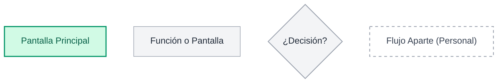

---

## 2. Mapa General del Sistema (Módulo de Usuario y Acceso del Personal)

Estructura de navegación global que articula la experiencia de clientes, visitantes y personal operativo.

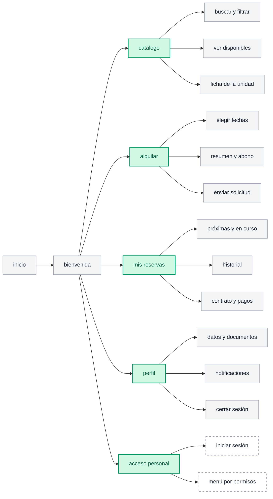

---

## 3. User Flow: Onboarding y Acceso

Primer ingreso a la aplicación: visitantes, clientes recurrentes y nuevo registro.

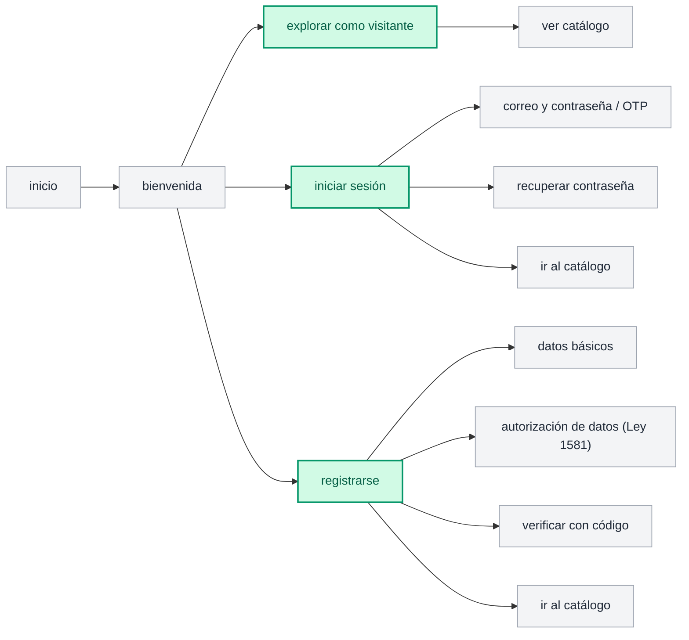

> **Reglas de Negocio de Onboarding:**  
> - **Sesión Activa:** Si ya hay una sesión activa, la app salta la bienvenida y abre el catálogo directamente.
> - **Progresión de Documentos:** La cédula y los documentos que exija el tipo de unidad se piden la primera vez que el cliente alquila, nunca en el registro inicial.
> - **Acceso Unificado con Google OAuth:** El botón "Continuar con Google" aprovisiona cuentas JIT en Cloudflare D1 de forma transparente. Si el usuario cancela o hay un error, se redirige de manera segura a `/login` con mensajes amigables.

---

## 4. User Flow: Catálogo Exclusivo por Local y Mecanismo Perimetral Anti-Fuga Pasivo

Este flujo describe con total detalle la experiencia interactiva, decisiones de usuario, bifurcaciones de interfaz y gobernanza perimetral cuando un dueño o administrador de patio comparte el catálogo de su sede física con clientes o prospectos.

### Filosofía y Reglas Fundamentales del Mecanismo Anti-Fuga:
1. **Contención Pasiva, Elegante y No Prohibitiva:**  
   El cliente no experimenta muros ciegos, pantallas de bloqueo ni mensajes restrictivos que le adviertan que "no puede ver otros vehículos". La experiencia es fluida, moderna y respetuosa de la autonomía del usuario.
2. **Priorización por Defecto del Comercio Captador:**  
   Al entrar mediante el enlace o QR de un local (`/c/[slug]`), el sistema confina por defecto las vistas, búsquedas, filtros y sugerencias al inventario de ese patio específico, blindando la inversión comercial del negocio.
3. **Persuasión y Navegación Abierta para Usuarios con Cuenta:**  
   Un usuario autenticado o que desee persuadir y comparar puede alternar voluntariamente hacia el catálogo general de la red FlotaX. Sin embargo, su **atribución de origen comercial** permanece fijada en la base de datos para futuras reservas y fidelización.
4. **Fidelización y Notificaciones Segmentadas de Vehículos:**  
   La atribución en Cloudflare D1 (`user.localOrigenId` y tabla `clientes_local`) permite que el comercio emita avisos transaccionales y notificaciones de nuevos modelos o descuentos directamente a los clientes captados en su patio.

---

### 4.1 Diagrama de Flujo: Ciclo Completo del Cliente y Mecanismo Anti-Fuga

```mermaid
flowchart TD
    classDef mainScreen fill:#d1fae5,stroke:#059669,stroke-width:2px,color:#065f46;
    classDef subScreen fill:#f3f4f6,stroke:#9ca3af,stroke-width:1px,color:#1f2937;
    classDef decision fill:#f3f4f6,stroke:#9ca3af,stroke-width:1.5px,color:#1f2937;
    classDef dashedFlow fill:#ffffff,stroke:#9ca3af,stroke-width:1.5px,stroke-dasharray: 5 5,color:#374151;

    %% 1. Origen de la Invitación
    subgraph Origen["1. Origen y Compartición"]
        admin_flota["Gestión de Flota (/admin/flota)"]:::dashedFlow
        share_card["Tarjeta: Compartir Catálogo Exclusivo"]:::mainScreen
        qr_mostrador["QR de Mostrador (Impresión Física)"]:::subScreen
        link_whatsapp["Link Compartible (/c/[slug])"]:::subScreen
        admin_flota --> share_card
        share_card --> qr_mostrador & link_whatsapp
    end

    %% 2. Acceso del Prospecto
    subgraph Acceso["2. Ingreso del Cliente"]
        prospecto_in["Cliente escanea QR o abre link"]:::subScreen
        qr_mostrador & link_whatsapp --> prospecto_in
        pantalla_local["Catálogo Exclusivo de Sede (/c/[slug])"]:::mainScreen
        prospecto_in --> pantalla_local
        cookie_pasiva["Fija Cookie en Edge: movix_local_captacion<br>(Pasiva, 30 días, HTTP-only, segura)"]:::subScreen
        pantalla_local -. en segundo plano .-> cookie_pasiva
    end

    %% 3. Experiencia en Catálogo del Local
    subgraph Experiencia["3. Exploración de Flota"]
        cabecera_local["Cabecera: Datos y Teléfono Directo de la Sede"]:::subScreen
        buscador_local["Buscador y Filtros Circulares<br>(Confinados a unidades de este patio)"]:::subScreen
        bento_unidades["Bento Showcase & Spotlight de la Sede"]:::subScreen
        pantalla_local --> cabecera_local --> buscador_local --> bento_unidades
        
        decision_exploracion{"¿Desea explorar solo esta sede o ver toda la red?"}:::decision
        bento_unidades --> decision_exploracion
    end

    %% 4. Bifurcación: Conmutación vs Continuidad
    subgraph Bifurcacion["4. Opciones de Navegación"]
        decision_exploracion -- "Continuar en sede (Por defecto)" --> unidad_local["Ficha Técnica del Vehículo (/vehiculos/:id)"]:::mainScreen
        decision_exploracion -- "Persuadir y ver más opciones" --> selector_red["Selector Sutil: Ver catálogo general"]:::subScreen
        selector_red --> catalogo_general["Catálogo General FlotaX (/catalogo?modo=red)"]:::mainScreen
        catalogo_general --> unidad_externa["Ficha de Vehículo de otra sede"]:::mainScreen
    end

    %% 5. Proceso de Autenticación y Cierre Transaccional
    subgraph Cierre["5. Vinculación y Reserva"]
        unidad_local & unidad_externa --> cta_alquilar["Botón: Alquilar"]:::subScreen
        cta_alquilar --> chk_sesion{"¿Tiene sesión iniciada?"}:::decision
        
        chk_sesion -- No --> flujo_auth["Registro o Inicio de Sesión<br>(Google OAuth o Email OTP)"]:::mainScreen
        flujo_auth --> mw_vinculacion["Middleware detecta cookie movix_local_captacion<br>y asocia user.localOrigenId en D1"]:::subScreen
        mw_vinculacion --> embudo_alquilar["Embudo de Alquiler (/alquilar/:id)"]:::mainScreen
        
        chk_sesion -- Sí --> embudo_alquilar
        embudo_alquilar --> reserva_imputada["Reserva Radicada con localId de la Sede"]:::subScreen
    end

    %% 6. Fidelización y Retorno Posterior
    subgraph Retorno["6. Retorno y Fidelización"]
        retorno_dias["Cliente abre la app días después o abre la PWA"]:::subScreen
        catalogo_defecto["/catalogo carga por defecto inventario del local captador"]:::mainScreen
        aviso_sede["Comercio emite notificación de nuevos vehículos"]:::dashedFlow
        notif_cliente["Cliente recibe aviso segmentado de su patio"]:::subScreen
        
        reserva_imputada --> retorno_dias --> catalogo_defecto
        reserva_imputada --> aviso_sede --> notif_cliente --> unidad_local
    end
```

---

### 4.2 Estados de Pantalla en el Catálogo Anti-Fuga (`/c/[slug]`)

A diferencia de un catálogo abierto genérico, la vista del catálogo exclusivo de local presenta adaptaciones visuales precisas orientadas a la contención y la confianza del usuario:

| Elemento de UI | Comportamiento en Catálogo Anti-Fuga (`/c/[slug]`) | Comportamiento en Catálogo General Abierto (`/catalogo`) |
| :--- | :--- | :--- |
| **Cabecera de Marca** | Muestra el nombre oficial de la sede (ej. *FlotaX Patio Norte*), su dirección física verificada y botón directo de atención telefónica o WhatsApp del patio. | Cabecera general de la plataforma FlotaX (*"Encuentra tu próximo vehículo"*). |
| **Buscador Píldora iOS** | La búsqueda predictiva opera **únicamente sobre las unidades del patio**. No arroja resultados de sedes lejanas. | Búsqueda global en todas las sedes y ciudades disponibles. |
| **Filtros Circulares** | Categorías disponibles computadas únicamente según la flota existente en esa sede (si la sede no tiene náuticos, el filtro no aparece). | Todas las categorías globales (SUVs, Sedanes, Motos, Eléctricos, Scooters, Náuticos). |
| **Hero Spotlight & Bento** | Exhibe las unidades destacadas del local con etiquetas de entrega pericial inmediata en patio. | Destaca vehículos promocionales de la red general. |
| **Acceso a Catálogo General** | Enlace discreto y accesible en pie de página o barra de estado: *"Estás viendo la flota de Patio Norte · Ver toda la red FlotaX"*. Permite la conmutación sin generar fricción al usuario. | Selector de ciudad y selector multisede visible en cabecera. |

---

### 4.3 Flujo de Navegación de Retorno y PWA (Persistencia Cautiva)

Cuando un cliente ya fue captado por un local mediante su enlace/QR:

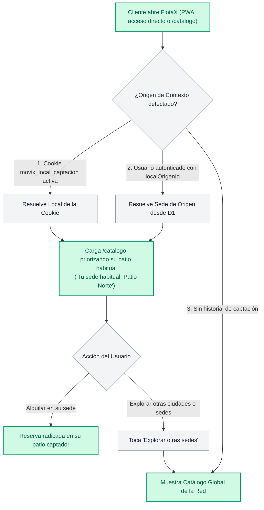

> **Gobernanza de Sesión Activa:**  
> Si el usuario ya cuenta con sesión iniciada y ha alquilado previamente en otros patios, el sistema **nunca le prohíbe el uso de la aplicación**. La plataforma respeta su cuenta, su historial de reservas previas y sus documentos ya verificados, priorizando amablemente la sede de la cual provino el enlace compartido sin bloquear ninguna función del sistema.

---

### 4.4 Flujo de Notificaciones Segmentadas por Sede (Retención Comercial)

Mecanismo mediante el cual el patio capitaliza la base de clientes captados:

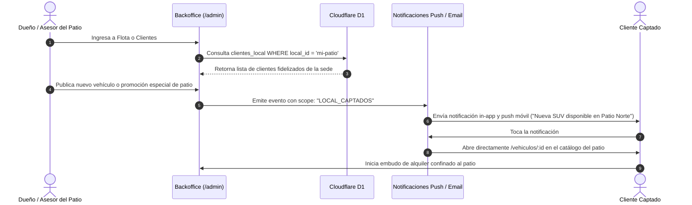

---

### 4.5 Resumen de Reglas de Negocio del Sistema Anti-Fuga:
1. **Regla de Invarianza de Origen:** El primer local que capta al cliente a través de `/c/[slug]` se fija como `user.localOrigenId`. Salvo que el usuario solicite explícitamente una reasignación formal de sede de residencia, ese patio conserva la atribución de origen del cliente.
2. **Regla de Cero Fricción para Cuentas Existentes:** Si un cliente ya registrado abre el enlace de un local amigo o nuevo, el sistema actualiza su última visita en `clientes_local` como sede preferida reciente sin sobreescribir destructivamente sus datos personales ni anular sus reservas en otros patios.
3. **Regla de Cero Bloqueo:** El sistema nunca debe mostrar alertas del tipo *"No tienes permiso para ver otros locales"* o *"Acceso restringido a esta sede"*. La conmutación entre la sede y la red general es siempre una decisión amigable y voluntaria del usuario.
4. **Regla de Integridad Financiera:** La imputación de cobros, comisiones de plataforma, pagos de reserva e inspecciones periciales de entrega/recepción se liquida siempre sobre el `localId` dueño del vehículo alquilado.

---

## 5. User Flow: Explorar y Analizar Unidades

Del catálogo a la ficha técnica de la unidad, con opción directa de alquiler y soporte para múltiples tipos de vehículos.

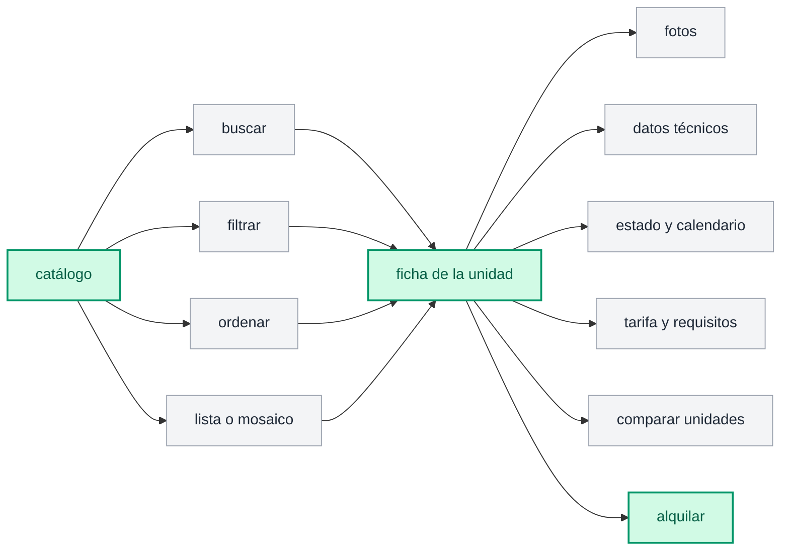

### Reglas de Visualización y Estados:
- **Disponibilidad en Tiempo Real:** El estado y calendario muestran si la unidad está *Disponible* o *No disponible*, indicando las fechas ocupadas en reservas activas.
- **Bloqueo por Documentos Vencidos:** Una unidad con documentos vencidos (por ejemplo SOAT o revisión técnico-mecánica en un carro/moto) **no aparece como disponible** en el catálogo para los clientes.
- **Parámetros Específicos por Tipo de Unidad:** Los datos técnicos y requisitos se adaptan automáticamente al tipo de unidad (carro, moto, patineta eléctrica, náutico).

---

## 6. User Flow: Alquilar una Unidad (Embudo del Cliente)

Solicitud de reserva con abono pactado, sujeta a validación y confirmación del personal de patio.

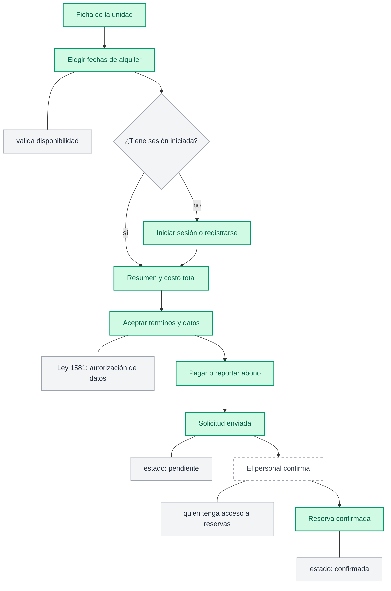

---

## 7. User Flow: Operación de una Reserva (Personal de Patio)

Ciclo de vida operativo completo gestionado por el personal con acceso a cada módulo, desde el pedido inicial del cliente hasta el cierre definitivo.

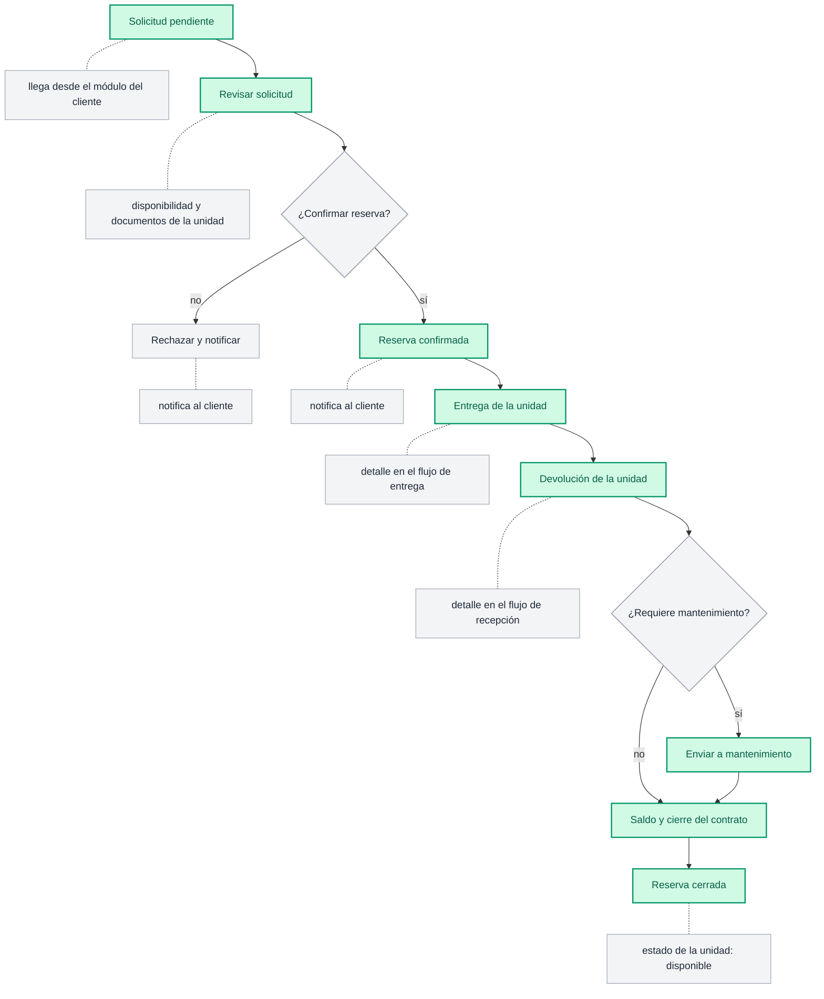

---

## 8. User Flow: Entrega de la Unidad (Inspección Previa)

Revisión pericial previa con la plantilla del tipo de unidad antes de ceder la posesión al cliente.

```mermaid
flowchart TD
    classDef mainScreen fill:#d1fae5,stroke:#059669,stroke-width:2px,color:#065f46;
    classDef subScreen fill:#f3f4f6,stroke:#9ca3af,stroke-width:1px,color:#1f2937;
    classDef decision fill:#f3f4f6,stroke:#9ca3af,stroke-width:1.5px,color:#1f2937;

    res_conf["Reserva confirmada"]:::mainScreen

    verif_cli["Verificar al cliente"]:::mainScreen
    verif_cli --- doc_req["cédula y licencia que exija el tipo"]:::subScreen

    chk_doc{"¿Documentos al día?"}:::decision

    bloq_ent["Bloquear entrega y avisar"]:::subScreen

    abrir_plan["Abrir plantilla del tipo"]:::mainScreen
    abrir_plan --- plan_esp["plantilla propia de cada tipo de unidad"]:::subScreen

    rev_ent["Revisión de entrega"]:::mainScreen
    rev_ent --- items_ent["estado, uso, energía y fotos"]:::subScreen

    pasos_esp["Pasos propios del tipo"]:::mainScreen
    pasos_esp --- doc_esp["briefing, declaración o capitán, si aplica"]:::subScreen

    firma_cli["Firma del cliente"]:::mainScreen
    firma_cli --- firma_acep["acepta el estado de la unidad"]:::subScreen

    acta_ent["Acta de entrega"]:::mainScreen
    acta_ent --- acta_pdf["PDF con fotos y firma"]:::subScreen

    unidad_alq["Unidad en alquiler"]:::mainScreen
    unidad_alq --- est_alq["estado de la unidad: en alquiler"]:::subScreen

    %% Conexiones
    res_conf --> verif_cli
    verif_cli --> chk_doc
    chk_doc -- no --> bloq_ent
    chk_doc -- sí --> abrir_plan
    abrir_plan --> rev_ent
    rev_ent --> pasos_esp
    pasos_esp --> firma_cli
    firma_cli --> acta_ent
    acta_ent --> unidad_alq
```

---

## 9. User Flow: Recepción de la Unidad (Comparativa y Novedades)

Revisión pericial de retorno y comparación automatizada contra el acta de entrega original.

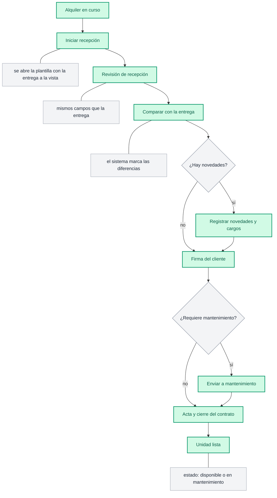

---

## 10. Campos de la Revisión y Plantillas Base por Tipo de Unidad

Estructura de peritaje estandarizada para garantizar rigor técnico y valor probatorio en contratos.

### Estructura de la Revisión:
1. **Encabezado:** Tipo de acto (entrega o recepción), reserva y contrato, unidad, cliente, responsable de patio, fecha y hora de inicio/fin, medidor de uso (km u horas), nivel de energía (combustible o batería %), estado general, documentos y accesorios presentes, fotos obligatorias, observaciones y firmas del cliente y responsable.
2. **Ítems del Checklist:** Cada ítem tiene nombre, categoría y tipo de respuesta: *estado*, *número*, *nivel*, *sí o no*, *texto* o *foto*. El estado puede ser *bien*, *con novedad* o *no aplica*. Un ítem puede ser obligatorio y exigir foto cuando se reporta novedad.
3. **Novedades:** Zona de la unidad afectada, tipo de daño, gravedad (*leve*, *moderada* o *grave*), fotos periciales en Cloudflare R2, costo estimado y especificación de si genera cargo al cliente. En la recepción se contrastan automáticamente con las novedades de entrega.
4. **Inmutabilidad y Versionado:** Cada plantilla lleva versión. Cada acta guarda la versión exacta con la que fue realizada para que modificaciones posteriores a la plantilla no alteren auditorías legales de contratos cerrados.

### Plantillas Base por Tipo de Unidad:

| Tipo | Medida de Uso | Energía | Ítems Propios de la Revisión | Documentos y Requisitos |
| :--- | :--- | :--- | :--- | :--- |
| **Carro** | km | Combustible | Exterior por zonas, vidrios y espejos, luces, llantas y repuesto, interior y limpieza, funcionamiento (aire, radio, limpiaparabrisas), testigos de tablero, kit de carretera. | SOAT y revisión técnico-mecánica vigentes; licencia de conducción de la categoría correspondiente. |
| **Moto** | km | Combustible | Tanque, llantas, frenos delantero y trasero, luces y direccionales, espejos, cadena y kit de arrastre, manubrio y suspensión, carenado, fugas de aceite, casco y chaleco. | SOAT y revisión técnico-mecánica vigentes; licencia de conducción de la categoría. |
| **Patineta eléctrica** | km o minutos | Batería (%) | Frenos, ruedas, luces, manillar, estado de batería y cargador, casco. | Según la normativa local aplicable. |
| **Moto de agua** | Horas de motor | Combustible | Estado del casco de la nave, motor y nivel de aceite, cordón de apagado (hombre al agua), chalecos salvavidas, fugas. | Documentos de la unidad y licencia o experiencia del conductor según la autoridad marítima (DIMAR). |
| **Lancha o yate** | Horas de motor y días | Combustible y agua | Motores, equipo de seguridad (chalecos, bengalas, extintores, radio VHF), inventario a bordo, baterías, niveles de combustible y agua dulce, estado del casco. | Documentos de la embarcación y del capitán según la autoridad marítima; alquiler con o sin capitán. |

---

## 11. User Flow: Personal, Módulos de Operación, Dinero y Configuración

Estructura integral del entorno administrativo para el personal y dueños del negocio.

### A. Módulos de Operación del Día a Día
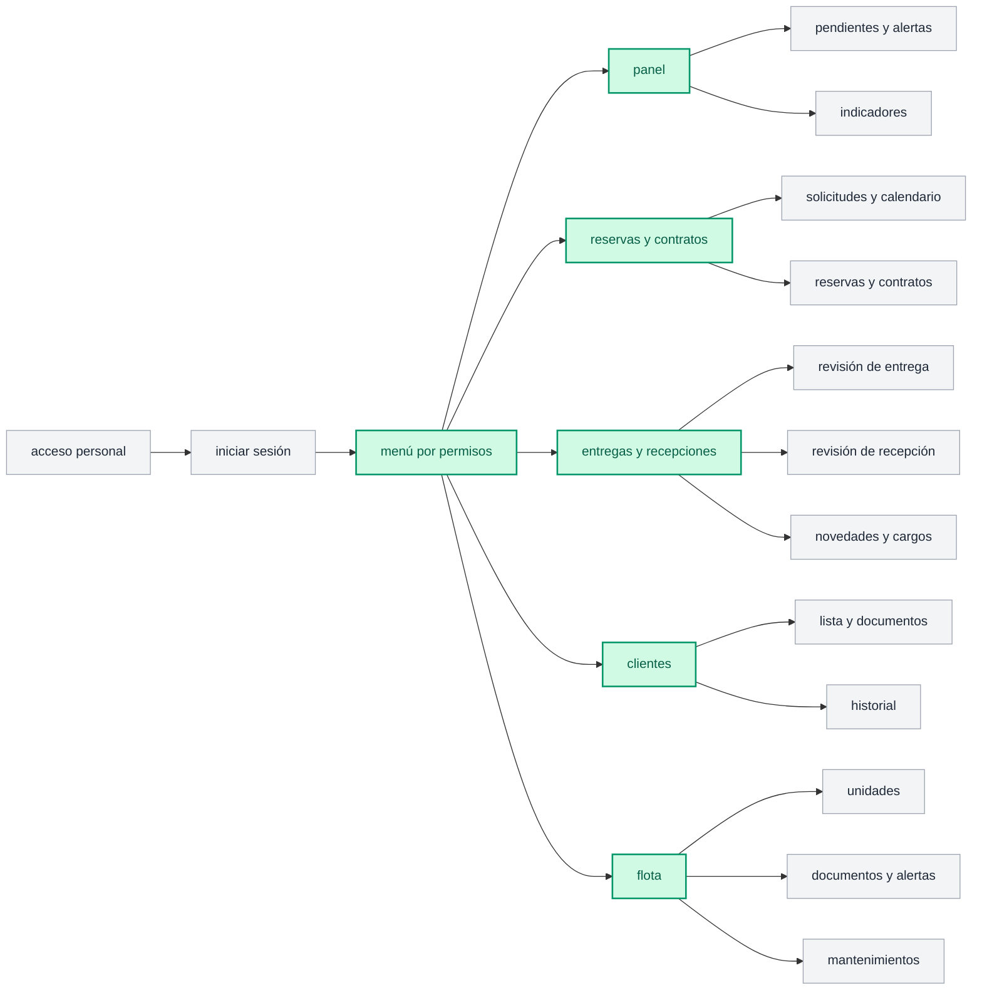

### B. Módulos de Dinero, Reportes y Configuración
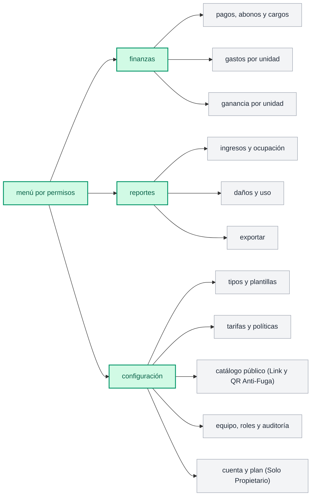

### Fases de Construcción:
- **Fase 1 (MVP Operativo Demostrable):** Panel de control, reservas y contratos, entregas y recepciones periciales con R2, clientes, flota e inventario, finanzas básicas de mostrador.
- **Fase 2 (Configuración Avanzada y Escala):** Reportes completos analíticos, plantillas de inspección totalmente editables, tarifas dinámicas por temporada, catálogo público multisede y gestión de plan SaaS.

### Cuatro Reglas y Alcance de la Administración:
1. **Tarifas y Políticas:** Tarifa por día, hora o minuto según tipo de unidad, temporadas altas/bajas, depósitos en garantía, límites de kilometraje/horas, regla de combustible y cargos por retraso. Con estas reglas el sistema computa los cargos de recepción automáticamente.
2. **Catálogo Público:** El dueño decide qué unidades se publican, qué fotos se exhiben y qué requisitos ve el cliente. El catálogo de usuario se nutre de la misma información de flota y no requiere mantenimiento paralelo.
3. **Privilegios Exclusivos del Propietario:** Administración del plan de FlotaX, datos fiscales maestros del negocio, transferencia de propiedad, y exportación o supresión de la base de datos empresarial.
4. **Licencias y Facturación:** La validación de licencias vive en la ficha del cliente y se ejecuta conforme a normativas oficiales (tratamiento seguro de datos personales según Ley 1581). La facturación electrónica con la DIAN se proyecta para una fase posterior.

---

## 12. User Flow: Crecimiento del Equipo y Roles

Modelo de escalamiento progresivo según el tamaño del equipo operativo del patio de alquiler.

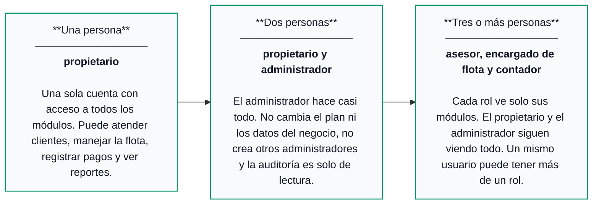

> **Regla del Sistema:** La cuenta inicial de registro es de **Propietario** con todos los privilegios; siempre debe existir al menos un propietario activo. Los demás roles son opcionales y se asignan conforme a la necesidad operativa.

---

## 13. Matriz de Acceso por Módulo y Rol (RBAC Canónica)

Gobierno de acceso estricto que dictamina la visibilidad de pantallas y la capacidad de mutación de datos:

| Módulo | Pantalla | Propietario | Administrador | Asesor | Encargado de Flota | Contador |
| :--- | :--- | :---: | :---: | :---: | :---: | :---: |
| **Panel** | Pendientes y alertas | ✓ | ✓ | ✓ | ✓ | L |
| | Indicadores | ✓ | ✓ | L | L | ✓ |
| **Reservas y contratos** | Solicitudes y calendario | ✓ | ✓ | ✓ | L | L |
| | Reservas y contratos | ✓ | ✓ | ✓ | — | L |
| **Entregas y recepciones** | Revisión de entrega | ✓ | ✓ | ✓ | ✓ | — |
| | Revisión de recepción | ✓ | ✓ | ✓ | ✓ | — |
| | Novedades y cargos | ✓ | ✓ | R | R | L |
| **Clientes** | Lista y documentos | ✓ | ✓ | ✓ | — | L |
| | Historial | ✓ | ✓ | ✓ | — | L |
| **Flota** | Unidades | ✓ | ✓ | L | ✓ | — |
| | Documentos y alertas | ✓ | ✓ | L | ✓ | L |
| | Mantenimientos | ✓ | ✓ | L | ✓ | L |
| **Finanzas** | Pagos, abonos y cargos | ✓ | ✓ | R | — | ✓ |
| | Gastos por unidad | ✓ | ✓ | — | L | ✓ |
| | Ganancia por unidad | ✓ | ✓ | — | L | ✓ |
| **Reportes** | Ingresos y ocupación | ✓ | ✓ | — | L | ✓ |
| | Daños y uso | ✓ | ✓ | — | L | ✓ |
| | Exportar | ✓ | ✓ | — | — | ✓ |
| **Configuración** | Tipos y plantillas | ✓ | ✓ | — | L | — |
| | Tarifas y políticas | ✓ | R | — | — | — |
| | Catálogo público | ✓ | ✓ | — | — | — |
| | Equipo, roles y auditoría | ✓ | R | — | — | — |
| | Cuenta y plan | ✓ | — | — | — | — |

### Convenciones de Permisos:
- **`✓` Acceso completo:** Crear, consultar, modificar y ejecutar acciones transaccionales.
- **`L` Solo lectura:** Consulta de registros y reportes sin potestad de edición.
- **`R` Acceso limitado:** Acciones operativas acotadas (ej. asesor y encargado de flota registran novedades pero no aprueban cargos económicos; administrador gestiona equipo y tarifas pero no crea administradores ni altera el plan).
- **`—` Sin acceso:** La opción se oculta en la barra de navegación y la ruta devuelve denegación (`403 Forbidden`).

---

## 14. Métricas del Dashboard desde la Revisión

Indicadores operacionales calculados a partir de los peritajes de entrega y recepción:

| Grupo | Métrica | Dato que la Alimenta | Primera Versión |
| :--- | :--- | :--- | :---: |
| **Operación** | Entregas y recepciones pendientes del día | Reservas confirmadas sin acta | ✓ |
| **Operación** | Duración promedio de la revisión | Hora de inicio y fin de cada revisión | — |
| **Operación** | Devoluciones a tiempo (%) | Fecha pactada frente a fecha de recepción | — |
| **Flota** | Novedades abiertas por unidad | Novedades sin reparar | ✓ |
| **Flota** | Unidades en mantenimiento | Estado operativo de la unidad | — |
| **Daños** | Recepciones con novedad (%) | Comparación pericial entre entrega y recepción | ✓ |
| **Daños** | Costo de novedades por unidad y por tipo | Costo estimado y efectivamente cobrado | ✓ |
| **Uso** | Uso por alquiler (km u horas) | Medidor inicial y final del odómetro/horómetro | ✓ |
| **Uso** | Energía devuelta frente a entregada | Nivel de combustible o porcentaje de batería | ✓ |
| **Rentabilidad** | Ganancia neta por unidad | Ingresos menos gastos, novedades y mantenimiento | — |

---

## 15. User Flow: Paradigma de Portal Persistente (Switch Explícito y Creación de Patio)

Conmutación bidireccional entre la experiencia de cliente consumidor y la cabina operativa de patio sin fricción ni credenciales duplicadas, permitiendo que cualquier usuario ofrezca unidades en alquiler.

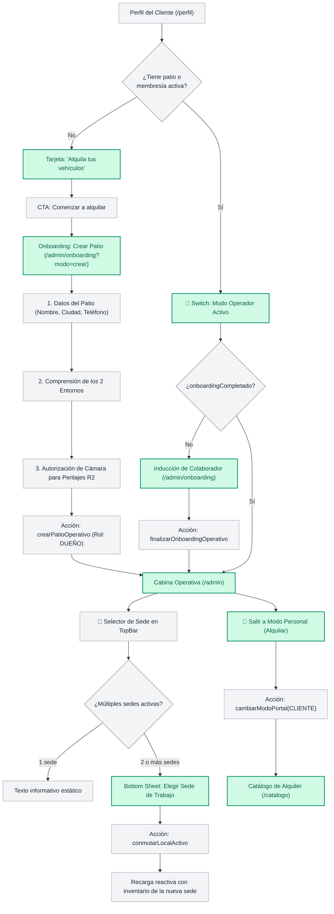

---

## 16. User Flow: Centro de Notificaciones Multicanal

Todos los usuarios autenticados disponen de la campana de notificaciones en la `TopBar`. El aviso se distribuye con un **scope** específico y se transmite por bandeja in-app, push web y correo electrónico en eventos prioritarios.

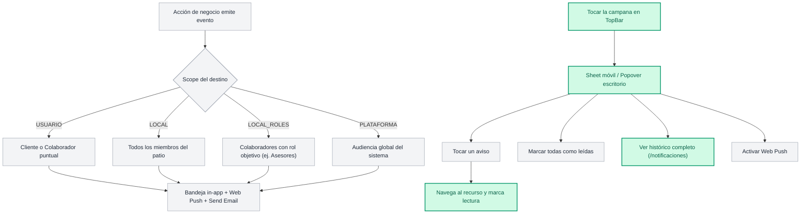

---

## 17. Mapeo Canónico de Rutas de Implementación (Astro & RBAC)

| Módulo / Pantalla Canónica | Ruta Astro (`src/pages/...`) | Componentes de Dominio Clave | Nivel de Acceso Mínimo |
| :--- | :--- | :--- | :--- |
| **Inicio & Bienvenida** | `src/pages/index.astro` | `HeroBienvenida`, `CategoriasGlance` | Público / Visitante |
| **Catálogo Exclusivo de Local (Link Corto)** | `src/pages/c/[slug].astro` | `LocalCatalogShowcase` (Bento iOS + Anti-Fuga Pasivo) | Público (Fija Cookie Pasiva) |
| **Catálogo de Unidades (General o Cautivo)** | `src/pages/catalogo/index.astro` | `LocalCatalogShowcase` | Público / Visitante |
| **Ficha de la Unidad (Showcase 360°)** | `src/pages/vehiculos/[id].astro` | `VehicleStudioShowcase` (Pedestal 360°, Planes 1D-30D) | Público / Visitante |
| **Embudo: Fechas y Costos** | `src/pages/alquilar/[id].astro` | `DateRangeSelector`, `ResumenCostos`, `TerminosLey1581` | Cliente Autenticado |
| **Mis Reservas (Cliente)** | `src/pages/reservas/index.astro` | `ReservasActivasList`, `HistorialReservasTable` | Cliente Autenticado |
| **Perfil del Cliente** | `src/pages/perfil/index.astro` | `DatosPersonalesForm`, `LicenciaUpload` | Cliente Autenticado |
| **Centro de Notificaciones** | `src/pages/notificaciones/index.astro` | `NotificacionesBandeja`, `FiltroScopeTabs` | Cliente / Personal |
| **Acceso Personal** | `src/pages/admin/login.astro` | `AdminLoginForm` | Público (Staff) |
| **Panel / Menú por Permisos** | `src/pages/admin/index.astro` | `AdminModuleNav`, `DashboardMetrics` | Personal (`tienePermiso`) |
| **Reservas: Solicitudes y Calendario** | `src/pages/admin/reservas/index.astro` | `SolicitudesTable`, `ReservasCalendario` | Asesor / Encargado (L) / Contador (L) |
| **Reservas: Contratos** | `src/pages/admin/contratos/index.astro` | `ContratosList`, `ContratoViewer` | Asesor / Contador (L) |
| **Entregas y Recepciones (Peritaje)** | `src/pages/admin/operaciones/index.astro` | `CheckInCheckOutForm`, `InspeccionPericialR2` | Asesor / Encargado de Flota |
| **Clientes: Lista y Documentos** | `src/pages/admin/clientes/index.astro` | `ClientesTable`, `DocumentosValidador` | Asesor / Contador (L) |
| **Flota: Unidades y Mantenimiento** | `src/pages/admin/flota/index.astro` | `FlotaGrid`, `MantenimientoForm`, `LocalCatalogShareCard` | Encargado de Flota / Asesor (L) |
| **Finanzas: Pagos y Gastos** | `src/pages/admin/caja/index.astro` | `AbonosTable`, `GastosVehiculoForm` | Contador / Asesor (R) |
| **Reportes y Exportación** | `src/pages/admin/reportes/index.astro` | `IngresosOcupacionChart`, `ExportarCSVButton` | Contador / Encargado (L) |
| **Configuración: Catálogo y Tarifas** | `src/pages/admin/configuracion/index.astro` | `UsuariosRolesManager`, `TarifasConfig`, `AuditoriaTable` | Propietario / Administrador (R/L) |
| **Inducción Operativa de Patio** | `src/pages/admin/onboarding.astro` | `OnboardingStepsWizard`, `CamaraPermissionGate` | Personal con `onboardingCompletado = false` |
